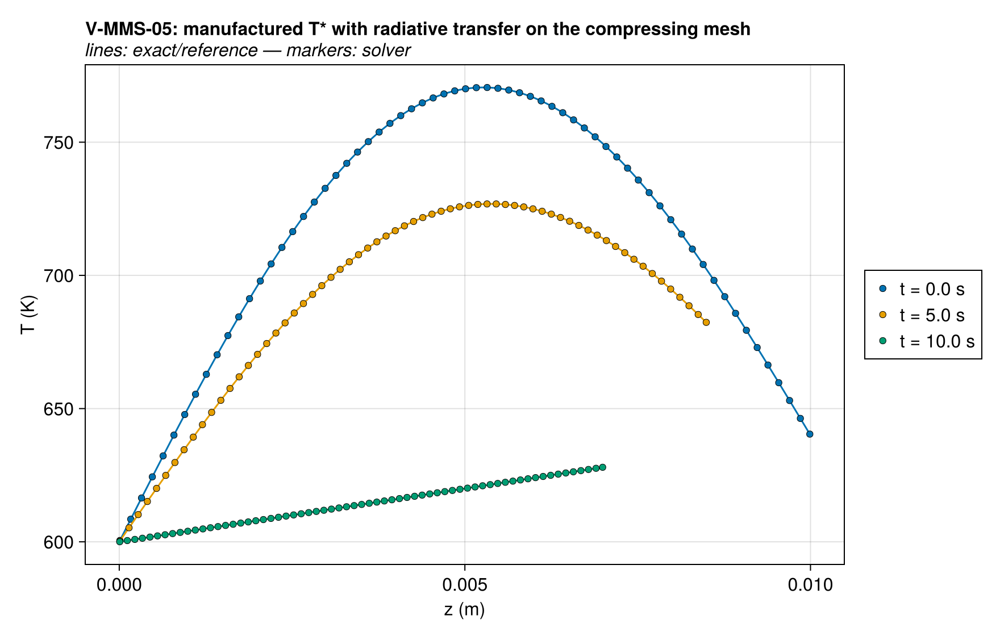
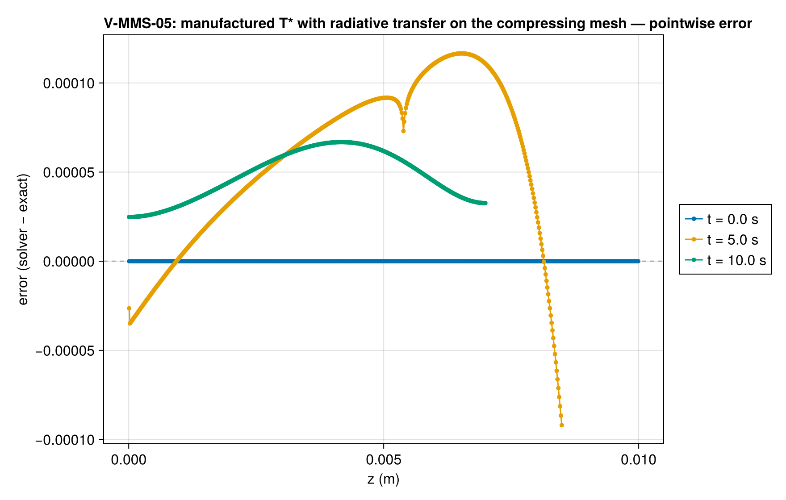
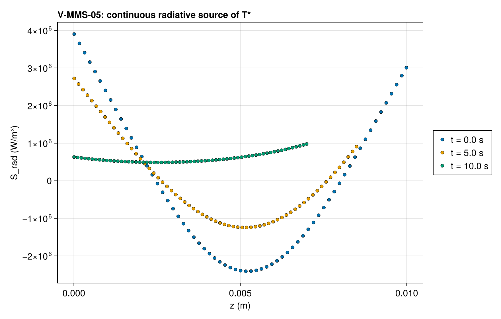
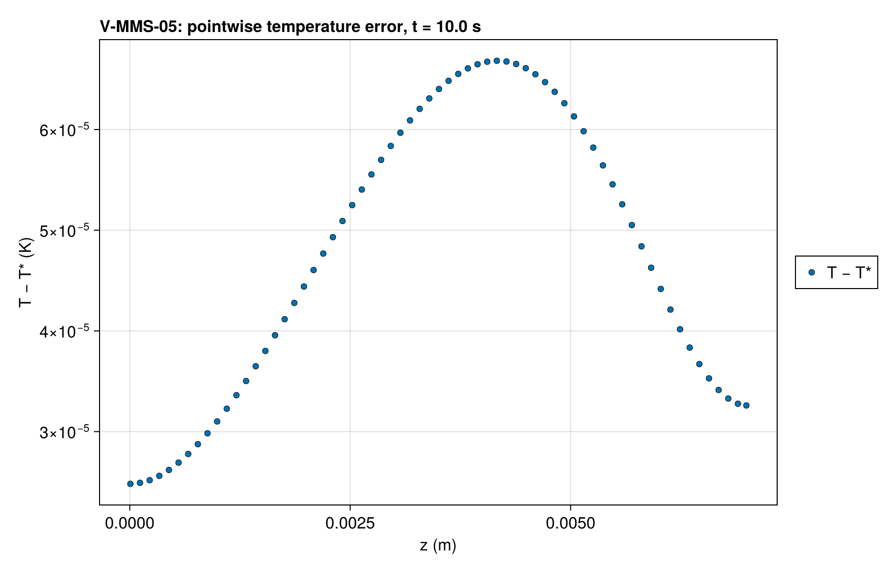
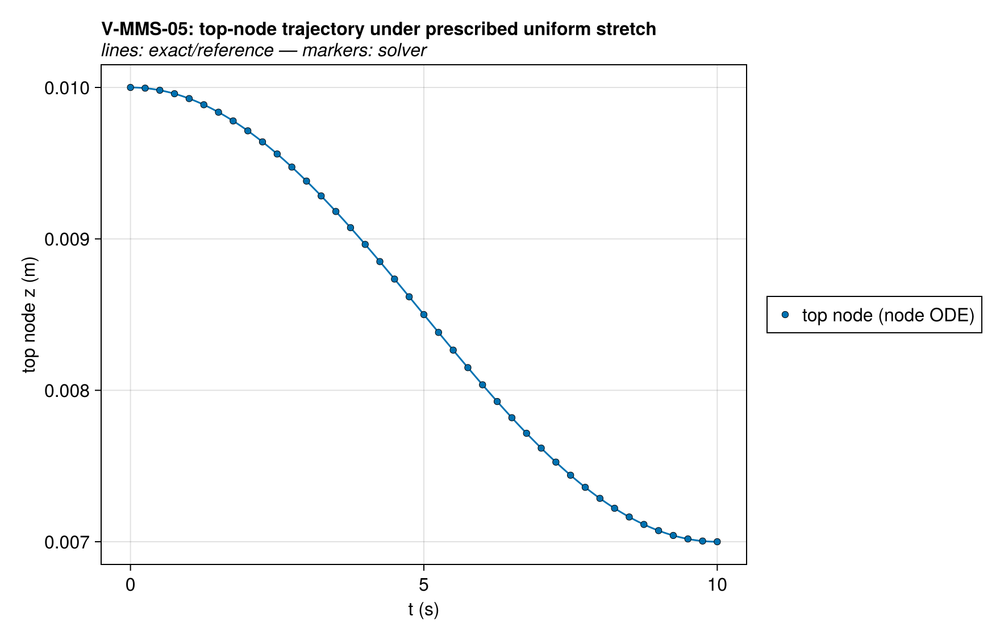
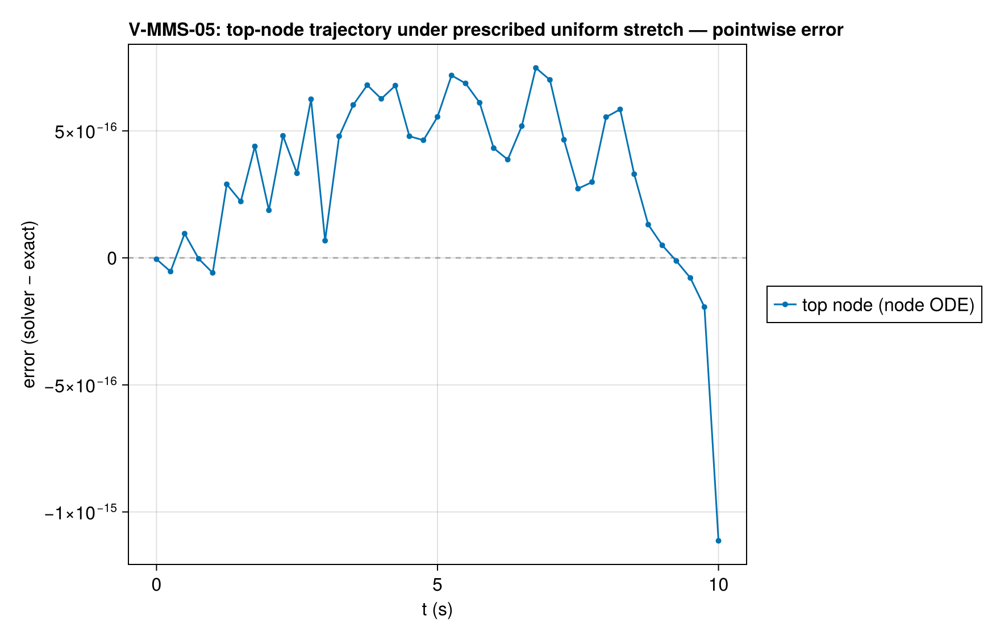
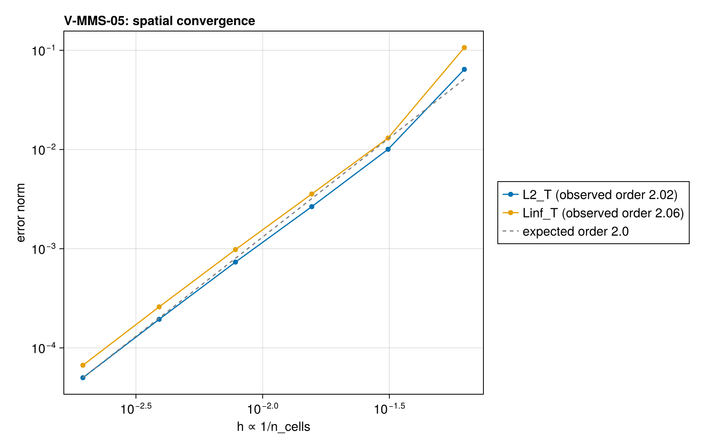

# V-MMS-05 — manufactured solution with radiative transfer on a moving mesh

**Tags:** `mms`, `ale`, `radiation`, `order_verification`

**References:**

- docs/guide/technical_reference/18_verification-validation.md §18.2 (MMS driver, ALE cases)
- Modest & Mazumder, Radiative Heat Transfer, 4th ed., §14.3 (two-flux method)
- exact/mms.jl (`mms_two_stream`, self-tested against the discrete rows)

## Problem statement

The order-verification case of conduction coupled to radiative transfer in
the solid. A gray, semi-transparent solid (ε = 0.8, κ = αξ ≈ 200–210 m⁻¹,
κL ≈ 2) carries a manufactured temperature between 600 and 790 K, so the
radiative conductivity 16σT³/(3κ) (0.32 W/m·K at 600 K) is of the order of
the conductive k (0.38 W/m·K). Solved without the radiative term in the
manufactured source, the temperature misses T* by 5 K in L2, 10⁵ times
the 512-cell error. The mesh is compressed to 70 % of its thickness by
V-MMS-03's prescribed uniform stretch

  w*(z, t) = (ṡ/s)·z,   s(t) = 1 − 0.15·(1 − cos(2πt/20)),

moving over a solid at rest, so every source is the Eulerian one,
evaluated at the cell centers (exact/mms.jl header, "ALE"). The solid is
uniform in z and decays in time, so κ changes with time; a z-varying solid
would cross the moving faces, which the case avoids as V-MMS-03 does.

The exposed face is a gray interface facing surroundings at T∞(t) through a
`RadiativeBC`, beside the manufactured conductive flux (`HeatFluxBC`); the
back carries only the manufactured conductive flux, so it is a mirror. The
manufactured source removes the continuous two-stream source of T*
(`mms_radiative_source`: the same face rows, the transfer solved exactly by
quadrature over the moving column), while the solver solves its radiation
rows for q± itself. The temperature error therefore carries the rows'
discretization error: the emission is constant within each cell, which is
second order for optically thin cells (κΔ = 0.033 at the CI mesh).

Expected order: second. The L2 rates are 1.86, 1.92, 1.96, 1.98 from 64 to
1024 cells, the same in both energy forms; tightening the time tolerances
by 100 moves the 512-cell error by 5×10⁻⁵ of itself, so the error is the
spatial one.

### Quantities of interest (n = 512)

| QoI | value | exact | error | tolerance | within tol | provenance |
| --- | --- | --- | --- | --- | --- | --- |
| L∞ T error on moving mesh, t=10.0 s | 6.683e-05 | — | 6.683e-05 | 0.011 | yes | manufactured T* with radiative transfer on a 30%-compressed mesh |
| relative L∞ ξ_solid (uniform) error, t=10.0 s | 6.863e-13 | — | 6.863e-13 | 1e-10 | yes | uniform solid: its absorption coefficient follows the manufactured one |

### Convergence

| n_cells | h | wall (s) | L2_T | Linf_T |
| --- | --- | --- | --- | --- |
| 16 | 0.0625 | 0.05002 | 0.06423 | 0.1066 |
| 32 | 0.03125 | 0.1148 | 0.01005 | 0.01305 |
| 64 | 0.01562 | 0.2645 | 0.002654 | 0.003562 |
| 128 | 0.007812 | 0.549 | 0.0007332 | 0.0009796 |
| 256 | 0.003906 | 1.259 | 0.0001942 | 0.0002593 |
| 512 | 0.001953 | 2.944 | 5.003e-05 | 6.683e-05 |

Wall time: median of up to five warm runs of problem construction and solve on one pinned core, after a discarded compiling run.

Observed order 2.016 (L2_T), expected 2.0.

### Solver configuration

| setting | value |
| --- | --- |
| integrator | Rodas5P (default) |
| abstol | 1.0e-11 |
| reltol | 1.0e-9 |
