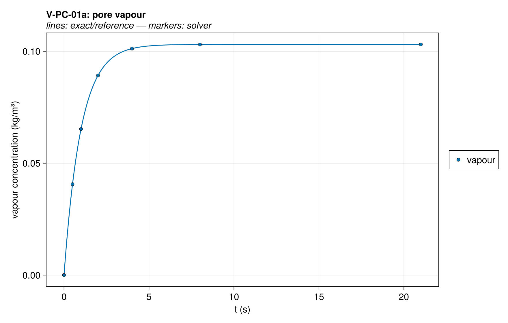
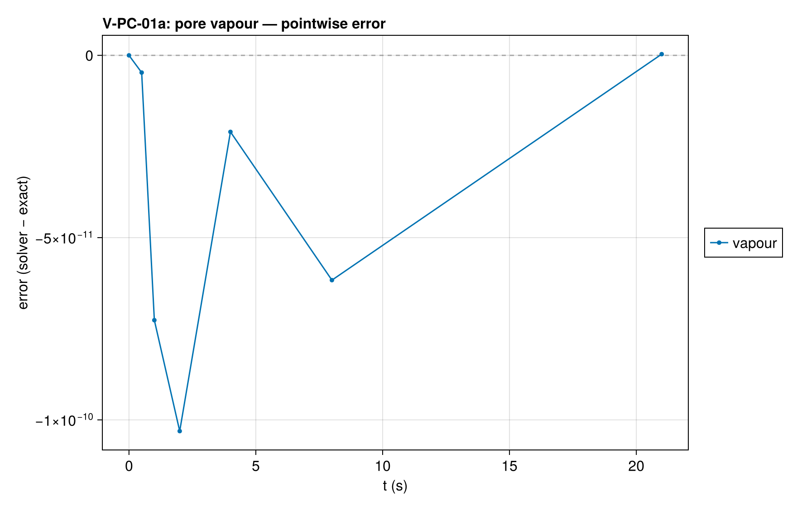
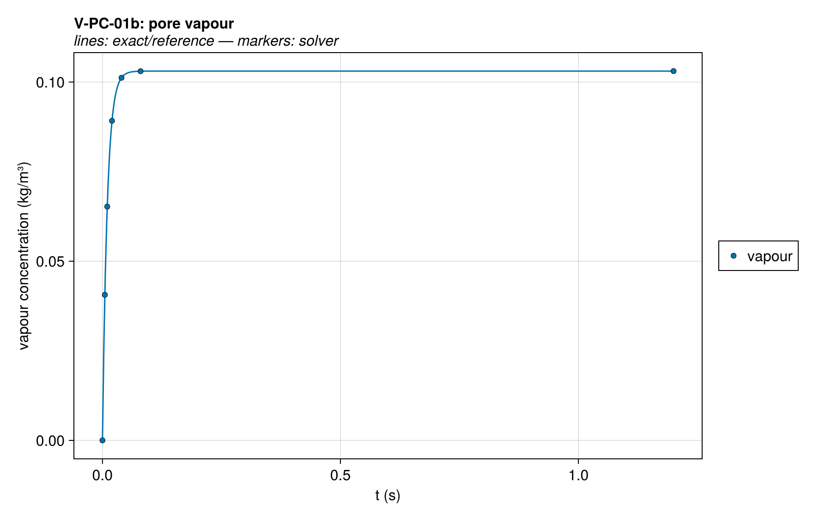
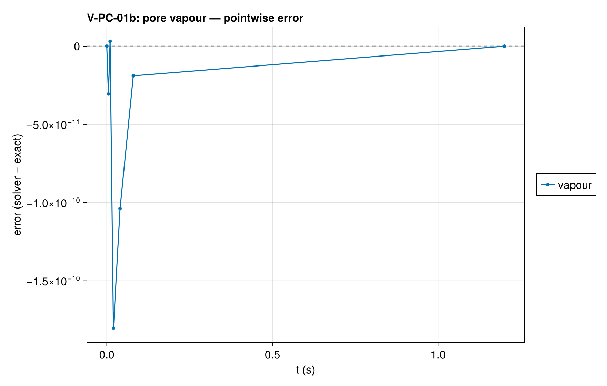
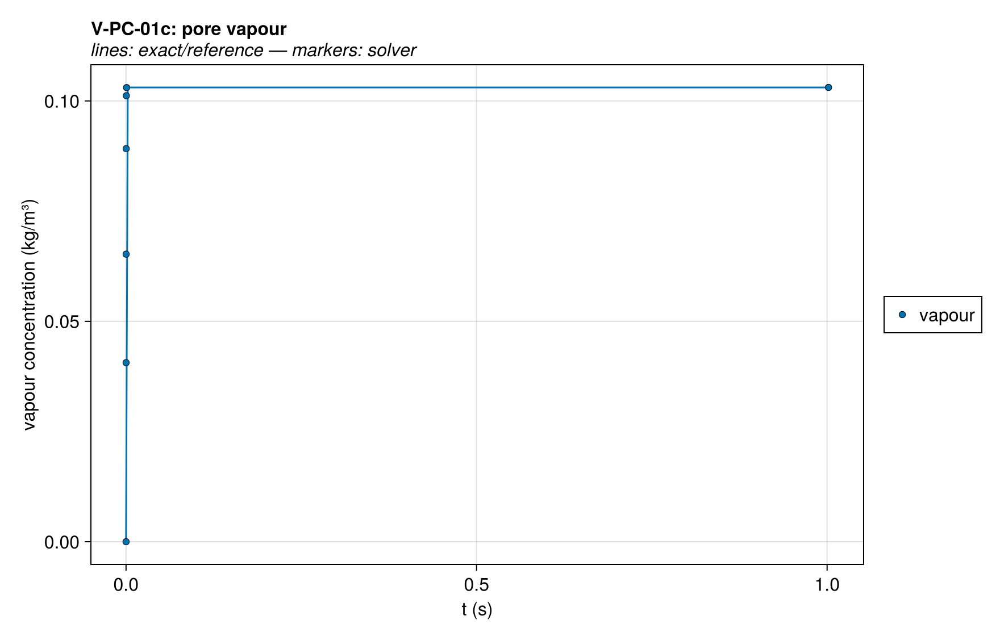
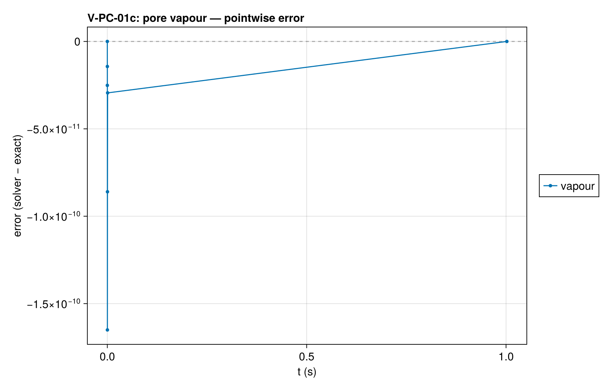

# V-PC-01 — sealed cell relaxing to the isotherm, athermal law, K = 1.0 1/s

**Tags:** `phase_change`, `sorption`, `sealed`, `analytical`

**References:**

- Dietenberger, Glass and Boardman (2024), the CAST isotherm, eq. 18 and Table 3 (spruce).
- Wagner and Pruß (2002), the saturation pressure of water, eq. 2.5.
- Independent quadrature of the one equation of the uniform sealed cell; see problem statement.

## Problem statement

A slab 4 mm thick of four cells of wood, 400 kg/m³ oven-dry with a skeletal
density of 1500 kg/m³, holding water at a moisture content of 0.10 at
350 K. Both faces are sealed and adiabatic. The pores start with air at
1 atm and no vapour. The water and its vapour exchange through the phase
change, K (ξ_eq − ξ_v), under an athermal law: the activity is the CAST
spruce isotherm held at 298.15 K, a function of the moisture content alone
with no heat of sorption, the latent heat is zero and the water takes the
vapour's heat capacity, so the step takes no heat and the temperature stays
where it starts. Every cell is the same, so nothing moves between them.

Exact answer: the vapour follows dξ_v/dt = K (ξ_eq(ξ_w0 − ξ_v) − ξ_v), with
the pore fraction and the moisture content following the water. Its end
state is the root of ξ_eq(ξ_w0 − x) = x, and its history the quadrature of
that equation (exact/phase_change.jl). Members a, b and c take
K = 1, 100 and 10⁴ per second.

Quantities: the vapour at 0.5, 1, 2, 4 and 8 times 1/K and at the end,
20/K + 1 s, relative to the quadrature; at the end the vapour pressure over
the equilibrium pressure, both from the independent closures (at K = 1 the
cell is then 21 relaxation times from its start, and e to the −21 of the way
from equilibrium); the largest departure of any temperature from 350 K; and
the accepted steps, which do not depend on K.

## V-PC-01a — sealed cell relaxing to the isotherm, athermal law, K = 1.0 1/s

### Quantities of interest (n = 4)

| QoI | value | exact | error | tolerance | within tol | provenance |
| --- | --- | --- | --- | --- | --- | --- |
| vapour at five times / quadrature | 1.156e-09 | — | 1.156e-09 | 7.2e-09 | yes | observed 1.16e-9 (temperature) and 2.39e-9 (enthalpy) |
| vapour at the end / quadrature | 3.209e-12 | — | 3.209e-12 | 1e-11 | yes | observed 3.2e-12 (temperature) and 9.0e-13 (enthalpy) |
| \|p_v/p_eq − 1\| at the end | 7.192e-10 | — | 7.192e-10 | 2.2e-09 | yes | observed 7.19e-10 and 7.22e-10: the relaxation left after 21/K, e^(−21) of the way |
| temperature drift [K] | 0 | — | 0 | 1e-10 | yes | the step takes no heat: the temperature stays at its start |
| accepted steps (\|log₂(steps/50)\|) | 47 | 50 | 0.08927 | 0.5 | yes | observed 47 (temperature) and 48 (enthalpy); within a factor √2 of 50 |

### Solver configuration

| setting | value |
| --- | --- |
| integrator | Rodas5P (default) |
| reltol | 1.0e-10 |
| abstol | 1.0e-12 |

## V-PC-01b — sealed cell relaxing to the isotherm, athermal law, K = 100.0 1/s

### Quantities of interest (n = 4)

| QoI | value | exact | error | tolerance | within tol | provenance |
| --- | --- | --- | --- | --- | --- | --- |
| vapour at five times / quadrature | 2.022e-09 | — | 2.022e-09 | 7.2e-09 | yes | observed 2.02e-9 (temperature) and 2.39e-9 (enthalpy) |
| vapour at the end / quadrature | 1.11e-15 | — | 1.11e-15 | 1e-13 | yes | observed 1.1e-15 and 1.3e-15, round-off |
| \|p_v/p_eq − 1\| at the end | 1.11e-15 | — | 1.11e-15 | 1e-13 | yes | observed 1.1e-15 and 5.6e-16, round-off |
| temperature drift [K] | 0 | — | 0 | 1e-10 | yes | the step takes no heat: the temperature stays at its start |
| accepted steps (\|log₂(steps/50)\|) | 51 | 50 | 0.02857 | 0.5 | yes | observed 51 (temperature) and 52 (enthalpy); within a factor √2 of 50 |

### Solver configuration

| setting | value |
| --- | --- |
| integrator | Rodas5P (default) |
| reltol | 1.0e-10 |
| abstol | 1.0e-12 |

## V-PC-01c — sealed cell relaxing to the isotherm, athermal law, K = 10000.0 1/s

### Quantities of interest (n = 4)

| QoI | value | exact | error | tolerance | within tol | provenance |
| --- | --- | --- | --- | --- | --- | --- |
| vapour at five times / quadrature | 1.851e-09 | — | 1.851e-09 | 7.2e-09 | yes | observed 1.85e-9 (temperature) and 2.39e-9 (enthalpy) |
| vapour at the end / quadrature | 8.882e-16 | — | 8.882e-16 | 1e-13 | yes | observed 8.9e-16 and 1.3e-15, round-off |
| \|p_v/p_eq − 1\| at the end | 0 | — | 0 | 1e-13 | yes | observed 0 and 2.2e-16, round-off |
| temperature drift [K] | 5.684e-14 | — | 5.684e-14 | 1e-10 | yes | the step takes no heat: the temperature stays at its start |
| accepted steps (\|log₂(steps/50)\|) | 54 | 50 | 0.111 | 0.5 | yes | observed 54 in both forms; within a factor √2 of 50 |

### Solver configuration

| setting | value |
| --- | --- |
| integrator | Rodas5P (default) |
| reltol | 1.0e-10 |
| abstol | 1.0e-12 |
