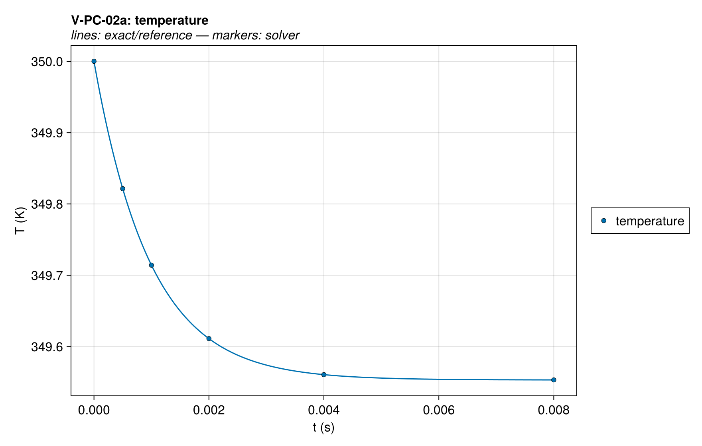
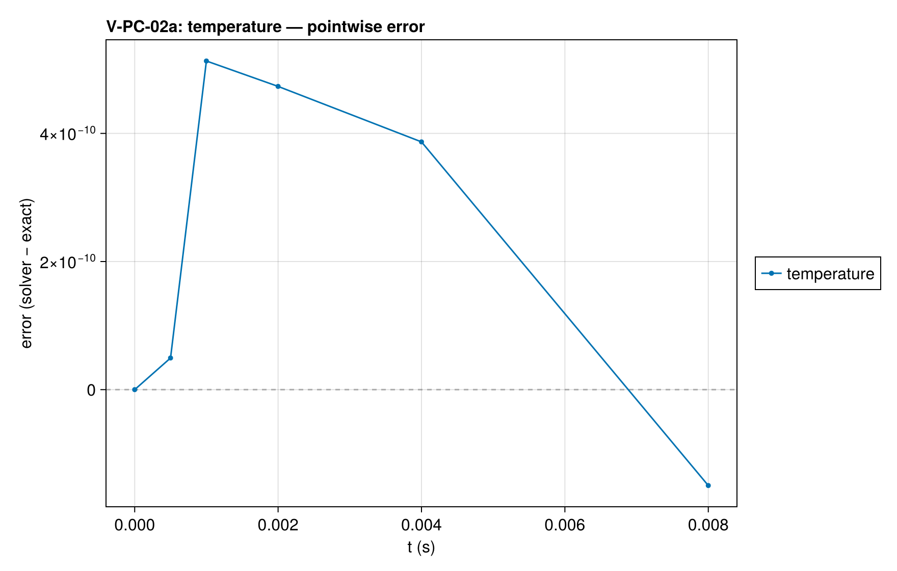
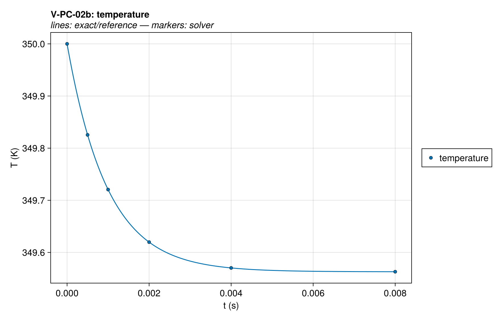
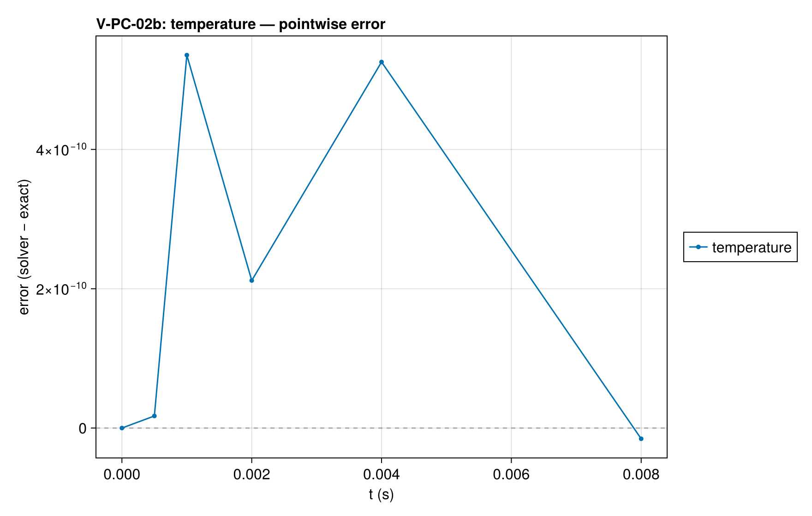
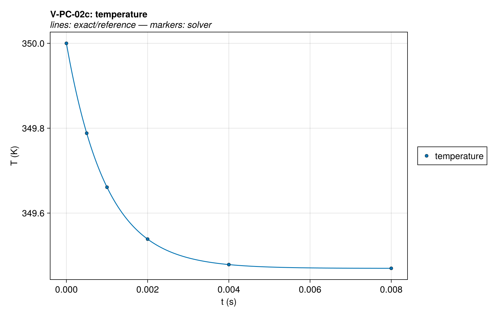
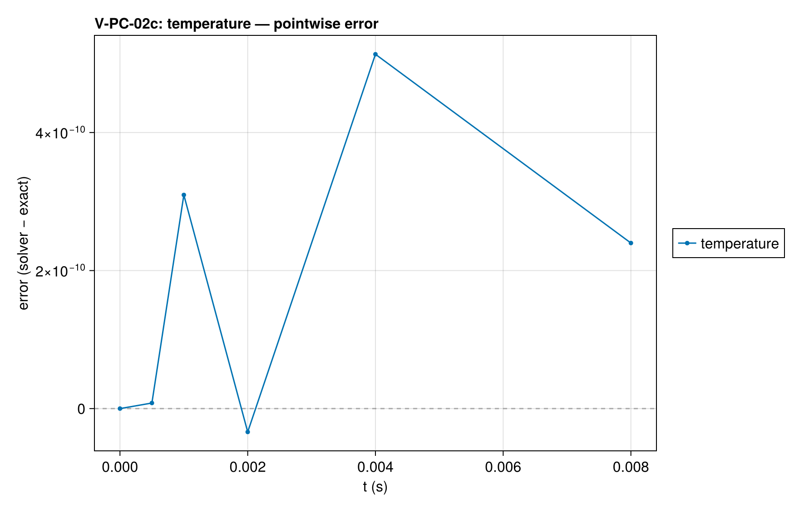

# V-PC-02 — sealed adiabatic cell relaxing to the isotherm, CAST spruce

**Tags:** `phase_change`, `sorption`, `sealed`, `adiabatic`, `analytical`

**References:**

- Dietenberger, Glass and Boardman (2024), the CAST isotherm, eqs. 18 and 19 and Table 3.
- Wagner and Pruß (2002), the saturation pressure of water, eq. 2.5.
- Independent Runge–Kutta integration of the two equations of the uniform sealed cell; see problem statement.

## Problem statement

The cell of V-PC-01: a slab 4 mm thick of four cells of wood, 400 kg/m³
oven-dry with a skeletal density of 1500 kg/m³, at a moisture content of
0.10 and 350 K, sealed and adiabatic, its pores holding air at 1 atm and no
vapour. The phase change now takes its heat: the latent heat of water at
298.15 K, 2441.7 kJ/kg, with Kirchhoff's law from the heat capacities of
water (4180 J/(kg K)) and of its vapour (1900 J/(kg K)), and the heat of
sorption of the activity law. The water evaporates into the dry pores at
the default exchange rate, 1000 per second, and the cell cools. Members:
a, the CAST spruce isotherm; b, the CAST beech isotherm; c, free water.

Exact answer: the two equations of the uniform cell, for the vapour and the
temperature, dξ_v/dt = K (ξ_eq − ξ_v) and C dT/dt = −h K (ξ_eq − ξ_v), with
h = L_ref + (c_v − c_w)(T − 298.15) + Q_s(X, T), integrated independently by
classical Runge–Kutta at a step of a thousandth of 1/K
(exact/phase_change.jl). For free water the total enthalpy, the components'
sensible enthalpies with the latent heat of the vapour, is conserved, which
with the water fixes the end state as well.

Quantities: the temperature and the vapour at 0.5, 1, 2, 4 and 8 times 1/K;
the closure of the solve's energy ledger; for free water, the temperature
and the vapour at the end against the state the mass and the enthalpy fix.

## V-PC-02a — sealed adiabatic cell relaxing to the isotherm, CAST spruce

### Quantities of interest (n = 4)

| QoI | value | exact | error | tolerance | within tol | provenance |
| --- | --- | --- | --- | --- | --- | --- |
| temperature at five times [K] | 5.131e-10 | — | 5.131e-10 | 1.6e-09 | yes | observed 5.13e-10 K (temperature) and 1.18e-10 K (enthalpy) |
| vapour at five times / reference | 1.774e-09 | — | 1.774e-09 | 5.4e-09 | yes | observed 1.77e-9 (temperature) and 4.10e-10 (enthalpy) |
| energy ledger closure (relative) | 2.51e-09 | — | 2.51e-09 | 7.6e-09 | yes | observed 2.51e-9 (temperature) and 1.04e-9 (enthalpy) |

### Solver configuration

| setting | value |
| --- | --- |
| integrator | Rodas5P (default) |
| reltol | 1.0e-10 |
| abstol | 1.0e-12 |

## V-PC-02b — sealed adiabatic cell relaxing to the isotherm, CAST beech

### Quantities of interest (n = 4)

| QoI | value | exact | error | tolerance | within tol | provenance |
| --- | --- | --- | --- | --- | --- | --- |
| temperature at five times [K] | 5.355e-10 | — | 5.355e-10 | 1.7e-09 | yes | observed 5.35e-10 K (temperature) and 3.38e-10 K (enthalpy) |
| vapour at five times / reference | 1.896e-09 | — | 1.896e-09 | 6.6e-09 | yes | observed 1.90e-9 (temperature) and 2.17e-9 (enthalpy) |
| energy ledger closure (relative) | 2.507e-09 | — | 2.507e-09 | 7.6e-09 | yes | observed 2.51e-9 (temperature) and 1.09e-9 (enthalpy) |

### Solver configuration

| setting | value |
| --- | --- |
| integrator | Rodas5P (default) |
| reltol | 1.0e-10 |
| abstol | 1.0e-12 |

## V-PC-02c — sealed adiabatic cell relaxing to the isotherm, free water

### Quantities of interest (n = 4)

| QoI | value | exact | error | tolerance | within tol | provenance |
| --- | --- | --- | --- | --- | --- | --- |
| temperature at five times [K] | 5.134e-10 | — | 5.134e-10 | 1.6e-09 | yes | observed 5.13e-10 K (temperature) and 1.81e-10 K (enthalpy) |
| vapour at five times / reference | 9.727e-10 | — | 9.727e-10 | 3e-09 | yes | observed 9.73e-10 (temperature) and 4.18e-10 (enthalpy) |
| energy ledger closure (relative) | 2.031e-09 | — | 2.031e-09 | 6.1e-09 | yes | observed 2.03e-9 (temperature) and 9.11e-10 (enthalpy) |
| temperature at the end / mass and enthalpy [K] | 349.5 | 349.5 | 5.855e-12 | 3.3e-11 | yes | observed 5.9e-12 K (temperature) and 1.1e-11 K (enthalpy) |
| vapour at the end / mass and enthalpy | 0.1752 | 0.1752 | 2.272e-13 | 1.3e-12 | yes | observed 2.3e-13 (temperature) and 4.2e-13 (enthalpy) |

### Solver configuration

| setting | value |
| --- | --- |
| integrator | Rodas5P (default) |
| reltol | 1.0e-10 |
| abstol | 1.0e-12 |
