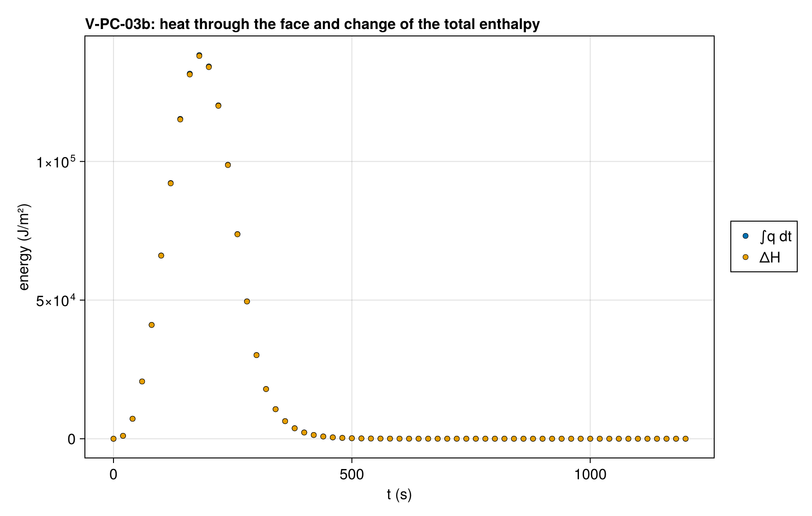

# V-PC-03 — sealed slab heated and cooled through one face, free water

**Tags:** `phase_change`, `sorption`, `energy_conservation`, `sealed`

**References:**

- Total enthalpy of the components with the latent heat at 298.15 K: Kirchhoff's law; see problem statement.
- Dietenberger, Glass and Boardman (2024), the CAST isotherm, eqs. 18 and 19 and Table 3.
- Wagner and Pruß (2002), the saturation pressure of water, eq. 2.5.

## Problem statement

heat over a closed cycle

A slab 2 mm thick of ten cells of wood, 400 kg/m³ oven-dry with a skeletal
density of 1500 kg/m³, holding water at a moisture content of 0.10 at
300 K, its pore vapour in equilibrium with the water and air making up
1 atm. Both faces are sealed; the back is adiabatic and the exposed face
convects, at 50 W/(m² K), to an ambient that rises smoothly from 300 to
400 K and back over 300 s (300 + 100 sin² of π t/300) and is then held at
300 K for 900 s, until the slab is at rest. The water evaporates as the
slab heats, the vapour moves inside it, and the water condenses again as it
cools. The phase change takes the latent heat of water at 298.15 K,
2441.7 kJ/kg, with Kirchhoff's law from the heat capacities of water
(4180 J/(kg K)) and of its vapour (1900 J/(kg K)), and the activity law's
heat of sorption. Members: a, free water; b, the CAST spruce isotherm.

Exact answer: with the total enthalpy H, the sensible enthalpies of all the
components with the latent heat at 298.15 K of the vapour, the heat through
the face equals the change of H at every time when the latent heat is the
components' own enthalpy difference: for free water exactly, and the slab
returns to its start. Under an isotherm the heat of sorption is not the
derivative of a state function, so over the cycle the heat through the face
and the change of H differ by the heat of sorption exchanged, its time
integral over the cells of Q_s times the evaporation rate. A latent heat
that ignored the heat capacities, the latent heat at 298.15 K at every
temperature, would leave 8e-4 of the peak rise of H in that difference over
this cycle of free water.

The heat through the face is the time integral of the flux the convective
condition applies, by Simpson's rule on the saved times (every 0.25 s); the
total enthalpy is evaluated from the saved masses and temperatures with
the components' heat capacities, independently of the solver's ledger.

Quantities, a: the heat through the face less the change of H, over the
peak rise of H, at 75, 150, 225, 300 and 600 s and at the end, 1200 s; the
largest departure of a temperature from 300 K and of the vapour from its
start at the end. b: the same difference less the heat of sorption
exchanged, over the peak rise of H, at the same times; and at the end the
difference itself over the heat of sorption exchanged in either direction,
which the excess heat capacity that the model leaves out bounds at 5 %.

## V-PC-03a — sealed slab heated and cooled through one face, free water

### Quantities of interest (n = 10)

| QoI | value | exact | error | tolerance | within tol | provenance |
| --- | --- | --- | --- | --- | --- | --- |
| \|∫q dt − ΔH\| / peak rise of H, five times and the end | 1.639e-10 | — | 1.639e-10 | 4.9e-10 | yes | observed 1.64e-10 (temperature) and 5.96e-11 (enthalpy) |
| temperature back at the start [K] | 2.34e-05 | — | 2.34e-05 | 7.1e-05 | yes | observed 2.34e-5 K in both forms: the water the cycle moved still flows back |
| vapour back at the start (relative) | 2.213e-06 | — | 2.213e-06 | 6.7e-06 | yes | observed 2.21e-6 in both forms, as the temperature |

### Solver configuration

| setting | value |
| --- | --- |
| integrator | Rodas5P (default) |
| reltol | 1.0e-10 |
| abstol | 1.0e-12 |

## V-PC-03b — sealed slab heated and cooled through one face, CAST spruce

### Quantities of interest (n = 10)

| QoI | value | exact | error | tolerance | within tol | provenance |
| --- | --- | --- | --- | --- | --- | --- |
| \|∫q dt − ΔH − ∫Q_s ω V dt\| / peak rise of H, five times and the end | 1.269e-08 | — | 1.269e-08 | 3.9e-08 | yes | observed 1.27e-8 (temperature) and 2.37e-9 (enthalpy) |
| cycle residual / heat of sorption exchanged | 0.01711 | — | 0.01711 | 0.05 | yes | the limit of the excess heat capacity; observed 0.0171 in both forms |

### Solver configuration

| setting | value |
| --- | --- |
| integrator | Rodas5P (default) |
| reltol | 1.0e-10 |
| abstol | 1.0e-12 |
