# V-PC-04 — drying front of free water from 323.15 K, K = 1000.0 1/s

**Tags:** `phase_change`, `free_water`, `moving_front`, `analytical`

**References:**

- Carslaw and Jaeger (1959), §11.2: the Neumann solution of the two-phase Stefan problem.
- Wagner and Pruß (2002), the saturation pressure of water, eq. 2.5.
- Kirchhoff's law for the latent heat from the heat capacities of water and its vapour; see problem statement.

## Problem statement

A slab 40 mm thick of wood, 400 kg/m³ oven-dry with a skeletal density of
1500 kg/m³ and a heat capacity of 1500 J/(kg K), holds free water at a
moisture content of 0.25, its pore vapour in equilibrium with the water and
air making up 1 atm. At t = 0 its exposed face is raised to 473.15 K; the
back is adiabatic and sealed. The face is in direct contact with dry air at
1 atm, and the wood's permeability is large (1e-10 m²) with no partial
pressure transfer, so the vapour leaves through the face at about 1 atm and
nothing condenses ahead of the front. The vapour and the air have a heat
capacity of 1 J/(kg K): the vapour carries no sensible heat out. The water
leaves through the phase change of free water, a = X/(|X| + 1e-4), at the
exchange rate K, with the latent heat of water at 298.15 K, 2441.7 kJ/kg,
and Kirchhoff's law from the heat capacities of water (4180 J/(kg K)) and
vapour.

Exact answer: in the stiff limit the water leaves at a front held at the
boiling temperature T_b, where a p_sat(T_b) = 1 atm, 373.136 K at this
moisture, and takes the latent heat L(T_b) there. The front then moves as
the Neumann solution of the two-phase Stefan problem, s(t) = 2 λ √(α_d t),
with the dry and wet zones' conductivities from the model's mixing law and
their heat capacities from their contents (exact/stefan.jl,
exact/phase_change.jl). Members, each on 400 cells: a, from 323.15 K at
K = 1000 per second; b, the same at K = 10⁴ per second; c, from the boiling
temperature at K = 1000 per second, which leaves the wet zone at
T_b and the second phase of the problem out. In c the pores start with
vapour alone at 1 atm, and the air, absent but for round-off, is held only
to the solve's tolerance on the cell's mass: at a relative tolerance of 1e-6
it sits near −0.2 Pa in the cell at the face, close to the −0.5 Pa the
domain test allows a gas, and in the enthalpy form a step takes it past
that. Just behind the front, where a cell's last water passes the knee of
the law's vanishing factor, the temperature follows the solve's tolerance
closely only from 1e-9. Member c therefore solves at 1e-9, the others at
1e-6.

The front is read as the depth at which half the initial water is left,
interpolated between cell centres, at the saved times from 200 to 600 s, every
20 s. Quantities: the mean of its error relative to the exact front; the
error of the slope of a fit of the front against √t through the origin; the
largest temperature error over the cells and those times; the energy ledger's
closure; and the accepted steps, against 1.5 times the count a separate
implementation of the model took for the same deck on the same mesh. The front's error is set by the exchange
rate, not by the mesh: a finite rate spreads the front over a depth that does
not shrink with the cells, which the report's ladders in the cells and in K
show.

## V-PC-04a — drying front of free water from 323.15 K, K = 1000.0 1/s

### Quantities of interest (n = 800)

| QoI | value | exact | error | tolerance | within tol | provenance |
| --- | --- | --- | --- | --- | --- | --- |
| front position, mean error (relative) | -0.00226 | — | 0.00226 | 0.0042 | yes | observed −1.413e-3 in both forms; +2.17e-4 at 200 cells and −2.26e-3 at 800, toward the exchange rate's error |
| slope of the front against √t (relative) | -0.002121 | — | 0.002121 | 0.004 | yes | observed −1.328e-3 in both forms |
| temperature, largest error [K] | 1.011 | — | 1.011 | 1.5 | yes | observed 1.015 K in both forms, at the front; three times is above the target, 1.5 K |
| energy ledger closure | 4.656e-07 | — | 4.656e-07 | 2e-06 | yes | observed 2.6e-7 (temperature) and 6.6e-7 (enthalpy) |
| accepted steps / the reference count | 1.266e+04 | 1.266e+04 | 1 | 1.5 | yes | a separate implementation of the model took 4661, 8193 and 12 661 at 200, 400 and 800 cells; observed 8193 (temperature) and 10 949 (enthalpy) at 400 |

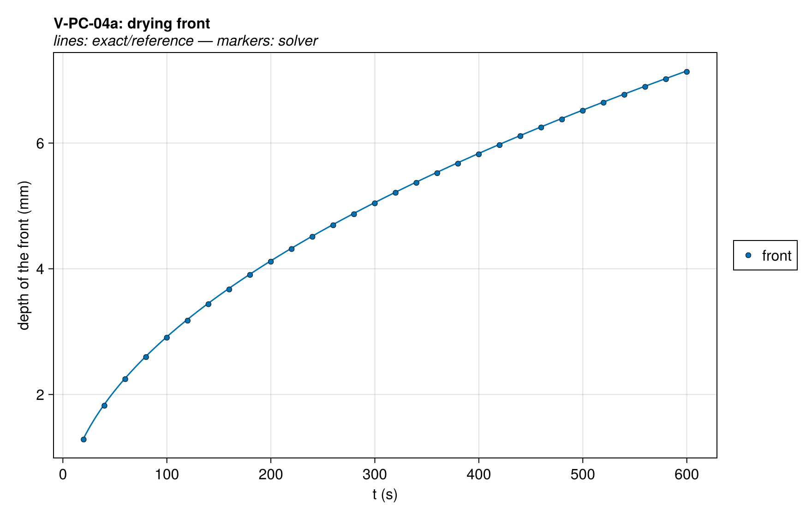

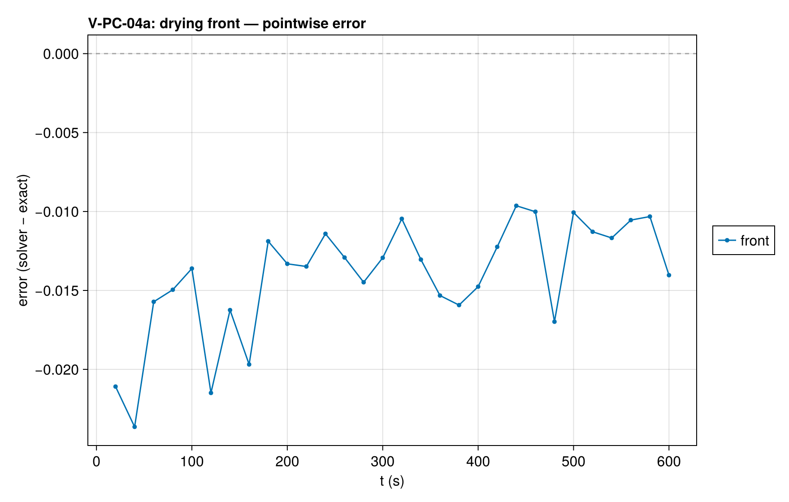

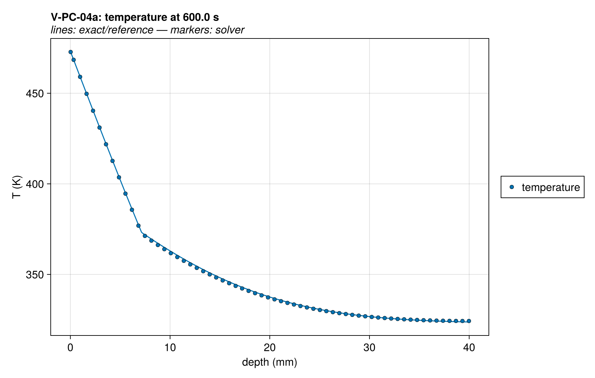

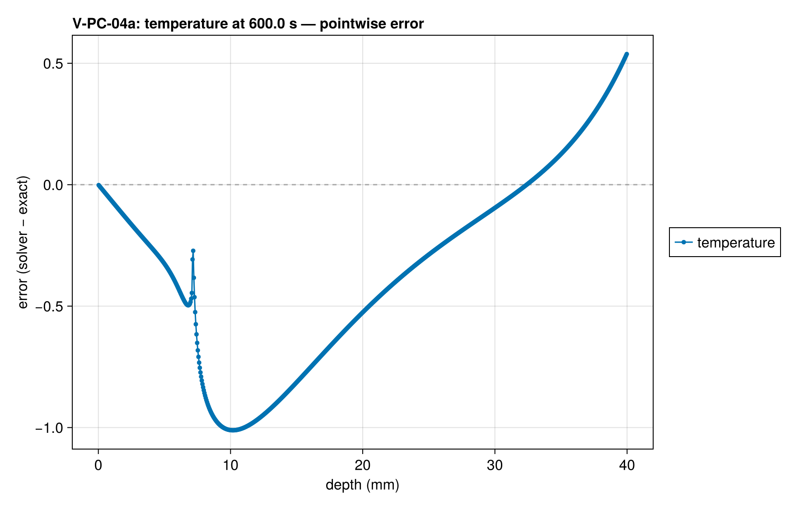

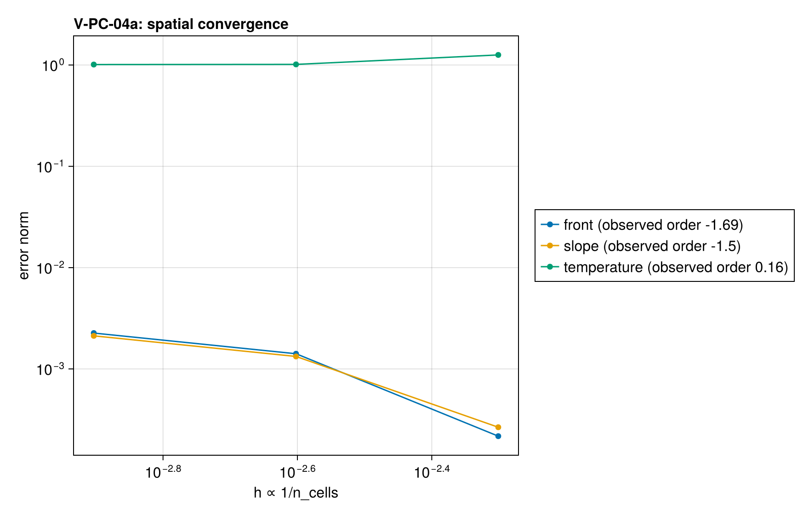

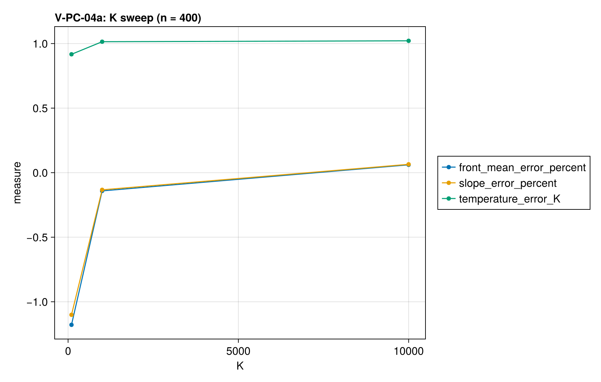

### Convergence

| n_cells | h | wall (s) | front | slope | temperature |
| --- | --- | --- | --- | --- | --- |
| 200 | 0.005 | 4.773 | 0.000217 | 0.0002658 | 1.258 |
| 400 | 0.0025 | 16.42 | 0.001413 | 0.001328 | 1.015 |
| 800 | 0.00125 | 51.04 | 0.00226 | 0.002121 | 1.011 |

Wall time: median of up to five warm runs of problem construction and solve on one pinned core, after a discarded compiling run.

Observed order -1.69 (front).

### Solver configuration

| setting | value |
| --- | --- |
| integrator | Rodas5P (default) |
| reltol | 1.0e-6 |
| abstol | 1.0e-8 |
| dtmax | 5.0 |

## V-PC-04b — drying front of free water from 323.15 K, K = 10000.0 1/s

### Quantities of interest (n = 400)

| QoI | value | exact | error | tolerance | within tol | provenance |
| --- | --- | --- | --- | --- | --- | --- |
| front position, mean error (relative) | 0.0006081 | — | 0.0006081 | 0.0018 | yes | observed +6.08e-4 in both forms; +2.38e-3 at 200 cells |
| slope of the front against √t (relative) | 0.0006473 | — | 0.0006473 | 0.0019 | yes | observed +6.47e-4 in both forms |
| temperature, largest error [K] | 1.021 | — | 1.021 | 1.5 | yes | observed 1.022 K in both forms, at the front; three times is above the target, 1.5 K |
| energy ledger closure | 3.078e-06 | — | 3.078e-06 | 9.2e-06 | yes | observed 3.08e-6 (temperature) and 1.42e-6 (enthalpy) |
| accepted steps / the reference count | 6955 | 6957 | 0.9997 | 1.5 | yes | a separate implementation of the model took 6957; observed 6955 (temperature) and 9557 (enthalpy) |

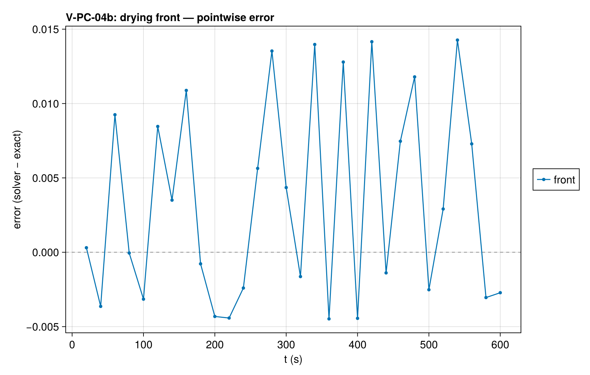

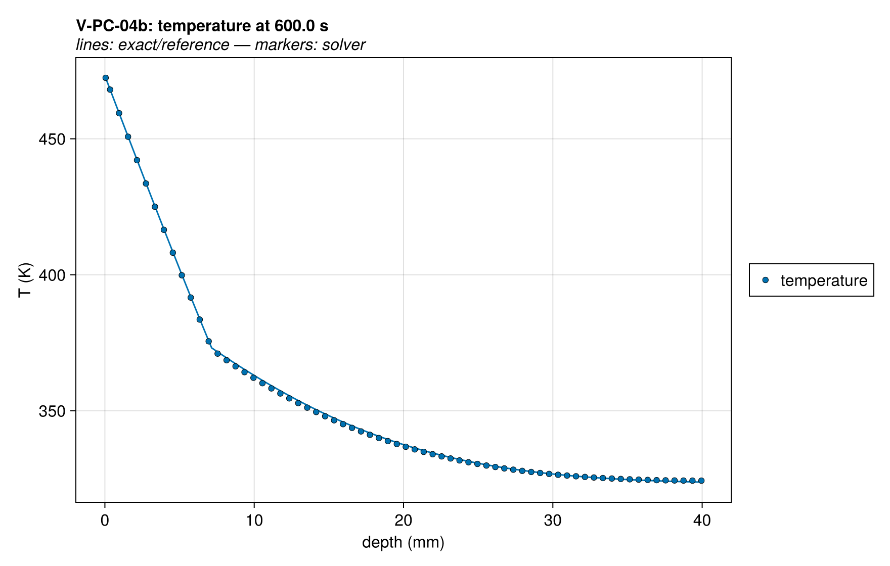

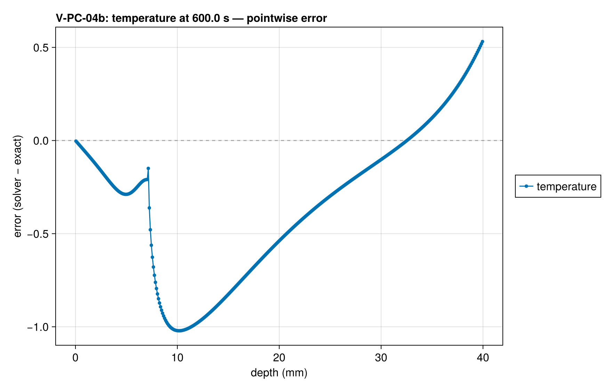

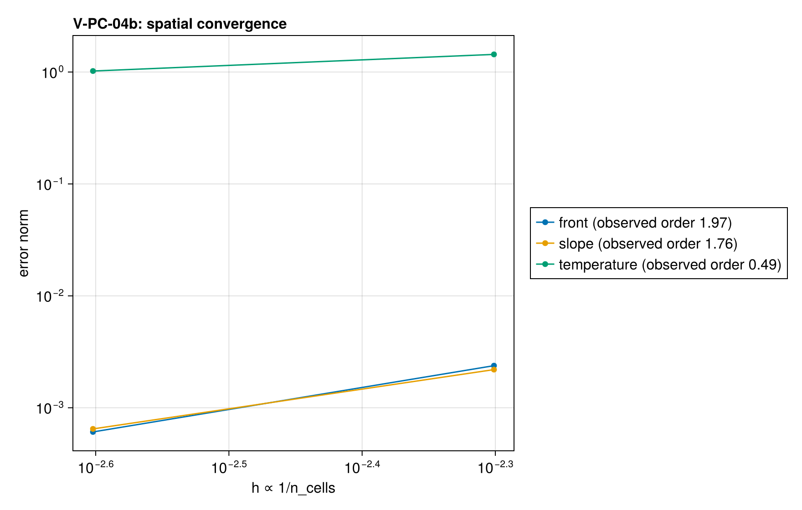

### Convergence

| n_cells | h | wall (s) | front | slope | temperature |
| --- | --- | --- | --- | --- | --- |
| 200 | 0.005 | 4.302 | 0.002378 | 0.002193 | 1.438 |
| 400 | 0.0025 | 14.03 | 0.0006081 | 0.0006473 | 1.021 |

Wall time: median of up to five warm runs of problem construction and solve on one pinned core, after a discarded compiling run.

Observed order 1.967 (front).

### Solver configuration

| setting | value |
| --- | --- |
| integrator | Rodas5P (default) |
| reltol | 1.0e-6 |
| abstol | 1.0e-8 |
| dtmax | 5.0 |

## V-PC-04c — drying front of free water from the boiling temperature, K = 1000.0 1/s

### Quantities of interest (n = 400)

| QoI | value | exact | error | tolerance | within tol | provenance |
| --- | --- | --- | --- | --- | --- | --- |
| front position, mean error (relative) | -0.0004885 | — | 0.0004885 | 0.0015 | yes | observed −4.885e-4 in both forms |
| slope of the front against √t (relative) | -0.0004594 | — | 0.0004594 | 0.0014 | yes | observed −4.594e-4 in both forms |
| temperature, largest error [K] | 0.4777 | — | 0.4777 | 1.43 | yes | observed 0.478 K in both forms |
| energy ledger closure | 6.221e-06 | — | 6.221e-06 | 1.9e-05 | yes | observed 6.2e-6 (temperature) and 4.7e-6 (enthalpy); 2.7e-3 at a relative tolerance of 1e-6 |
| accepted steps / the reference count | 1.006e+04 | 1.006e+04 | 1 | 1.5 | yes | a separate implementation of the model took 10 059; observed 10 059 (temperature) and 10 221 (enthalpy) |

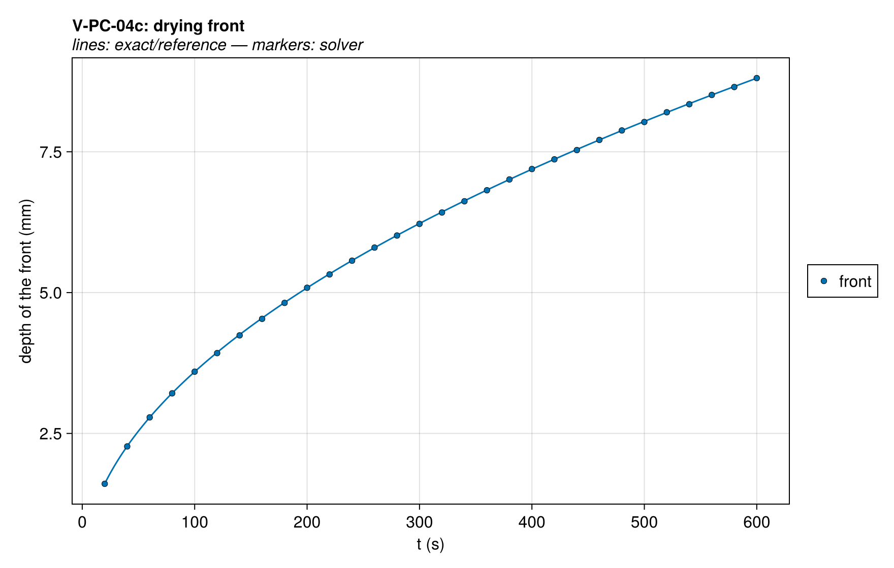

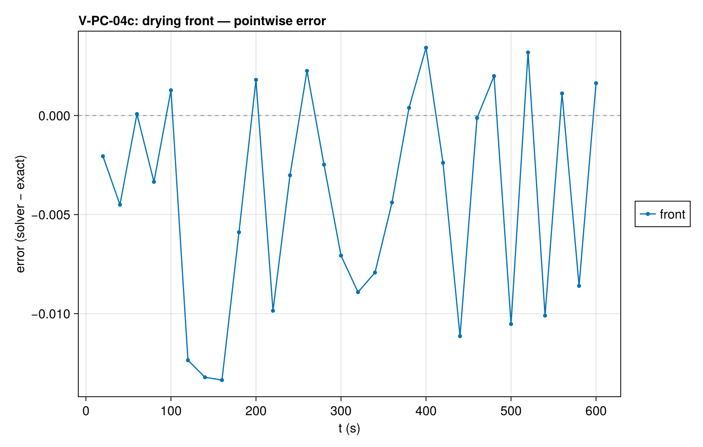

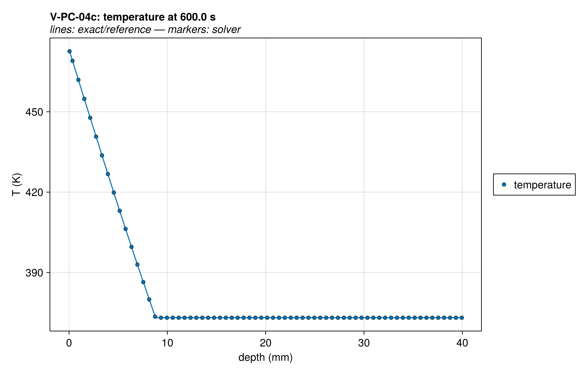

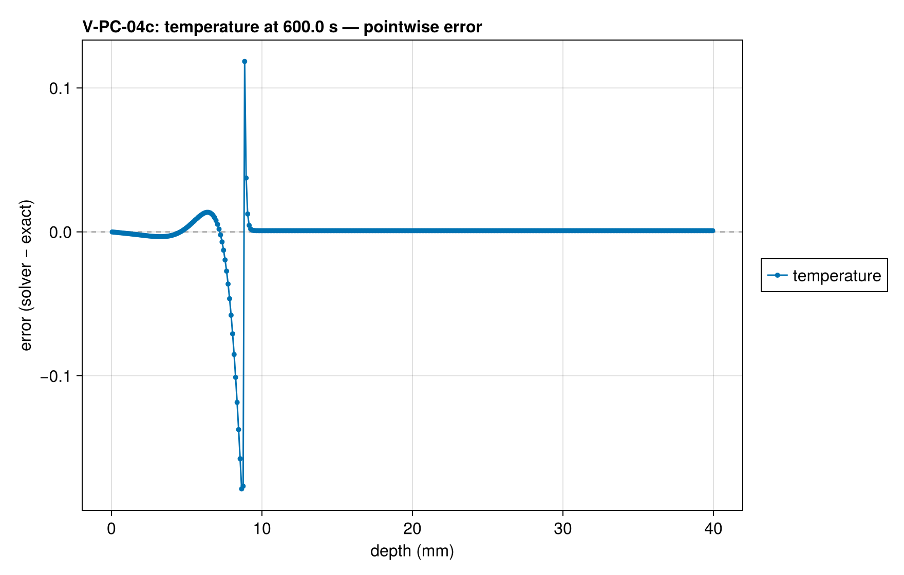

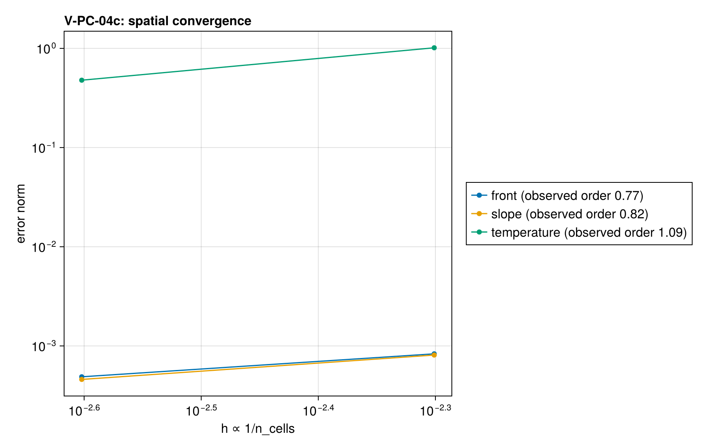

### Convergence

| n_cells | h | wall (s) | front | slope | temperature |
| --- | --- | --- | --- | --- | --- |
| 200 | 0.005 | 7.565 | 0.0008322 | 0.000809 | 1.014 |
| 400 | 0.0025 | 21.3 | 0.0004885 | 0.0004594 | 0.4777 |

Wall time: median of up to five warm runs of problem construction and solve on one pinned core, after a discarded compiling run.

Observed order 0.7687 (front).

### Solver configuration

| setting | value |
| --- | --- |
| integrator | Rodas5P (default) |
| reltol | 1.0e-9 |
| abstol | 1.0000000000000001e-11 |
| dtmax | 5.0 |
