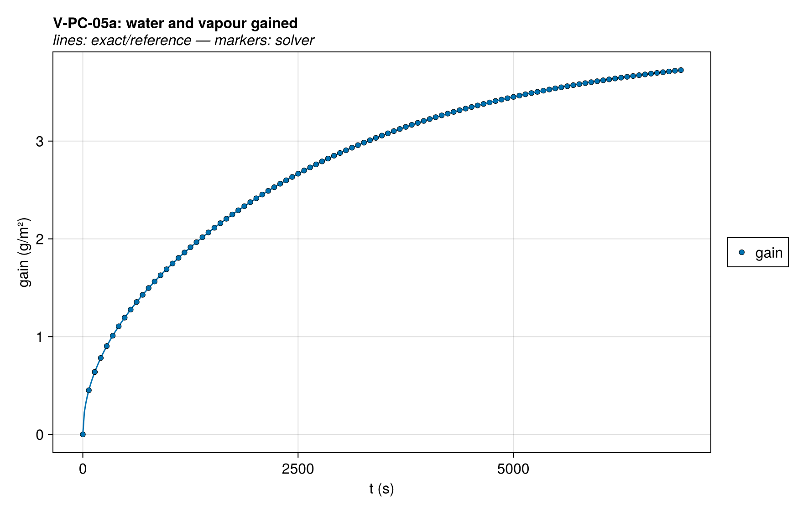
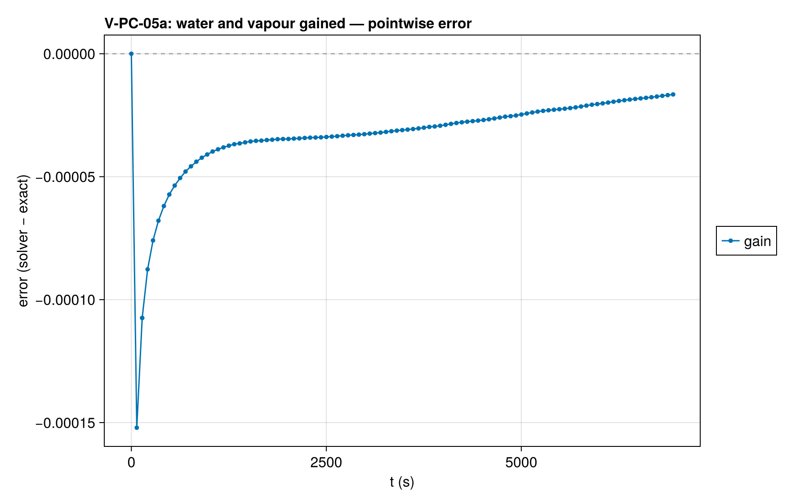
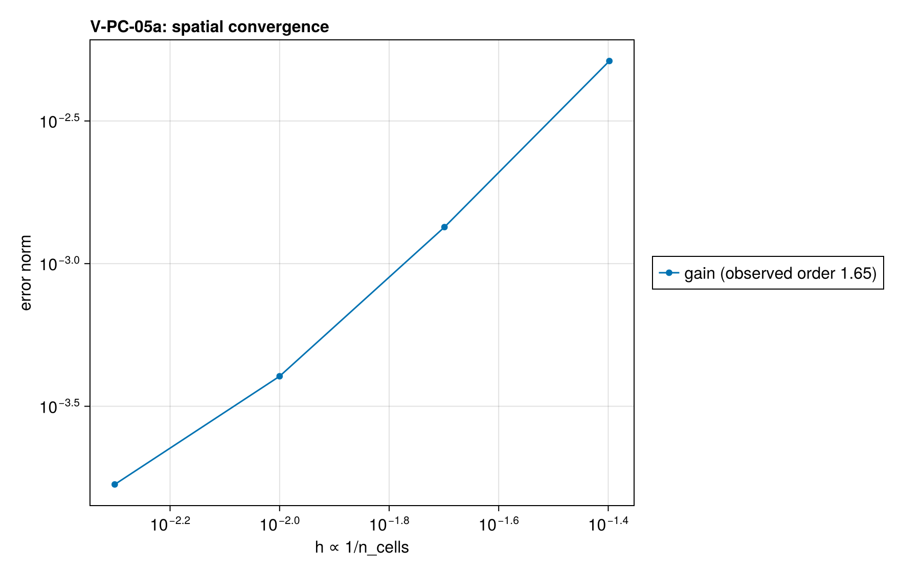
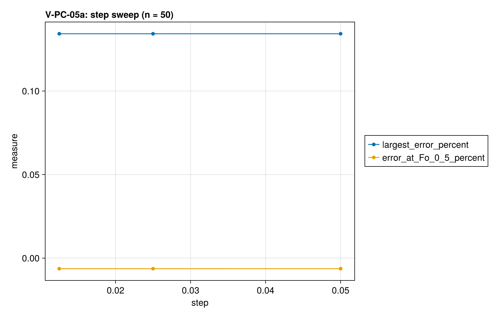
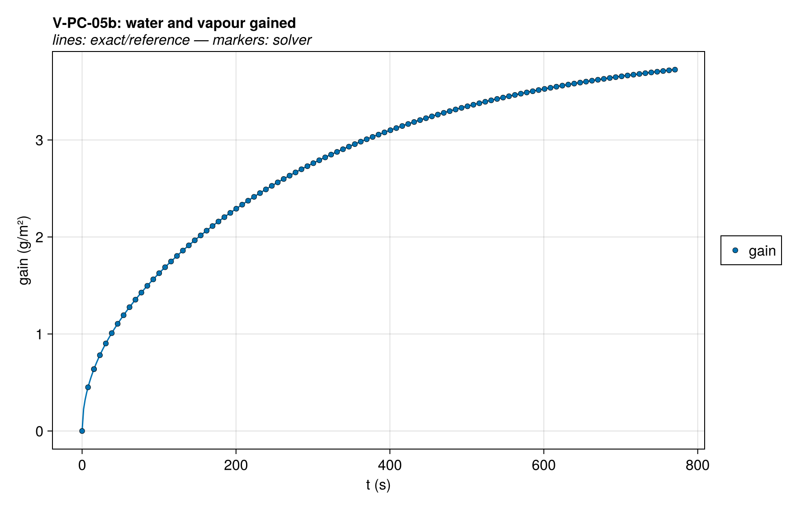
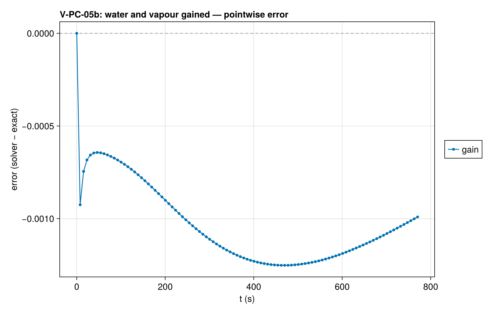
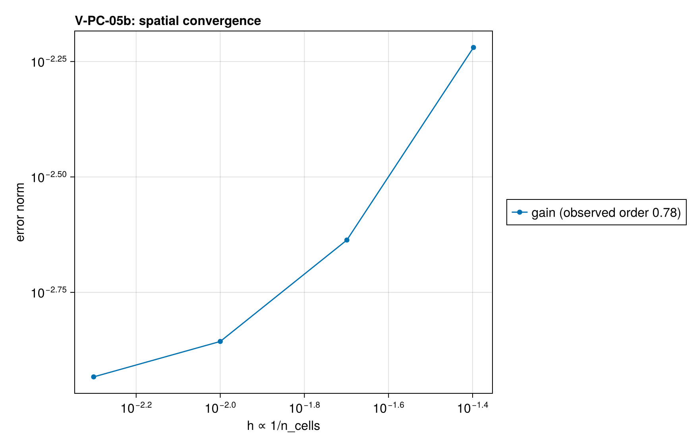
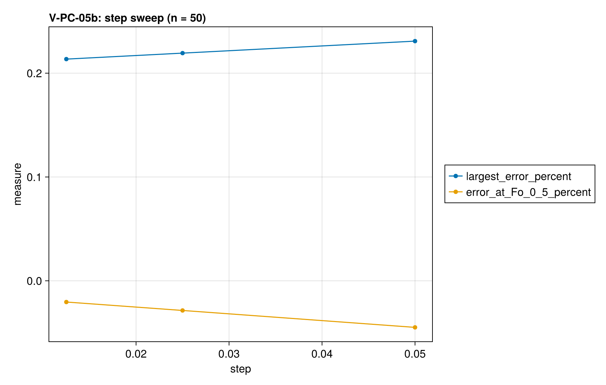

# V-PC-05 — sorption into a slab from a humid reservoir, linear isotherm, lumped transfer

**Tags:** `phase_change`, `sorption`, `gas_transport`, `analytical`

**References:**

- Crank (1975), The Mathematics of Diffusion, eq. 4.18: uptake by a plane sheet.
- Mason and Malinauskas (1983), the dusty-gas model: diffusion through a stagnant gas.
- Wagner and Pruß (2002), the saturation pressure of water, eq. 2.5.

## Problem statement

A slab 1 mm thick of wood, 400 kg/m³ oven-dry with a skeletal density of
1500 kg/m³, at 298.15 K, holds water in equilibrium with its pore vapour at
an activity of 0.50, with air making up 1 atm. Its back is sealed and the
wood has no permeability. At t = 0 its exposed face meets, in direct
contact with no film, a reservoir of air at 1 atm whose humidity is an
activity of 0.55. The vapour moves into the slab and the water takes it up.
The water follows a linear law, a = X/0.2, through the phase change at an
exchange rate of 10⁵ per second; the law does not depend on temperature,
the latent heat is zero and the water has its vapour's heat capacity, so the
step takes no heat and the slab stays at 298.15 K. The law's vanishing
factor, X/(|X| + X₀), is taken with X₀ = 1e-7, where it moves the activity by
1e-6 and its slope by 1e-12. Members: a, the lumped closure with a transfer
coefficient of 5e-7 m²/s; b, the dusty-gas closure, a tortuosity of 4, a
pore diameter of 10 µm and a vapour–air diffusivity of 2.6e-5 m²/s at
298.15 K and 1 atm.

Exact answer: in the stiff limit the vapour's density in the pores obeys a
diffusion equation, its flux the transfer coefficient times its gradient,
its storage the water's through the isotherm with the vapour's own beside it.
The slab's gain is then the series of a slab held at a fixed value at its
face (exact/phase_change.jl, the limit of exact/slab_series.jl's convective
slab), with the gain at the end from the two equilibrium states and the
diffusivity the transfer coefficient over the chord of the storage. Under
the dusty-gas closure the transfer coefficient is that of vapour diffusing
through air that does not move, evaluated at the mean of the two states'
pore fractions and mole fractions; the pore fraction falls by 0.6 % as the
water's volume grows, and the coefficient with it.

Quantities: the water and vapour the slab has gained, per unit area, at
Fourier numbers of 0.02, 0.05, 0.1, 0.2 and 0.5, relative to the series;
and the largest departure of a temperature from 298.15 K. The exchange rate
leaves the water a relaxation time of 7e-6 (a) and 7e-5 (b) of the
diffusion time, and the water's lag behind the vapour costs about that over
four times the Fourier number: 1e-4 and 8e-4 of the gain at the first time.
The report's ladder in the step of the reservoir's activity, 0.05, 0.025 and
0.0125, shows how the error depends on the step: under the lumped closure
the pore fraction enters only the vapour's own storage, and the step moves
the error by 1e-7; under the dusty-gas closure the transfer coefficient
follows the pore fraction and the mole fractions, and the error at the last
time falls in proportion to the step.

## V-PC-05a — sorption into a slab from a humid reservoir, linear isotherm, lumped transfer

### Quantities of interest (n = 200)

| QoI | value | exact | error | tolerance | within tol | provenance |
| --- | --- | --- | --- | --- | --- | --- |
| gain at five times / series (relative) | 0.0001683 | — | 0.0001683 | 0.004 | yes | observed 1.343e-3 in both forms, at the first time; the mesh's: 4.0e-4 at 100 cells, 1.7e-4 at 200 |
| temperature drift [K] | 5.684e-14 | — | 5.684e-14 | 1e-10 | yes | the step takes no heat; observed 5.7e-14 K (temperature) and 0 (enthalpy) |

### Convergence

| n_cells | h | wall (s) | gain |
| --- | --- | --- | --- |
| 25 | 0.04 | 0.009711 | 0.00513 |
| 50 | 0.02 | 0.01777 | 0.001343 |
| 100 | 0.01 | 0.0355 | 0.0004029 |
| 200 | 0.005 | 0.06911 | 0.0001683 |

Wall time: median of up to five warm runs of problem construction and solve on one pinned core, after a discarded compiling run.

Observed order 1.653 (gain).

### Solver configuration

| setting | value |
| --- | --- |
| integrator | Rodas5P (default) |
| reltol | 1.0e-6 |
| abstol | 1.0e-8 |

## V-PC-05b — sorption into a slab from a humid reservoir, linear isotherm, dusty gas

### Quantities of interest (n = 200)

| QoI | value | exact | error | tolerance | within tol | provenance |
| --- | --- | --- | --- | --- | --- | --- |
| gain at five times / series (relative) | 0.001167 | — | 0.001167 | 0.0069 | yes | observed 2.309e-3 in both forms, at the first time; with the coefficient's trace limit, x_a = 1, it would be 7.6e-3 |
| temperature drift [K] | 5.684e-14 | — | 5.684e-14 | 1e-10 | yes | the step takes no heat; observed 5.7e-14 K (temperature) and 0 (enthalpy) |

### Convergence

| n_cells | h | wall (s) | gain |
| --- | --- | --- | --- |
| 25 | 0.04 | 0.02426 | 0.006031 |
| 50 | 0.02 | 0.05025 | 0.002309 |
| 100 | 0.01 | 0.1045 | 0.001392 |
| 200 | 0.005 | 0.216 | 0.001167 |

Wall time: median of up to five warm runs of problem construction and solve on one pinned core, after a discarded compiling run.

Observed order 0.7839 (gain).

### Solver configuration

| setting | value |
| --- | --- |
| integrator | Rodas5P (default) |
| reltol | 1.0e-6 |
| abstol | 1.0e-8 |
