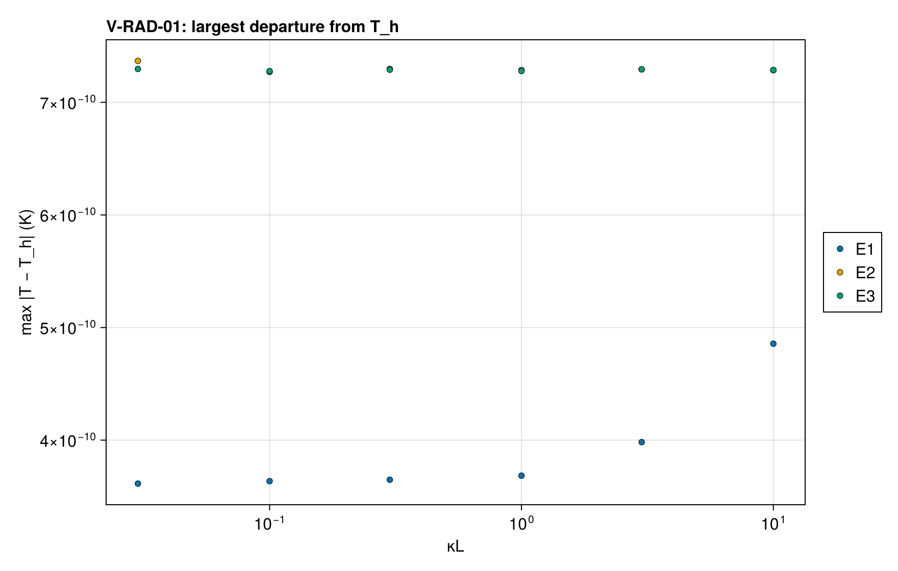

# V-RAD-01 — a gray slab in a radiative enclosure at its own temperature

**Tags:** `radiation`, `radiative_transfer`, `equilibrium`

**References:**

- Kirchhoff's law: the cells absorb and emit with one coefficient, the faces transmit with one emissivity both ways

## Problem statement

Under radiative transfer every cell emits and absorbs with one absorption
coefficient, and a face crosses radiation at its cell's emissivity in both
directions, so a slab at T_h that faces surroundings at T_h exchanges
nothing: at any optical thickness, on any mesh, behind a mirror or an open
back.

The rows: a slab 1 mm thick at a uniform 700 K whose exposed face looks at
surroundings at 700 K (`RadiativeBC`), behind a mirror (an adiabatic back) or
an open back facing 700 K, with κL from 10⁻³ to 10³, the emissivity 0.3,
0.96 or 1, on uniform, graded and irregular meshes of 16 cells. Every face
flux is σT_h⁴ and every cell's radiative source zero, to 10⁻¹² σT_h⁴. The
answer is the solver's consistent start; nothing is integrated in time.

The solver: a slab of 40 cells with PMMA's density, absorption coefficient
and emissivity, κL from 0.03 to 10, integrated from T_h to 30 of its
radiative time constants ρcL/(4εσT_h³) in three enclosures:

- E1: diffuse radiation σT_h⁴ onto the exposed face, an open back facing T_h;
- E2: the same exposed face, a mirror back;
- E3: as E2, behind an opaque 10 µm layer of another material.

The exposed face's radiation is a diffuse `RadiativeFluxBC(σT_h⁴)` beside a
`RadiativeBC` facing 1 K, so the flux and the surroundings both enter the
rows; the 1 K surroundings add σ·1⁴, which settles the slab 1/(4T_h³) =
7.3×10⁻¹⁰ K above T_h behind a mirror and half that with E1's open back.
Every cell must stay within 10⁻⁸ K of T_h at every saved time.

### Quantities of interest (n = 40)

| QoI | value | exact | error | tolerance | within tol | provenance |
| --- | --- | --- | --- | --- | --- | --- |
| rows, mirror back, uniform mesh: every face flux σT_h⁴, every source zero | 6.68e-16 | — | 6.68e-16 | 1e-12 | yes | largest over κL = 1e-3 … 1e3 and ε = 0.3, 0.96, 1, as a fraction of σT_h⁴ |
| rows, mirror back, graded mesh: every face flux σT_h⁴, every source zero | 1.336e-16 | — | 1.336e-16 | 1e-12 | yes | largest over κL = 1e-3 … 1e3 and ε = 0.3, 0.96, 1, as a fraction of σT_h⁴ |
| rows, mirror back, irregular mesh: every face flux σT_h⁴, every source zero | 2.672e-16 | — | 2.672e-16 | 1e-12 | yes | largest over κL = 1e-3 … 1e3 and ε = 0.3, 0.96, 1, as a fraction of σT_h⁴ |
| rows, open back, uniform mesh: every face flux σT_h⁴, every source zero | 4.008e-16 | — | 4.008e-16 | 1e-12 | yes | largest over κL = 1e-3 … 1e3 and ε = 0.3, 0.96, 1, as a fraction of σT_h⁴ |
| rows, open back, graded mesh: every face flux σT_h⁴, every source zero | 8.016e-16 | — | 8.016e-16 | 1e-12 | yes | largest over κL = 1e-3 … 1e3 and ε = 0.3, 0.96, 1, as a fraction of σT_h⁴ |
| rows, open back, irregular mesh: every face flux σT_h⁴, every source zero | 4.008e-16 | — | 4.008e-16 | 1e-12 | yes | largest over κL = 1e-3 … 1e3 and ε = 0.3, 0.96, 1, as a fraction of σT_h⁴ |
| solver, E1: every cell stays at T_h | 4.857e-10 | — | 4.857e-10 | 1e-08 | yes | K, largest over κL = 0.03 … 10, every cell and saved time; the 1 K surroundings settle the slab 7.3e-10 K above T_h |
| solver, E2: every cell stays at T_h | 7.368e-10 | — | 7.368e-10 | 1e-08 | yes | K, largest over κL = 0.03 … 10, every cell and saved time; the 1 K surroundings settle the slab 7.3e-10 K above T_h |
| solver, E3: every cell stays at T_h | 7.296e-10 | — | 7.296e-10 | 1e-08 | yes | K, largest over κL = 0.03 … 10, every cell and saved time; the 1 K surroundings settle the slab 7.3e-10 K above T_h |

### Solver configuration

| setting | value |
| --- | --- |
| integrator | Rodas5P (default) |
| radiation_model | RADIATIVE_TRANSFER |
