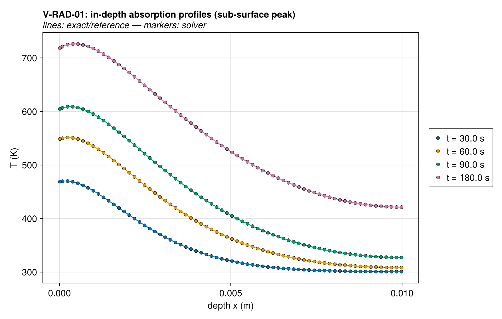
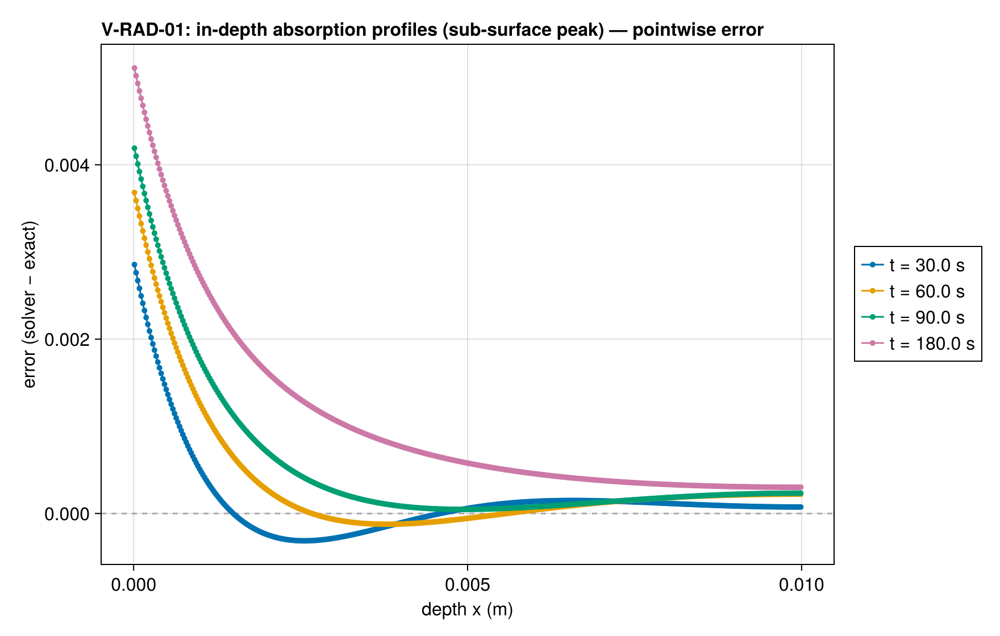
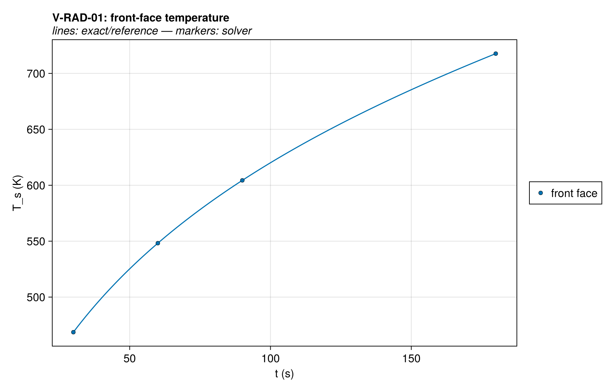
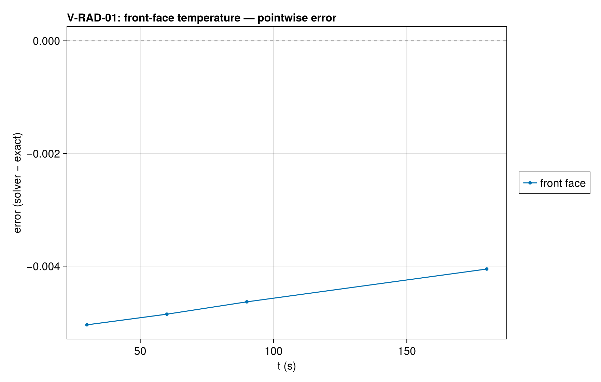
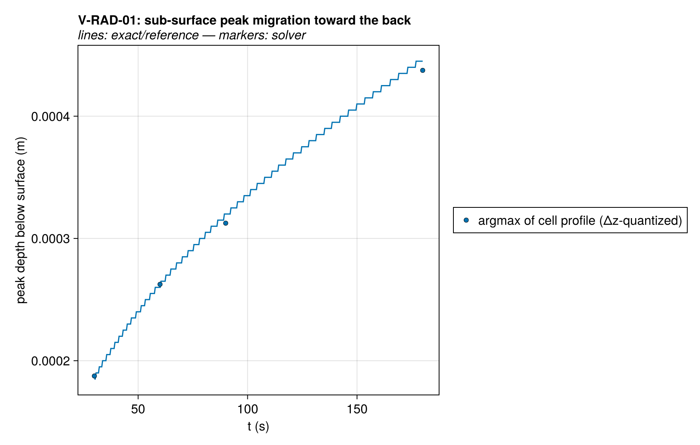
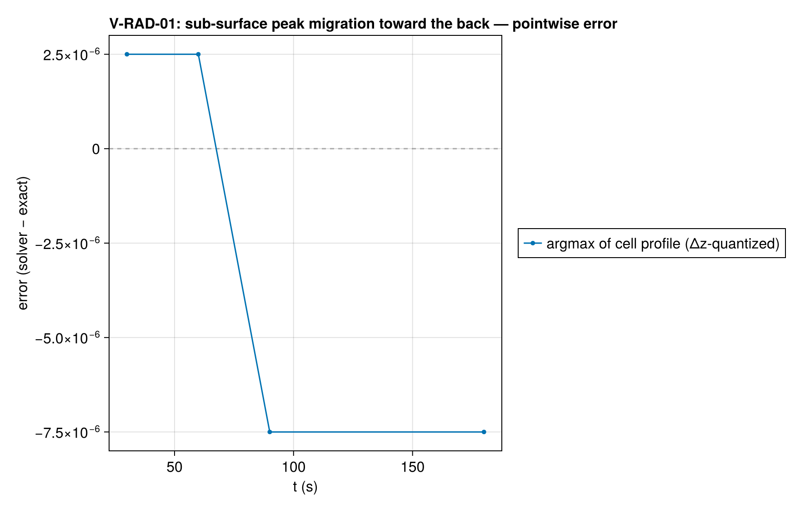
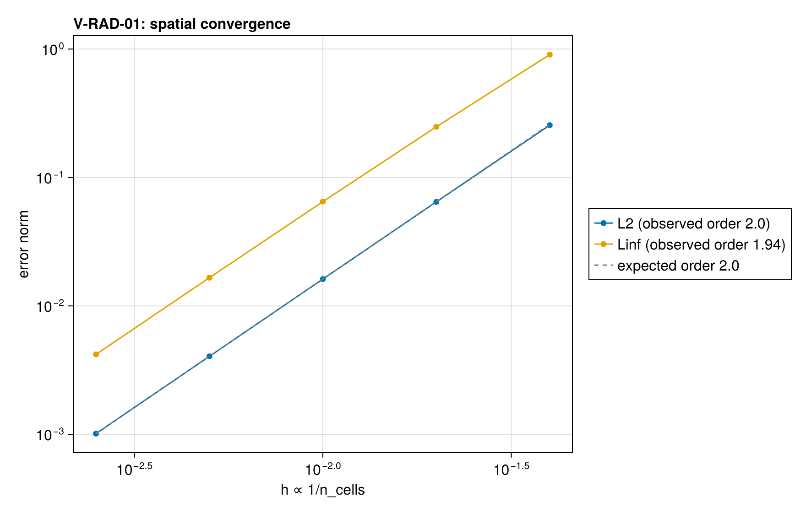
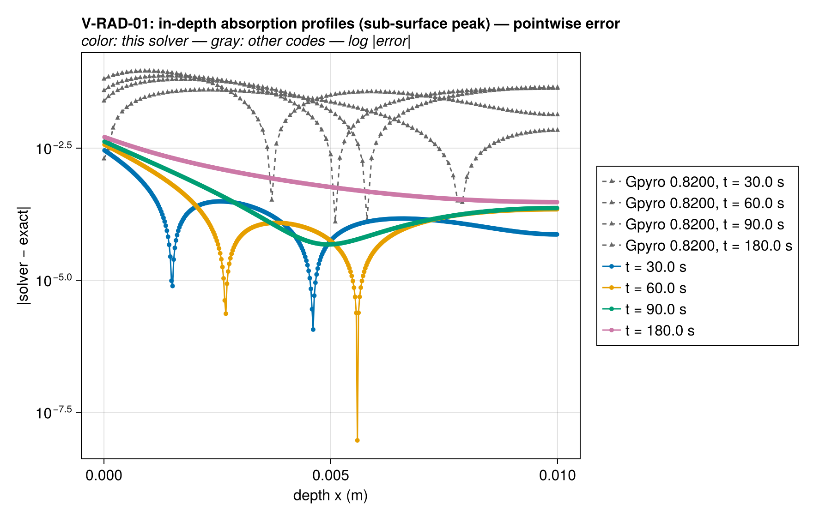
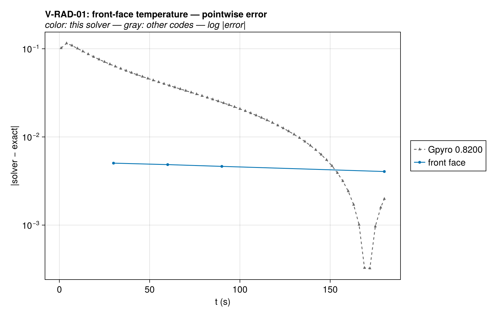
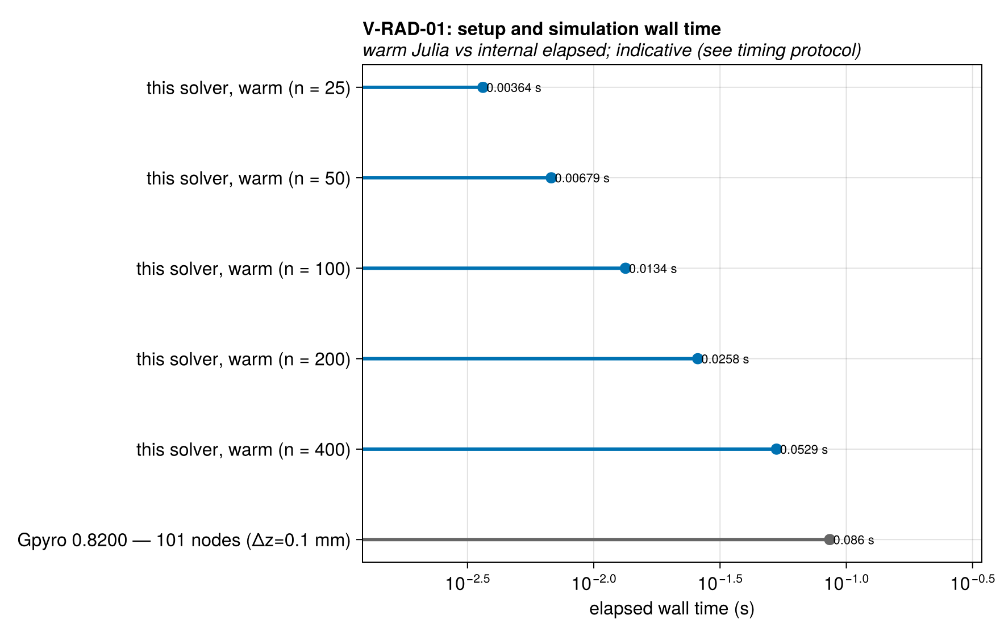

# V-RAD-01 — in-depth absorption + conduction (sub-surface peak)

**Tags:** `radiation`, `beer_lambert`, `convective_bc`, `coupled`

**References:**

- Lautenberger dissertation (2007) §3.4.2 + Appendix A
- exact/indepth_absorption.jl (re-derivation, PDE-residual self-test)

## Problem statement

Lautenberger dissertation §3.4.2 + Appendix A: finite slab δ = 1 cm,
in-depth source q₀κe^(−κx) with κ = 1000 m⁻¹ (κδ = 10), convective loss at
the irradiated face, insulated back. Exact eigenfunction solution re-derived
in exact/indepth_absorption.jl (PDE-residual self-tested).

This is the definitive BEER_LAMBERT + conduction + ConvectiveBC coupling
case. The existing Beer–Lambert test checks the absorption profile and
energy split WITHOUT conduction; the physics marker here is the SUB-SURFACE
temperature peak (the peak sits at the front face at t → 0⁺ and migrates
toward the insulated back as t → ∞), which only the coupled problem shows.

Configuration pitfalls encoded below:
- `RadiativeFluxBC(flux = q₀, absorptivity = 1.0)`: the EXPLICIT
  absorptivity bypasses the Kirchhoff ε_eff rescaling at volumetric
  injection, so exactly q₀ enters the Beer–Lambert sweep.
- Under BEER_LAMBERT the incident flux contributes zero to the surface
  Newton balance (deposited volumetrically); convective loss stays at the
  surface — exactly the exact solution's BC structure. No RadiativeBC is
  present, so there is no re-radiation term (the exact model has none).
- The component absorption kwarg α is a MASS coefficient [m²/kg]:
  α = κ/ρ = 1.0 m²/kg gives the target κ = 1000 m⁻¹.
- The transmitted fraction e^(−κδ) ≈ 4.5e-5 of q₀ exits the insulated back
  in both the exact model and the solver (never deposited): consistent.

k, ρ, c, h, q₀ follow the Gpyro §3.4.1 property set for cross-code
comparability of the dissertation figures (report mode).

### Quantities of interest (n = 400)

| QoI | value | exact | error | tolerance | within tol | provenance |
| --- | --- | --- | --- | --- | --- | --- |
| L∞ T-profile error, t=30.0 s | 0.002856 | — | 0.002856 | 0.25 | yes | observed 0.044/0.057/0.065/0.080 K at t=30/60/90/180 s |
| L∞ T-profile error, t=60.0 s | 0.003682 | — | 0.003682 | 0.25 | yes | observed 0.044/0.057/0.065/0.080 K at t=30/60/90/180 s |
| L∞ T-profile error, t=90.0 s | 0.004191 | — | 0.004191 | 0.25 | yes | observed 0.044/0.057/0.065/0.080 K at t=30/60/90/180 s |
| L∞ T-profile error, t=180.0 s | 0.005112 | — | 0.005112 | 0.25 | yes | observed 0.044/0.057/0.065/0.080 K at t=30/60/90/180 s |
| front-face temperature, t=30.0 s | 468.6 | 468.6 | 0.005042 | 0.25 | yes | convective-only surface balance under BEER_LAMBERT |
| front-face temperature, t=60.0 s | 548.2 | 548.2 | 0.004853 | 0.25 | yes | convective-only surface balance under BEER_LAMBERT |
| front-face temperature, t=90.0 s | 604.4 | 604.4 | 0.004634 | 0.25 | yes | convective-only surface balance under BEER_LAMBERT |
| front-face temperature, t=180.0 s | 717.7 | 717.7 | 0.004051 | 0.25 | yes | convective-only surface balance under BEER_LAMBERT |
| sub-surface peak value, t=90 s | 608.9 | 608.9 | 0.001528 | 0.05 | yes | the coupled-physics marker no uncoupled test checks |
| sub-surface peak location, t=90 s | 0.0003125 | 0.000319 | 6.5e-06 | 3.75e-05 | yes | peak must sit strictly below the surface |
| peak strictly interior, t=90 s | 388 | — | 0 | 0.5 | yes | argmax at a boundary cell would mean no sub-surface peak |

### Comparison with other codes

The same case was solved with Gpyro 0.8200 at 101 nodes (Δz=0.1 mm); decks, outputs, and
run provenance are committed under `test/verification/reference/`.
Each code's error against the same exact solution is drawn below
on a log scale, muted gray behind this solver's series — the
signed linear-scale panel above shows where the error lives, this
one compares magnitudes across codes.

Setup and simulation wall times at every ladder rung against the
reference runs. Julia times model construction and solve after warm-up;
FDS and Gpyro use internal total elapsed wall time, including setup and
simulation output. Process launch and Julia compilation are excluded
from the figure. Output costs, discretizations and time-stepping rules
still differ, so these are indicative costs, not pure solver speedups.
See `test/verification/reference/README.md` and `timings.csv` for the
timer boundaries, resolutions and measurement provenance.

Reference timings below are medians of five runs after one warm-up. Full process time also includes launch and shutdown; it is shown separately and is not compared with Julia's warmed time.

| Code | Resolution | Internal elapsed (s) | Full process (s) |
| --- | --- | --- | --- |
| Gpyro 0.8200 | 101 nodes (Δz=0.1 mm) | 0.086 | 0.08843 |

Solution overlays including the other codes' points: [T_profiles_vs_codes](assets/V-RAD-01/V-RAD-01_T_profiles_vs_codes.png), [surface_T_history_vs_codes](assets/V-RAD-01/V-RAD-01_surface_T_history_vs_codes.png).

### Convergence

| n_cells | h | wall (s) | L2 | Linf |
| --- | --- | --- | --- | --- |
| 25 | 0.04 | 0.003642 | 0.2555 | 0.9054 |
| 50 | 0.02 | 0.006789 | 0.06456 | 0.248 |
| 100 | 0.01 | 0.01336 | 0.01618 | 0.06485 |
| 200 | 0.005 | 0.02582 | 0.004048 | 0.01658 |
| 400 | 0.0025 | 0.05292 | 0.001012 | 0.004191 |

Observed order 1.996 (L2), expected 2.0.

### Solver configuration

| setting | value |
| --- | --- |
| integrator | Rodas5P (default) |
| abstol | 1.0e-12 |
| reltol | 1.0e-10 |
| radiation_model | BEER_LAMBERT |

