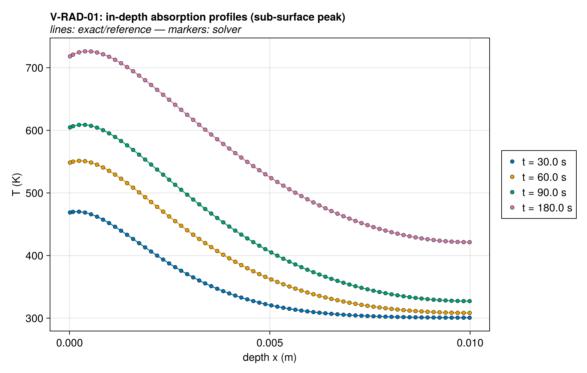
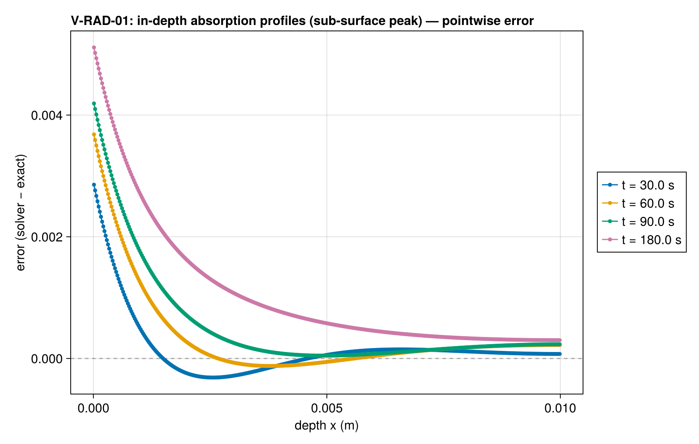
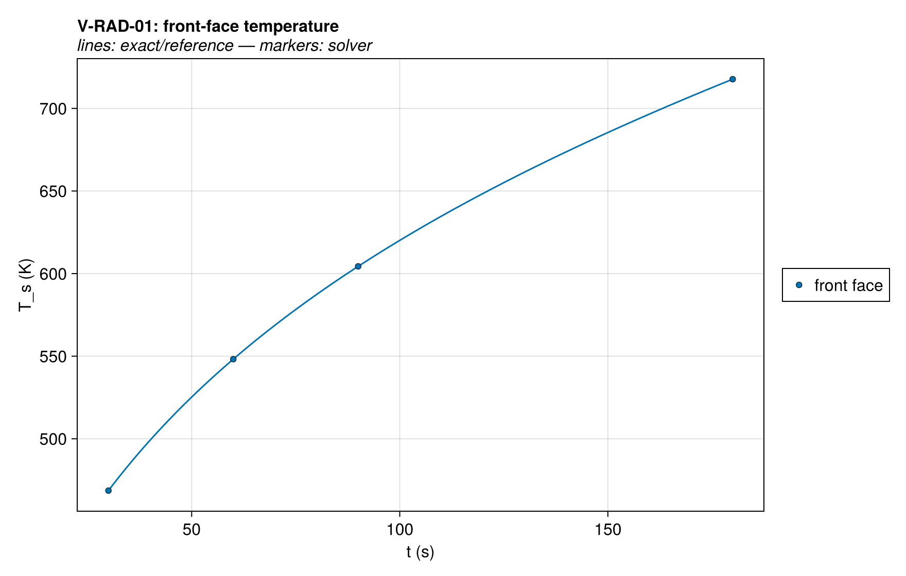
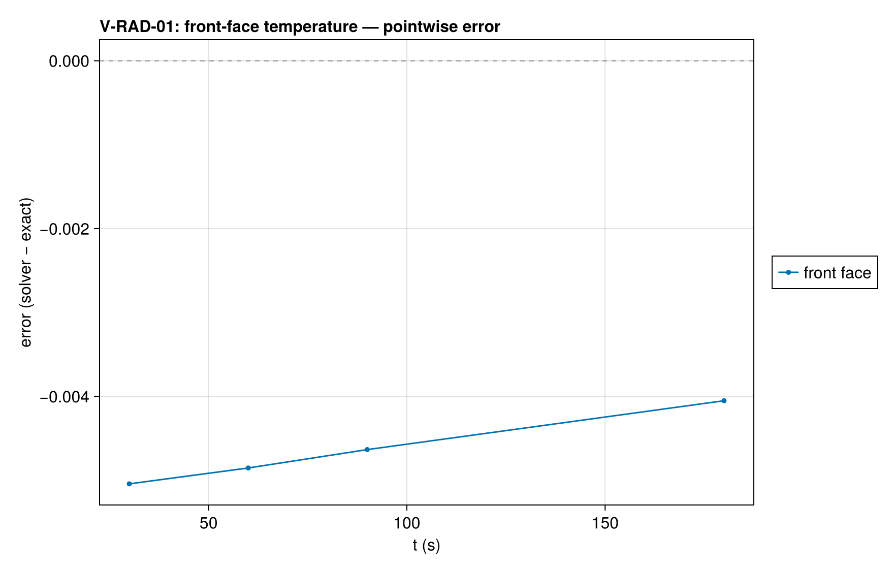
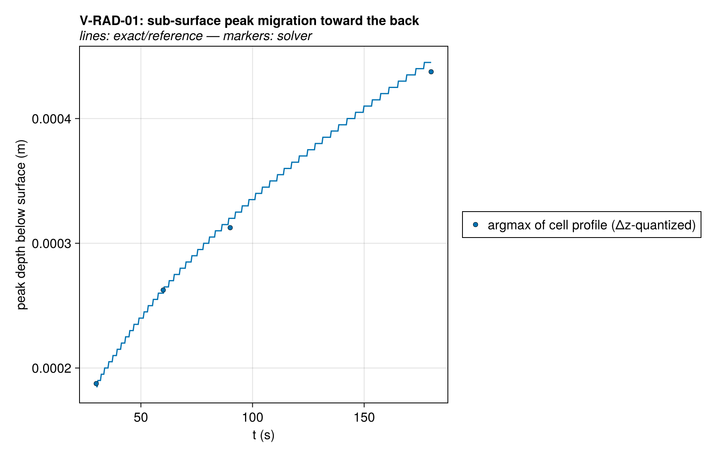
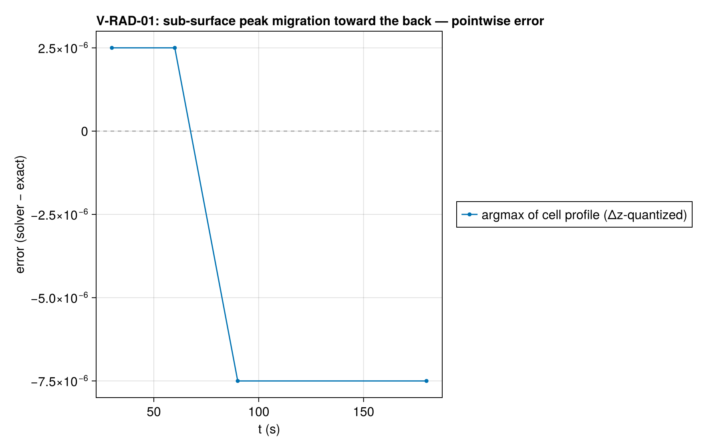
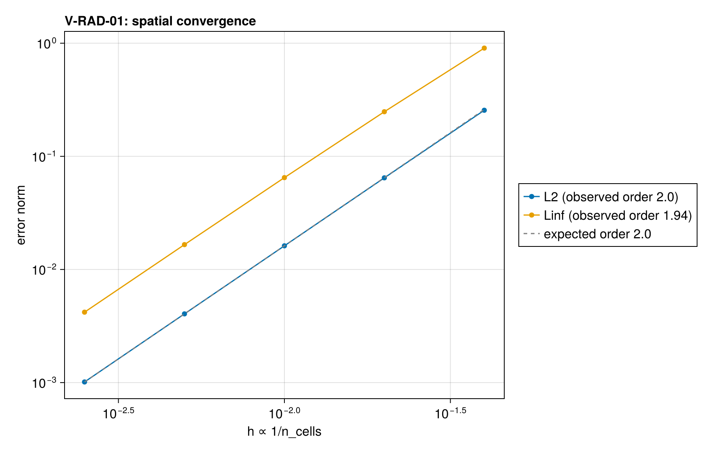
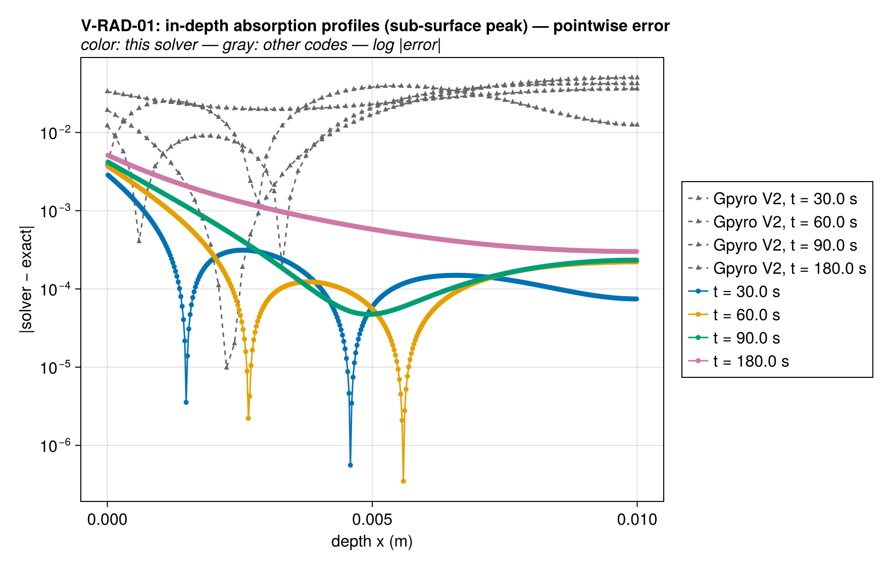
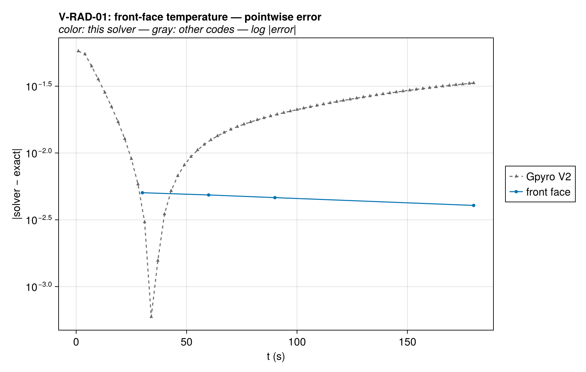
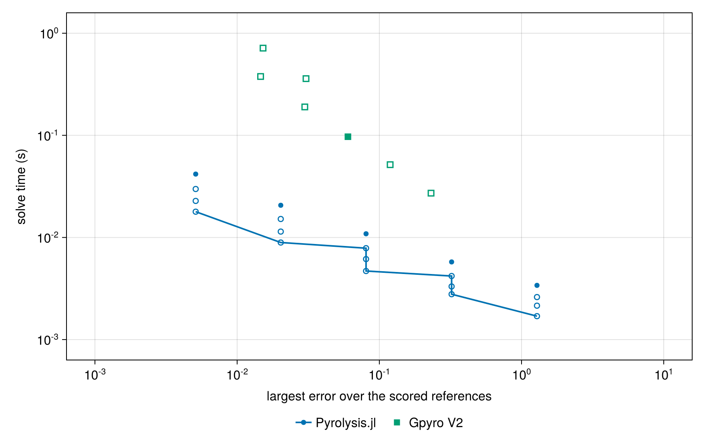

# V-RAD-01 — in-depth absorption + conduction (sub-surface peak)

**Tags:** `radiation`, `beer_lambert`, `convective_bc`, `coupled`

**References:**

- Lautenberger dissertation (2007) §3.4.2 + Appendix A
- exact/indepth_absorption.jl (re-derivation, PDE-residual self-test)

## Problem statement

Lautenberger dissertation §3.4.2 + Appendix A: finite slab δ = 1 cm,
in-depth source q₀κe^(−κx) with κ = 1000 m⁻¹ (κδ = 10), convective loss at
the irradiated face, insulated back. Exact eigenfunction solution re-derived
in exact/indepth_absorption.jl (PDE-residual self-tested).

This is the definitive BEER_LAMBERT + conduction + ConvectiveBC coupling
case. The existing Beer–Lambert test checks the absorption profile and
energy split WITHOUT conduction; the physics marker here is the SUB-SURFACE
temperature peak (the peak sits at the front face at t → 0⁺ and migrates
toward the insulated back as t → ∞), which only the coupled problem shows.

Configuration pitfalls encoded below:
- `RadiativeFluxBC(q₀, absorptivity = 1.0)`: the EXPLICIT
  absorptivity bypasses the Kirchhoff ε_eff rescaling at volumetric
  injection, so exactly q₀ enters the Beer–Lambert sweep.
- Under BEER_LAMBERT the incident flux contributes zero to the surface
  Newton balance (deposited volumetrically); convective loss stays at the
  surface — exactly the exact solution's BC structure. No RadiativeBC is
  present, so there is no re-radiation term (the exact model has none).
- The component absorption kwarg α is a MASS coefficient [m²/kg]:
  α = κ/ρ = 1.0 m²/kg gives the target κ = 1000 m⁻¹.
- The transmitted fraction e^(−κδ) ≈ 4.5e-5 of q₀ exits the insulated back
  in both the exact model and the solver (never deposited): consistent.

k, ρ, c, h, q₀ follow the Gpyro §3.4.1 property set for cross-code
comparability of the dissertation figures (report mode).

### Quantities of interest (n = 400)

| QoI | value | exact | error | tolerance | within tol | provenance |
| --- | --- | --- | --- | --- | --- | --- |
| L∞ T-profile error, t=30.0 s | 0.002856 | — | 0.002856 | 0.25 | yes | observed 0.044/0.057/0.065/0.080 K at t=30/60/90/180 s |
| L∞ T-profile error, t=60.0 s | 0.003682 | — | 0.003682 | 0.25 | yes | observed 0.044/0.057/0.065/0.080 K at t=30/60/90/180 s |
| L∞ T-profile error, t=90.0 s | 0.004191 | — | 0.004191 | 0.25 | yes | observed 0.044/0.057/0.065/0.080 K at t=30/60/90/180 s |
| L∞ T-profile error, t=180.0 s | 0.005112 | — | 0.005112 | 0.25 | yes | observed 0.044/0.057/0.065/0.080 K at t=30/60/90/180 s |
| front-face temperature, t=30.0 s | 468.6 | 468.6 | 0.005042 | 0.25 | yes | convective-only surface balance under BEER_LAMBERT |
| front-face temperature, t=60.0 s | 548.2 | 548.2 | 0.004853 | 0.25 | yes | convective-only surface balance under BEER_LAMBERT |
| front-face temperature, t=90.0 s | 604.4 | 604.4 | 0.004634 | 0.25 | yes | convective-only surface balance under BEER_LAMBERT |
| front-face temperature, t=180.0 s | 717.7 | 717.7 | 0.004051 | 0.25 | yes | convective-only surface balance under BEER_LAMBERT |
| sub-surface peak value, t=90 s | 608.9 | 608.9 | 0.001528 | 0.05 | yes | the coupled-physics marker no uncoupled test checks |
| sub-surface peak location, t=90 s | 0.0003125 | 0.000319 | 6.5e-06 | 3.75e-05 | yes | peak must sit strictly below the surface |
| peak strictly interior, t=90 s | 388 | — | 0 | 0.5 | yes | argmax at a boundary cell would mean no sub-surface peak |

### Comparison with other codes

Physical-problem agreement does not establish equal discretization or cost. See the [mesh and time comparison basis](comparison_coverage.md#comparison-basis-audit) and [per-pair inventory](assets/comparison_basis.csv). Costs are compared at matched accuracy only.

Matched native-input runs at seven configurations (coarser and finer time steps at fixed mesh, and a finer mesh) are retained under `test/verification/reference/matched/`. See the [coverage and matching notes](comparison_coverage.md). The plotted external series use the base resolution; [analytical errors at every configuration](assets/V-RAD-01/V-RAD-01_comparison_accuracy.csv) are retained separately, and the same runs are timed for the cost comparison.

Gpyro V2 revision `bff0126c68f2` uses 401 boundary nodes (400 intervals, 0.025 mm spacing) at dt = 0.1 s, with Beer–Lambert deposition through its absorption coefficient and the same eigenfunction parameters.

Error panels show absolute error at each code's output points. Zeros are displayed at 1e-12 on the logarithmic axis; the reference CSV precision limits the discernible error.

#### Cost at matched accuracy

Each external code appears at its matched mesh h and time step Δt, at
coarser steps (2Δt, 4Δt) and at refinements (Δt/2, Δt/4, h/2 at Δt/4,
h/2 at Δt/2); this code at its report ladder, the external meshes and any
finer cost-only meshes, each at its report tolerances and at 10, 100 and
1000 times looser ones, the counterpart of the coarser steps. A coarse
configuration a code cannot express or complete is left out; for the
external codes the reason is in the matched provenance. The error is the
largest analytical error over
the curves and references the external run is scored on. Times are FDS's
internal elapsed time, which excludes its MPI start-up; Gpyro's and
ThermaKin's process time; and this code's warm problem construction and
solve. Each is the median of repeated runs on one pinned core
(`scripts/timing/README.md`; data and provenance in
`test/verification/reference/matched/timing/`). On the smallest problems
the external times are mostly input, setup and output. In the figure,
filled markers are each external code's matched mesh and step and this
code's report tolerances, open markers are the other runs, and this
code's line joins its cheapest configuration at each accuracy; lower left
is better. Errors at or below 1e-12 count as exact
when matching accuracy, errors at or below 1e-14 are drawn at 1e-14, and
runs every code solves exactly are not drawn.

For each external mesh and step: the external code's cheapest run at least as accurate (often itself; a coarser or finer run of the same code when that costs less), this code's cheapest configuration at least as accurate on every scored reference (its cells, and its tolerance multiplier when looser than the report's), and the ratio of the two. A ratio marked ≥ uses this code's coarsest configuration, fewest cells at the loosest tolerance, whose accuracy already exceeds the external run's.

| External run | Mesh, step | External error | External time (s) | Cheapest external at this accuracy (s) | Our cells, tolerance | Our time (s) | Cheapest external/our time |
| --- | --- | --- | --- | --- | --- | --- | --- |
| Gpyro V2 | h, Δt | 0.06013 | 0.09695 | 0.09695 | 200, 1000× tol | 0.008858 | 10.9 |
| Gpyro V2 | h, 2Δt | 0.1191 | 0.05161 | 0.05161 | 100, 1000× tol | 0.004791 | 10.8 |
| Gpyro V2 | h, 4Δt | 0.231 | 0.02716 | 0.02716 | 100, 1000× tol | 0.004791 | 5.67 |
| Gpyro V2 | h, Δt/2 | 0.02991 | 0.1897 | 0.1897 | 200, 1000× tol | 0.008858 | 21.4 |
| Gpyro V2 | h, Δt/4 | 0.01462 | 0.3769 | 0.3769 | 400, 1000× tol | 0.0177 | 21.3 |
| Gpyro V2 | h/2, Δt/4 | 0.01521 | 0.7147 | 0.3769 | 400, 1000× tol | 0.0177 | 21.3 |
| Gpyro V2 | h/2, Δt/2 | 0.0305 | 0.3592 | 0.1897 | 200, 1000× tol | 0.008858 | 21.4 |

Solution overlays including the other codes' points: [T_profiles_vs_codes](assets/V-RAD-01/V-RAD-01_T_profiles_vs_codes.png), [surface_T_history_vs_codes](assets/V-RAD-01/V-RAD-01_surface_T_history_vs_codes.png).

### Convergence

| n_cells | h | wall (s) | L2 | Linf |
| --- | --- | --- | --- | --- |
| 25 | 0.04 | 0.003466 | 0.2555 | 0.9054 |
| 50 | 0.02 | 0.005625 | 0.06456 | 0.248 |
| 100 | 0.01 | 0.01087 | 0.01618 | 0.06485 |
| 200 | 0.005 | 0.02062 | 0.004048 | 0.01658 |
| 400 | 0.0025 | 0.04116 | 0.001012 | 0.004191 |

Wall time: median of up to five warm runs of problem construction and solve on one pinned core, after a discarded compiling run.

Observed order 1.996 (L2), expected 2.0.

### Solver configuration

| setting | value |
| --- | --- |
| integrator | Rodas5P (default) |
| abstol | 1.0e-12 |
| reltol | 1.0e-10 |
| radiation_model | BEER_LAMBERT |
