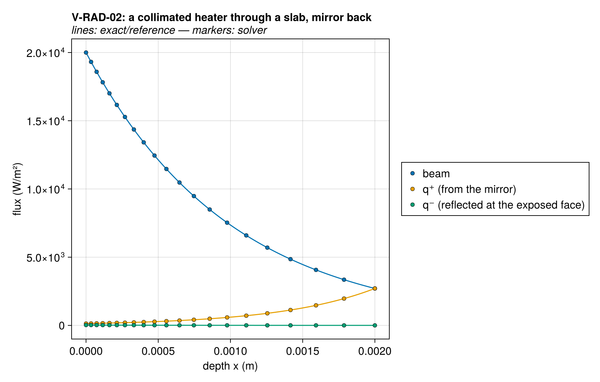
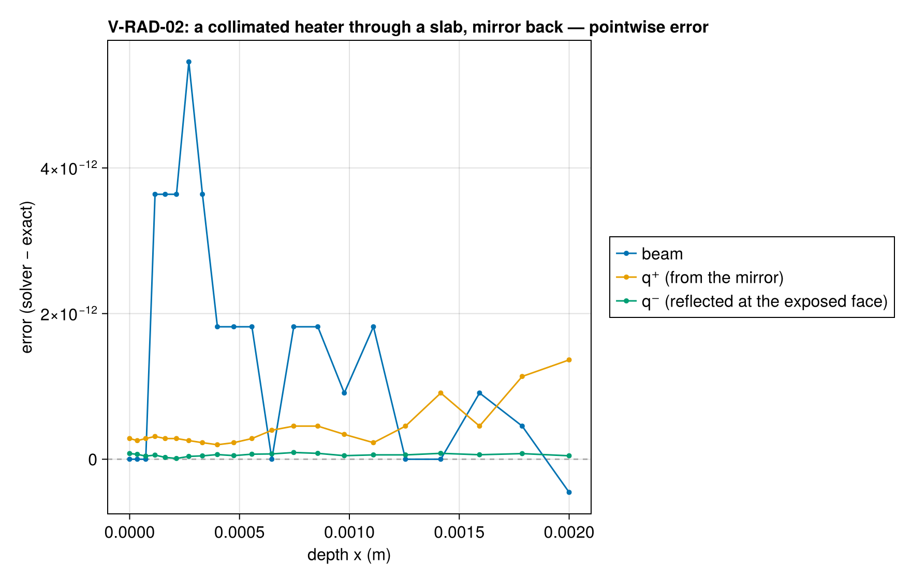
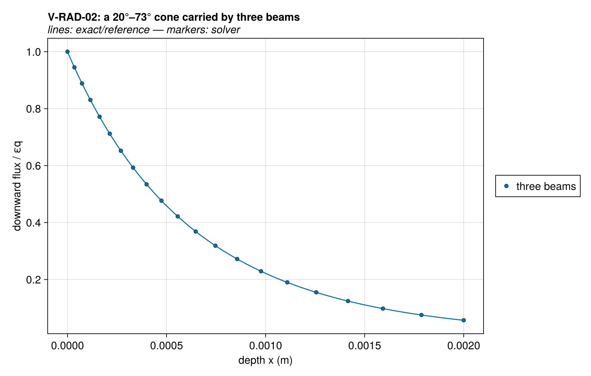
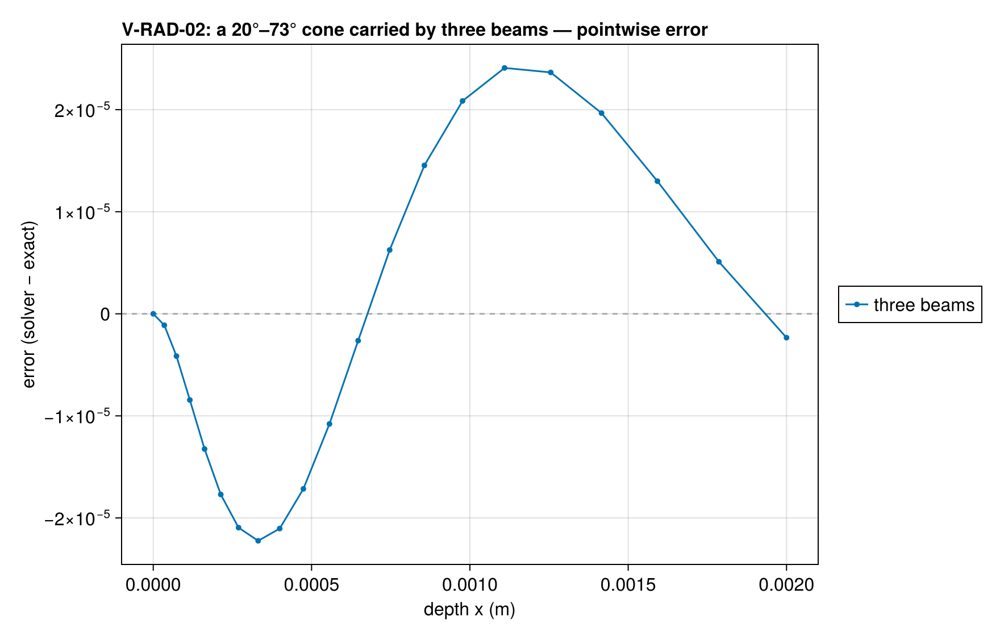

# V-RAD-02 — a heater through a gray slab (radiation rows)

**Tags:** `radiation`, `radiative_transfer`, `closed_form`

**References:**

- exact/two_stream.jl (closed forms of the rows, self-tested)
- exact/gray_slab.jl (exact transfer; the cone in closed form)
- Modest & Mazumder, Radiative Heat Transfer, 4th ed., §13.3 and §14.3

## Problem statement

The radiation a heater sends through a gray slab of optical thickness
τ_L = 2 on a graded mesh, with the exposed face's transmissivity ε = 0.8,
behind it a mirror (an adiabatic back) or an open gray back facing its
surroundings (`RadiativeBC` on `:bottom`). The answer is the solver's
consistent start: `setup` solves the radiation rows for the initial state,
and nothing is integrated in time.

The heater's own field is found by superposition: the rows are linear in
the fluxes for given temperatures, so the solve with the heater minus the
solve without it, at the same uniform 300 K, is the field the heater alone
sends through a cold slab (the solver cannot hold a cell at 0 K). With no
component absorptivity, every heater enters at the interface's ε.

- Collimated: the beam e^{−τ} at every face, and the thermal field the back
  reflects into q⁺ (1 − ε_b of the arriving beam) and the exposed face
  reflects down, in closed form (`two_stream_beam_slab`).
- Diffuse: the closed form of the rows for a slab of no emission
  (`two_stream_isothermal_slab` with B = 0).
- A cone between 20° and 73°, carried by three beams at the Gauss–Legendre
  nodes of its direction cosine: each beam is exactly e^{−τ/μ_h} of its
  share, their sum is within 2×10⁻⁴ of the exact downward cone
  (`gray_slab_cone_transmission`, black faces), and the whole field with
  the beams converted at the back agrees with `two_stream_solve`.

Every flux is compared at every face, as a fraction of the entering εq.
Reported beside, not asserted: how far the collimated field behind a mirror
is from exact radiative transfer with a specular mirror (`gray_slab_exact`),
the distance the conversion at the back and the two-stream closure make.

### Quantities of interest (n = 20)

| QoI | value | exact | error | tolerance | within tol | provenance |
| --- | --- | --- | --- | --- | --- | --- |
| collimated heater, mirror back: every face against the closed form | 2.728e-16 | — | 2.728e-16 | 1e-12 | yes | largest difference of q⁻, q⁺, the beams and the crossing fluxes, over εq |
| collimated heater, open back: every face against the closed form | 2.728e-16 | — | 2.728e-16 | 1e-12 | yes | largest difference of q⁻, q⁺, the beams and the crossing fluxes, over εq |
| diffuse heater, mirror back: every face against the closed form | 2.728e-16 | — | 2.728e-16 | 1e-12 | yes | largest difference of q⁻, q⁺, the beams and the crossing fluxes, over εq |
| diffuse heater, open back: every face against the closed form | 3.638e-16 | — | 3.638e-16 | 1e-12 | yes | largest difference of q⁻, q⁺, the beams and the crossing fluxes, over εq |
| cone heater, mirror back: every face against the closed form | 9.095e-17 | — | 9.095e-17 | 1e-12 | yes | largest difference of q⁻, q⁺, the beams and the crossing fluxes, over εq |
| cone heater, open back: every face against the closed form | 9.37e-17 | — | 9.37e-17 | 1e-12 | yes | largest difference of q⁻, q⁺, the beams and the crossing fluxes, over εq |
| cone heater: three beams against the exact downward cone | 2.409e-05 | — | 2.409e-05 | 0.0002 | yes | quadrature of the cone in three directions |
| cone heater, mirror back: the field against two_stream_solve | 4.547e-17 | — | 4.547e-17 | 1e-12 | yes | the beams reaching the mirror join q⁺ |
| collimated heater, mirror back: flux leaving the exposed face against exact transfer | 0.009313 | — | 0.009313 | Inf | yes | reported: the two-stream closure and the conversion at the back, against a specular mirror |
| collimated heater, mirror back: L1 of the cell sources against exact transfer | 0.02939 | — | 0.02939 | Inf | yes | reported: the two-stream closure and the conversion at the back, against a specular mirror |

### Solver configuration

| setting | value |
| --- | --- |
| integrator | Rodas5P (default) |
