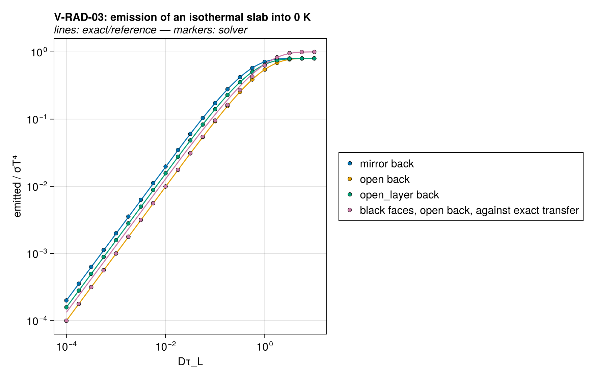
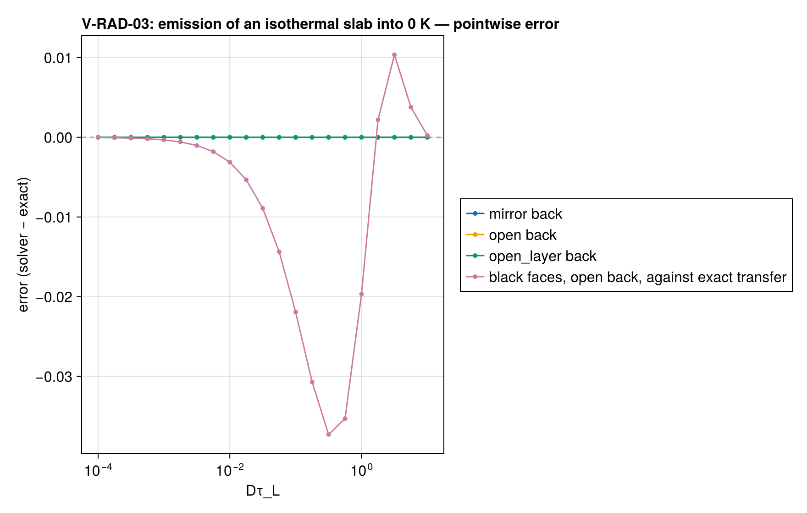

# V-RAD-03 — an isothermal slab emitting to 0 K (radiation rows)

**Tags:** `radiation`, `radiative_transfer`, `closed_form`

**References:**

- exact/two_stream.jl (closed forms of the rows, self-tested)
- exact/gray_slab.jl (exact transfer with black faces)
- Modest & Mazumder, Radiative Heat Transfer, 4th ed., §14.3

## Problem statement

A gray slab 1 mm thick at a uniform 900 K with the exposed face's
transmissivity ε = 0.8 faces surroundings at 0 K (a diffuse incoming flux of
zero) and loses its emission through that face. Behind it:

- a mirror (an adiabatic back): εB(1 − t²)/(1 − (1 − ε)t²);
- an open back of the same material, facing 0 K:
  εB(1 − t)/(1 − (1 − ε)t);
- an open back whose last cell is another material, of the same absorption
  coefficient and emissivity ε_l = 0.3:
  εB(1 − t)(1 + (1 − ε_l)t)/(1 − (1 − ε)(1 − ε_l)t²);

with t = e^{−Dτ_L} and D = 3/2 (`two_stream_slab_emission`). The rows are
exact across each cell at any optical thickness, so every face flux
(`two_stream_isothermal_slab` gives the four face values, and each face is
B + (q − B)e^{−Dτ} of them) is independent of the mesh: uniform, graded and
irregular meshes of 16 cells, Dτ_L from 10⁻⁴ to 10. The answer is the
solver's consistent start; nothing is integrated in time.

Reported beside, not asserted: the two-stream's thin-slab deficit. With
black faces and an open back the slab emits B(1 − e^{−Dτ_L}) against the
exact B(1 − 2E₃(τ_L)), 25 % low as τ_L → 0 (Dτ against 2τ) and exact as
the slab becomes opaque.

### Quantities of interest (n = 16)

| QoI | value | exact | error | tolerance | within tol | provenance |
| --- | --- | --- | --- | --- | --- | --- |
| mirror back, uniform mesh: every face against the closed form | 3.129e-15 | — | 3.129e-15 | 1e-12 | yes | largest over Dτ_L = 1e-4 … 10, as a fraction of B |
| mirror back, graded mesh: every face against the closed form | 1.369e-15 | — | 1.369e-15 | 1e-12 | yes | largest over Dτ_L = 1e-4 … 10, as a fraction of B |
| mirror back, irregular mesh: every face against the closed form | 6.356e-16 | — | 6.356e-16 | 1e-12 | yes | largest over Dτ_L = 1e-4 … 10, as a fraction of B |
| open back, uniform mesh: every face against the closed form | 1.173e-15 | — | 1.173e-15 | 1e-12 | yes | largest over Dτ_L = 1e-4 … 10, as a fraction of B |
| open back, graded mesh: every face against the closed form | 9.779e-16 | — | 9.779e-16 | 1e-12 | yes | largest over Dτ_L = 1e-4 … 10, as a fraction of B |
| open back, irregular mesh: every face against the closed form | 7.823e-16 | — | 7.823e-16 | 1e-12 | yes | largest over Dτ_L = 1e-4 … 10, as a fraction of B |
| open_layer back, uniform mesh: every face against the closed form | 1.565e-15 | — | 1.565e-15 | 1e-12 | yes | largest over Dτ_L = 1e-4 … 10, as a fraction of B |
| open_layer back, graded mesh: every face against the closed form | 5.867e-16 | — | 5.867e-16 | 1e-12 | yes | largest over Dτ_L = 1e-4 … 10, as a fraction of B |
| open_layer back, irregular mesh: every face against the closed form | 7.823e-16 | — | 7.823e-16 | 1e-12 | yes | largest over Dτ_L = 1e-4 … 10, as a fraction of B |
| black faces, Dτ_L = 0.0001: two-stream emission over exact | 0.7502 | 1 | 0.2498 | Inf | yes | reported: B(1 − e^{−Dτ_L}) against B(1 − 2E₃(τ_L)) |
| black faces, Dτ_L = 0.01: two-stream emission over exact | 0.7613 | 1 | 0.2387 | Inf | yes | reported: B(1 − e^{−Dτ_L}) against B(1 − 2E₃(τ_L)) |
| black faces, Dτ_L = 0.3: two-stream emission over exact | 0.8753 | 1 | 0.1247 | Inf | yes | reported: B(1 − e^{−Dτ_L}) against B(1 − 2E₃(τ_L)) |
| black faces, Dτ_L = 1.0: two-stream emission over exact | 0.9698 | 1 | 0.03018 | Inf | yes | reported: B(1 − e^{−Dτ_L}) against B(1 − 2E₃(τ_L)) |
| black faces, Dτ_L = 10.0: two-stream emission over exact | 1 | 1 | 0.0002256 | Inf | yes | reported: B(1 − e^{−Dτ_L}) against B(1 − 2E₃(τ_L)) |

### Solver configuration

| setting | value |
| --- | --- |
| integrator | Rodas5P (default) |
