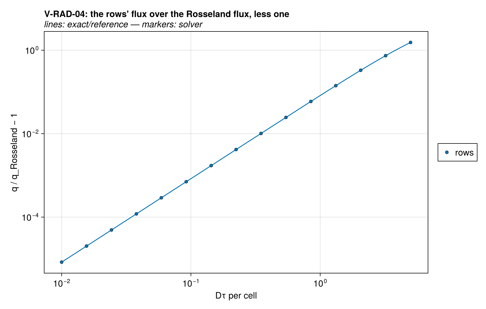
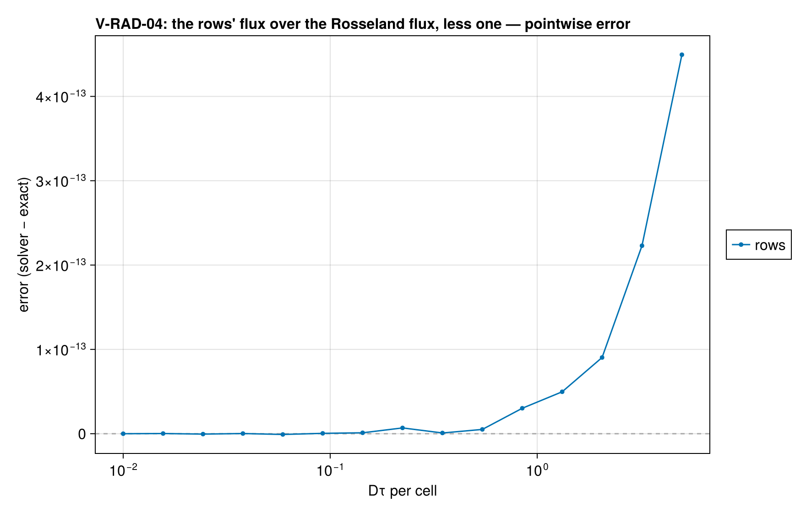

# V-RAD-04 — a linear emissive power (radiation rows)

**Tags:** `radiation`, `radiative_transfer`, `closed_form`

**References:**

- exact/two_stream.jl (`two_stream_linear_flux`, self-tested)
- Modest & Mazumder, Radiative Heat Transfer, 4th ed., §15.6 (Rosseland)

## Problem statement

A black slab (ε = 1 at both faces, 40 equal cells) whose emissive power
σT⁴ falls by g = 50 W/m² per cell into the depth, 2×10⁴ − g W/m² in the
exposed cell (T between 751 and 770 K). Diffuse fluxes arrive on both faces
at the values of the rows' particular solution, q± = B ∓ const, so every
face carries the net flux

  q⁻ − q⁺ = g·coth(Dτ/2),   D = 3/2, τ the cell's optical thickness

(`two_stream_linear_flux`), at any τ: the rows are exact across a cell. The
answer is the solver's consistent start; nothing is integrated in time.

Reported beside, not asserted: the approach to the Rosseland flux. The
continuous two-stream carries −(2/(Dκ))dB/dx, which at D = 3/2 is the
diffusion limit; per cell of Dτ = x the rows carry (x/2)coth(x/2) of it,
1 + x²/12 for small x. An optically thick cell therefore adds a spurious
radiative conductivity (×2.53 at Dτ = 5 per cell).

### Quantities of interest (n = 40)

| QoI | value | exact | error | tolerance | within tol | provenance |
| --- | --- | --- | --- | --- | --- | --- |
| Dτ = 0.01 per cell: the net flux at every face | 9.095e-17 | — | 9.095e-17 | 1e-12 | yes | g·coth(Dτ/2), as a fraction of the largest emissive power |
| Dτ = 0.1 per cell: the net flux at every face | 2.274e-17 | — | 2.274e-17 | 1e-12 | yes | g·coth(Dτ/2), as a fraction of the largest emissive power |
| Dτ = 1.0 per cell: the net flux at every face | 4.057e-16 | — | 4.057e-16 | 1e-12 | yes | g·coth(Dτ/2), as a fraction of the largest emissive power |
| Dτ = 5.0 per cell: the net flux at every face | 4.604e-16 | — | 4.604e-16 | 1e-12 | yes | g·coth(Dτ/2), as a fraction of the largest emissive power |
| Dτ = 0.01 per cell: the flux over Rosseland's, less one | 8.333e-06 | 8.333e-06 | 2.22e-16 | Inf | yes | reported: (x/2)coth(x/2) − 1, against x²/12 for small x |
| Dτ = 0.1 per cell: the flux over Rosseland's, less one | 0.0008332 | 0.0008333 | 4.441e-16 | Inf | yes | reported: (x/2)coth(x/2) − 1, against x²/12 for small x |
| Dτ = 1.0 per cell: the flux over Rosseland's, less one | 0.08198 | 0.08333 | 2.798e-14 | Inf | yes | reported: (x/2)coth(x/2) − 1, against x²/12 for small x |
| Dτ = 5.0 per cell: the flux over Rosseland's, less one | 1.534 | 2.083 | 4.49e-13 | Inf | yes | reported: (x/2)coth(x/2) − 1, against x²/12 for small x |

### Solver configuration

| setting | value |
| --- | --- |
| integrator | Rodas5P (default) |
