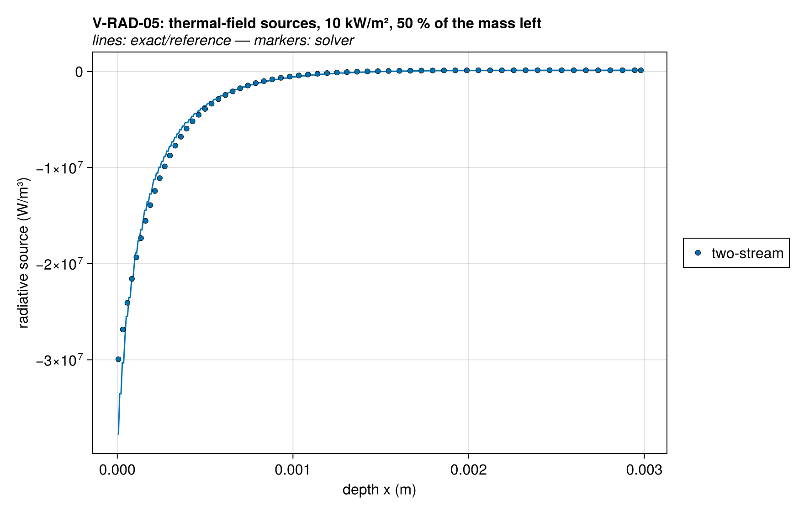
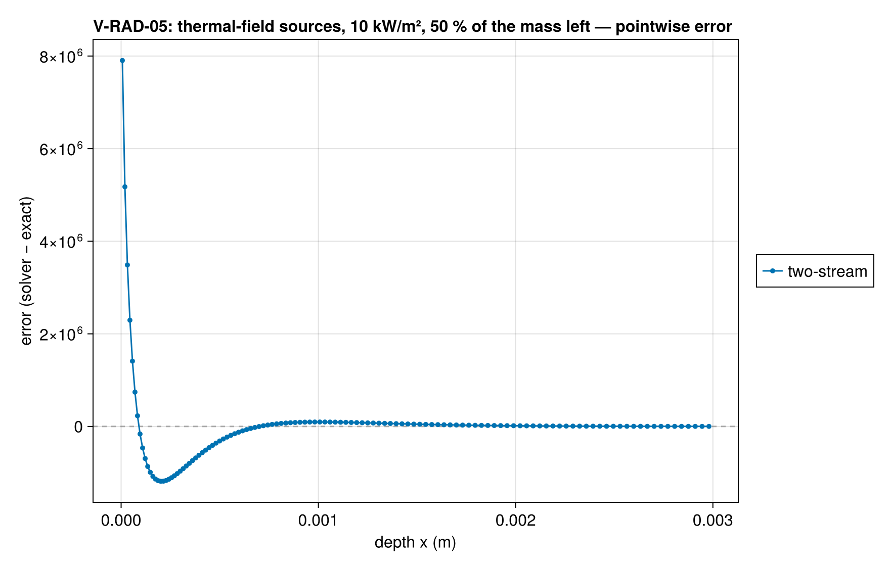
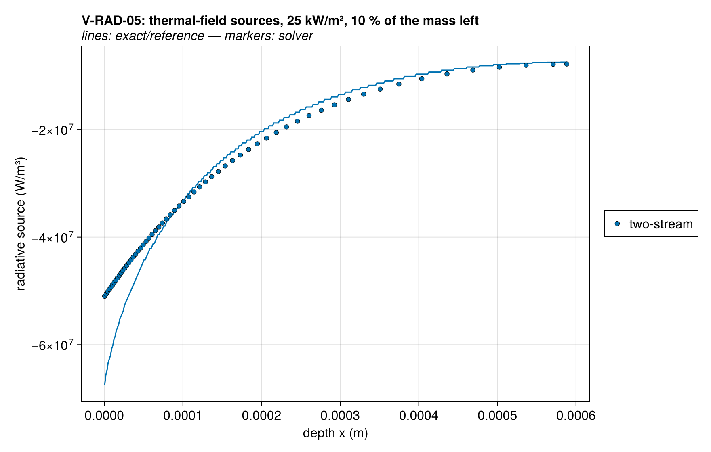
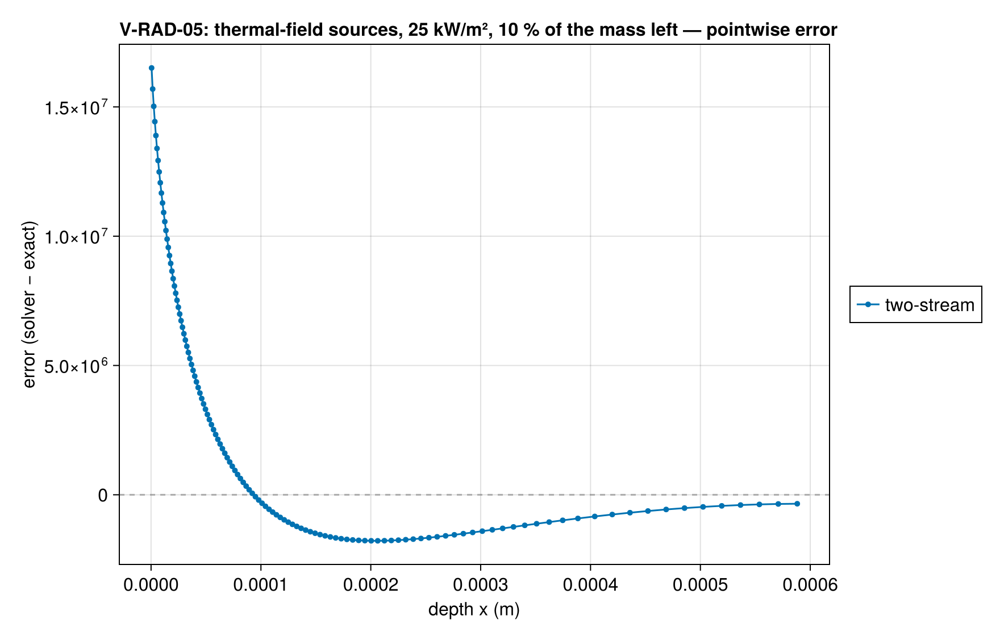

# V-RAD-05 — the two-stream against exact transfer on burning profiles

**Tags:** `radiation`, `radiative_transfer`, `model_error`

**References:**

- exact/gray_slab.jl (exact gray transfer, self-tested)
- reference/radiation/vrad05_profiles.jl (the frames)
- MaCFP matl-db, PMMA/Material_Properties/2021/MaCFP_PMMA_GIDAZE+.json

## Problem statement

The gray two-stream (D = 3/2) is a closure: it carries the hemispherical
fluxes as if the intensity were isotropic in each hemisphere. This case
measures what that costs on the temperature and absorption profiles of a
burning PMMA sample, against exact gray radiative transfer
(`gray_slab_exact`: the transfer equation of a non-scattering gray medium
solved per direction, with the same staircase emission and specular faces).

The profiles are frames of the solver's own runs (the MaCFP-2 PMMA
gasification target with the GIDAZE+ property set: 6 mm, 20 cells/mm, a
collimated heater of 10 or 25 kW/m², surroundings at 293 K, no convection,
a mirror back, moving mesh, deactivation) when 50 % and 10 % of the PMMA
mass is left; reference/radiation/vrad05_profiles.jl writes them. The case
rebuilds each frame as a deck, takes the radiation of its consistent start
(nothing is integrated in time), and compares, as fractions of the
heater's εq:

- the thermal field alone (the solve without the heater: emission, the
  surroundings, reflection at the faces): the flux leaving the exposed
  face, the L1 difference of the cell sources over the top 0.5 mm, and the
  exposed cell's source;
- the whole field with the heater: the flux leaving and the L1 difference
  of the sources over the whole sample. The beams themselves are exact; the
  difference adds the conversion at the mirror (the beam reaching the back
  travels on as diffuse);
- the whole field with the same heater diffuse, the default distribution:
  the same two measures. The two-stream attenuates diffuse incidence as
  e^{−Dτ} where exact transfer gives 2E₃(τ): it transmits 3 % more through
  an optical depth of 0.1 and 38 % less through one of 3.

The values are the model's error, not a discretization error: they are
pinned at 3× the observed as a regression. The exposed cell's two-stream
source is about three quarters of the exact one (the thin-layer limit, Dτ
against 2τ). The rebuilt frames are checked against their files: the
solver's absorption coefficient is ξα of the stored PMMA concentration and
the exposed cell's emissivity PMMA's 0.96.

GIDAZE+ (MaCFP matl-db, PMMA/Material_Properties/2021/MaCFP_PMMA_GIDAZE+.json):
ρ = 1210 kg/m³, ε = 0.96, κ = 2870 m⁻¹, k = 0.2(T/300)^−1.2 W/m·K,
c = 1200(T/300)^1.2 J/kg·K, PMMA → MMA first order with A = 2×10⁸ s⁻¹,
E = 130 kJ/mol, ΔH = 540 kJ/kg; the gas carries no heat capacity.

### Quantities of interest (n = 1)

| QoI | value | exact | error | tolerance | within tol | provenance |
| --- | --- | --- | --- | --- | --- | --- |
| 10 kW/m², 50 % left: the rebuilt frame's κ and exposed ε | 0 | — | 0 | 1e-12 | yes | κ = ξα of the stored PMMA concentration; ε of PMMA |
| 10 kW/m², 50 % left, thermal field: flux leaving | 0.0003975 | — | 0.0003975 | 0.001194 | yes | two-stream against exact transfer, over εq; exposed-cell source ratio 0.791 |
| 10 kW/m², 50 % left, thermal field: L1 of the sources, top 0.5 mm | 0.06259 | — | 0.06259 | 0.1878 | yes | two-stream against exact transfer, over εq; exposed-cell source ratio 0.791 |
| 10 kW/m², 50 % left, thermal field: the exposed cell's source | 0.0105 | — | 0.0105 | 0.0315 | yes | two-stream against exact transfer, over εq; exposed-cell source ratio 0.791 |
| 10 kW/m², 50 % left, with the heater: flux leaving | 0.0003975 | — | 0.0003975 | 0.001194 | yes | two-stream with conversion at the mirror against exact transfer, over εq |
| 10 kW/m², 50 % left, with the heater: L1 of the sources | 0.07317 | — | 0.07317 | 0.2196 | yes | two-stream with conversion at the mirror against exact transfer, over εq |
| 10 kW/m², 50 % left, with a diffuse heater: flux leaving | 0.0003975 | — | 0.0003975 | 0.001194 | yes | two-stream, the heater attenuated as e^{−Dτ}, against exact transfer, over εq |
| 10 kW/m², 50 % left, with a diffuse heater: L1 of the sources | 0.02374 | — | 0.02374 | 0.0711 | yes | two-stream, the heater attenuated as e^{−Dτ}, against exact transfer, over εq |
| 10 kW/m², 10 % left: the rebuilt frame's κ and exposed ε | 0 | — | 0 | 1e-12 | yes | κ = ξα of the stored PMMA concentration; ε of PMMA |
| 10 kW/m², 10 % left, thermal field: flux leaving | 0.004432 | — | 0.004432 | 0.01329 | yes | two-stream against exact transfer, over εq; exposed-cell source ratio 0.766 |
| 10 kW/m², 10 % left, thermal field: L1 of the sources, top 0.5 mm | 0.06754 | — | 0.06754 | 0.2028 | yes | two-stream against exact transfer, over εq; exposed-cell source ratio 0.766 |
| 10 kW/m², 10 % left, thermal field: the exposed cell's source | 0.004883 | — | 0.004883 | 0.01467 | yes | two-stream against exact transfer, over εq; exposed-cell source ratio 0.766 |
| 10 kW/m², 10 % left, with the heater: flux leaving | 0.01345 | — | 0.01345 | 0.0405 | yes | two-stream with conversion at the mirror against exact transfer, over εq |
| 10 kW/m², 10 % left, with the heater: L1 of the sources | 0.0811 | — | 0.0811 | 0.2433 | yes | two-stream with conversion at the mirror against exact transfer, over εq |
| 10 kW/m², 10 % left, with a diffuse heater: flux leaving | 0.0002748 | — | 0.0002748 | 0.000825 | yes | two-stream, the heater attenuated as e^{−Dτ}, against exact transfer, over εq |
| 10 kW/m², 10 % left, with a diffuse heater: L1 of the sources | 0.0124 | — | 0.0124 | 0.0372 | yes | two-stream, the heater attenuated as e^{−Dτ}, against exact transfer, over εq |
| 25 kW/m², 50 % left: the rebuilt frame's κ and exposed ε | 0 | — | 0 | 1e-12 | yes | κ = ξα of the stored PMMA concentration; ε of PMMA |
| 25 kW/m², 50 % left, thermal field: flux leaving | 0.0003937 | — | 0.0003937 | 0.001182 | yes | two-stream against exact transfer, over εq; exposed-cell source ratio 0.773 |
| 25 kW/m², 50 % left, thermal field: L1 of the sources, top 0.5 mm | 0.03869 | — | 0.03869 | 0.1161 | yes | two-stream against exact transfer, over εq; exposed-cell source ratio 0.773 |
| 25 kW/m², 50 % left, thermal field: the exposed cell's source | 0.002235 | — | 0.002235 | 0.00672 | yes | two-stream against exact transfer, over εq; exposed-cell source ratio 0.773 |
| 25 kW/m², 50 % left, with the heater: flux leaving | 0.0003936 | — | 0.0003936 | 0.001182 | yes | two-stream with conversion at the mirror against exact transfer, over εq |
| 25 kW/m², 50 % left, with the heater: L1 of the sources | 0.04567 | — | 0.04567 | 0.1371 | yes | two-stream with conversion at the mirror against exact transfer, over εq |
| 25 kW/m², 50 % left, with a diffuse heater: flux leaving | 0.0003937 | — | 0.0003937 | 0.001182 | yes | two-stream, the heater attenuated as e^{−Dτ}, against exact transfer, over εq |
| 25 kW/m², 50 % left, with a diffuse heater: L1 of the sources | 0.05119 | — | 0.05119 | 0.1536 | yes | two-stream, the heater attenuated as e^{−Dτ}, against exact transfer, over εq |
| 25 kW/m², 10 % left: the rebuilt frame's κ and exposed ε | 0 | — | 0 | 1e-12 | yes | κ = ξα of the stored PMMA concentration; ε of PMMA |
| 25 kW/m², 10 % left, thermal field: flux leaving | 0.002299 | — | 0.002299 | 0.0069 | yes | two-stream against exact transfer, over εq; exposed-cell source ratio 0.755 |
| 25 kW/m², 10 % left, thermal field: L1 of the sources, top 0.5 mm | 0.0393 | — | 0.0393 | 0.1179 | yes | two-stream against exact transfer, over εq; exposed-cell source ratio 0.755 |
| 25 kW/m², 10 % left, thermal field: the exposed cell's source | 0.0006726 | — | 0.0006726 | 0.002019 | yes | two-stream against exact transfer, over εq; exposed-cell source ratio 0.755 |
| 25 kW/m², 10 % left, with the heater: flux leaving | 0.0157 | — | 0.0157 | 0.0474 | yes | two-stream with conversion at the mirror against exact transfer, over εq |
| 25 kW/m², 10 % left, with the heater: L1 of the sources | 0.05816 | — | 0.05816 | 0.1746 | yes | two-stream with conversion at the mirror against exact transfer, over εq |
| 25 kW/m², 10 % left, with a diffuse heater: flux leaving | 0.002438 | — | 0.002438 | 0.00732 | yes | two-stream, the heater attenuated as e^{−Dτ}, against exact transfer, over εq |
| 25 kW/m², 10 % left, with a diffuse heater: L1 of the sources | 0.04222 | — | 0.04222 | 0.1266 | yes | two-stream, the heater attenuated as e^{−Dτ}, against exact transfer, over εq |

### Solver configuration

| setting | value |
| --- | --- |
| integrator | Rodas5P (default) |
