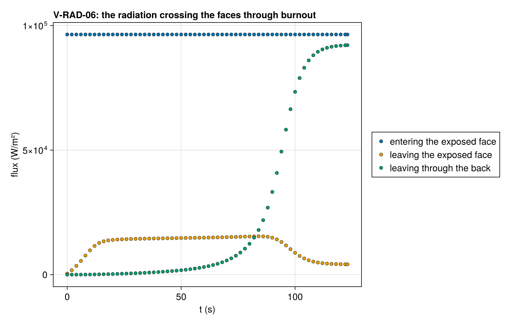

# V-RAD-06 — the radiative energy ledger through burnout

**Tags:** `radiation`, `radiative_transfer`, `burnout`, `conservation`

**References:**

- the rows' telescoping identity (exact at any state)
- conservation_audit with a ConservationRecorder (the live region's ledger)

## Problem statement

A 4 mm GIDAZE+ PMMA sample (V-RAD-05's deck, 40 cells, moving mesh) burns
out completely under a collimated heater of 100 kW/m², facing surroundings
at 293 K through its exposed face and through an open back (a `RadiativeBC`
on `:bottom`), so radiation leaves through both faces. The heater is
absorbed in depth and the sample pyrolyses through its volume, so its cells
empty together, in three deactivation invocations between 86 and 123 s,
and the exposed face, with the radiation rows' boundary, moves down through
the sample until none is left. The pore gas runs under a pressure tolerance
of 1e-3: without it the gas the emptying cells release closes the mass
ledger to 1e-4 instead of 1e-9.

At every accepted step, through every deactivation event:

- the radiation crossing the faces balances what the cells absorb: what
  enters through the exposed face (`radiation_absorbed`), less what leaves
  through it (`radiation_emitted`) and through the back (`radiation_back`),
  equals the summed radiative sources of the live cells per unit area, to
  round-off (an identity of the rows at any state);
- what enters is the heater and the surroundings at the interface's
  transmissivity, ε(q + σT∞⁴), ε = 0.96 of PMMA, whichever cell is exposed;
- the live region's energy and mass close (`ConservationRecorder`,
  `conservation_audit`): the change of the inventories equals what entered
  less what the events took out, at the solve's tolerance.

Reported beside: the radiation absorbed, emitted and lost through the back
over the burn [J/m²].

### Quantities of interest (n = 40)

| QoI | value | exact | error | tolerance | within tol | provenance |
| --- | --- | --- | --- | --- | --- | --- |
| the sample burns out, every cell deactivated | 40 | 40 | 0 | 0.5 | yes | outcome burned_out, 40 events |
| radiation crossing the faces against the cells' sources, every accepted step | 6.063e-16 | — | 6.063e-16 | 1e-12 | yes | absorbed − emitted − back against Σ S_rad / A over 1745 states, over εq |
| radiation entering, every accepted step | 0 | — | 0 | 1e-12 | yes | ε(q + σT∞⁴) through whichever cell is exposed, over εq |
| energy closure of the live region | 7.563e-08 | — | 7.563e-08 | 2.3e-07 | yes | change − inflow + lost over the largest of them; inflow 30700.0 J |
| mass closure of the live region | 1.521e-09 | — | 1.521e-09 | 4.6e-09 | yes | lost 0.00121 kg of 4.84 kg |
| radiation absorbed over the burn [J/m²] | 1.185e+07 | — | 0 | Inf | yes | reported |
| radiation emitted through the exposed face over the burn [J/m²] | 1.451e+06 | — | 0 | Inf | yes | reported |
| radiation leaving through the back over the burn [J/m²] | 2.941e+06 | — | 0 | Inf | yes | reported |

### Solver configuration

| setting | value |
| --- | --- |
| integrator | Rodas5P (default) |
| abstol | 1.0e-8 |
| reltol | 1.0e-6 |
| radiation_model | RADIATIVE_TRANSFER |
| use_ale | true |
| deactivation | true |
| pressure_tolerance | 0.001 |
