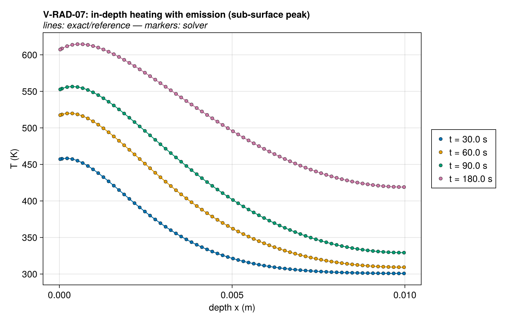
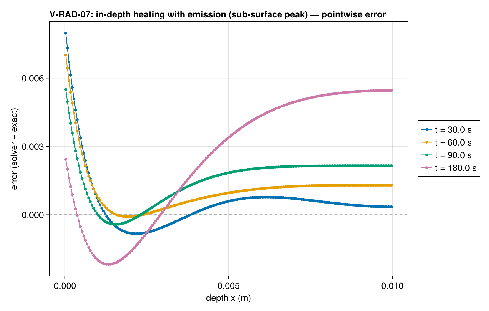
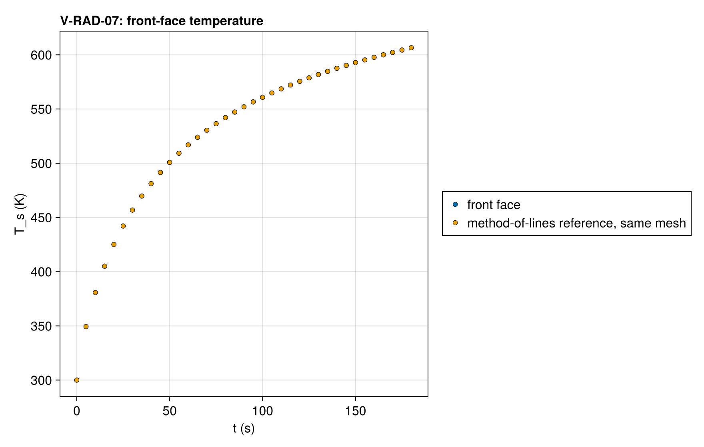
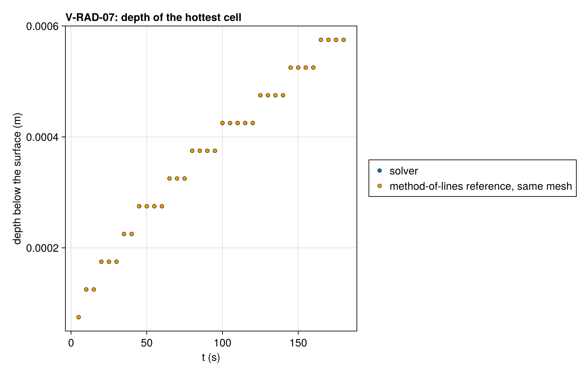
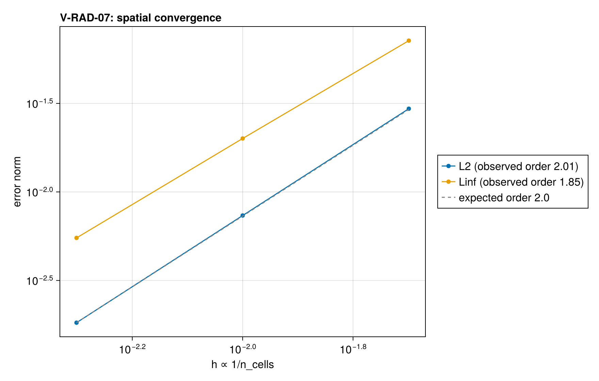

# V-RAD-07 — in-depth heating with emission (sub-surface peak)

**Tags:** `radiation`, `radiative_transfer`, `convective_bc`, `coupled`

**References:**

- reference/radiation/vrad07_reference.jl (independent method of lines)
- exact/two_stream.jl (the radiation rows, self-tested)
- Lautenberger dissertation (2007) §3.4.2 (the slab, without emission)

## Problem statement

A gray slab (δ = 1 cm, κ = 1000 m⁻¹ so κδ = 10, ρ = 1000 kg/m³,
c = 1400 J/kg·K, k = 0.2 W/m·K, ε = 1) at T₀ = 300 K under a collimated
heater of 25 kW/m², facing surroundings at T₀ through its exposed face and
losing heat there by convection (h = 20 W/m²·K to T₀); the back is
adiabatic and reflects all radiation (a mirror). The heater is absorbed in
depth as e^{−κx}, every cell emits σT⁴ and absorbs what the others emit,
and the exposed face both cools by convection and lets the slab's emission
out, so the temperature peaks below the surface: 8 K above the surface
temperature at 180 s, 0.6 mm deep, and deepening with time.

Reference: the same discretization solved by an independent method of
lines (reference/radiation/vrad07_reference.jl, which does not use the
package): the radiation rows of exact/two_stream.jl eliminated at every
evaluation, so the reference is an ordinary differential system in the
cell temperatures, integrated by Kvaerno5 at reltol 1e-12 (its distance to
FBDF at the same tolerance is at most 2.5e-7 K). On the same mesh the two
differ only by the time integration. The order is measured against the
reference's 1600-cell solution, interpolated to the cell centres.

The exposed face is black (ε = 1), so its transmissivity is one both ways:
the heater enters whole and the slab's emission leaves whole. Under
radiative transfer the surface balance holds convection only; the
radiation is in the cells' sources.

### Quantities of interest (n = 200)

| QoI | value | exact | error | tolerance | within tol | provenance |
| --- | --- | --- | --- | --- | --- | --- |
| L∞ T against the reference, t=30.0 s | 8.17e-09 | — | 8.17e-09 | 1.2e-06 | yes | same mesh: the two differ by the time integration only |
| L∞ T against the reference, t=60.0 s | 3.85e-08 | — | 3.85e-08 | 1.2e-06 | yes | same mesh: the two differ by the time integration only |
| L∞ T against the reference, t=90.0 s | 3.937e-08 | — | 3.937e-08 | 1.2e-06 | yes | same mesh: the two differ by the time integration only |
| L∞ T against the reference, t=180.0 s | 4.698e-09 | — | 4.698e-09 | 1.2e-06 | yes | same mesh: the two differ by the time integration only |
| front-face temperature, t=30.0 s | 456.8 | 456.8 | 8.151e-09 | 1.2e-06 | yes | the surface balance holds convection only |
| front-face temperature, t=60.0 s | 516.9 | 516.9 | 3.84e-08 | 1.2e-06 | yes | the surface balance holds convection only |
| front-face temperature, t=90.0 s | 552 | 552 | 3.341e-08 | 1.2e-06 | yes | the surface balance holds convection only |
| front-face temperature, t=180.0 s | 606.5 | 606.5 | 4.667e-09 | 1.2e-06 | yes | the surface balance holds convection only |
| sub-surface peak value, t=90 s | 556.5 | 556.5 | 3.525e-08 | 1.2e-06 | yes | the coupled marker: in-depth absorption against surface loss and emission |
| peak cell equals the reference's at every save | 0 | — | 0 | 0.5 | yes | number of saves (5 to 180 s) where the hottest cell differs |
| peak below the exposed cell from 10 s | 0 | — | 0 | 0.5 | yes | number of saves from 10 s where the exposed cell is the hottest |

### Convergence

| n_cells | h | wall (s) | L2 | Linf |
| --- | --- | --- | --- | --- |
| 50 | 0.02 | 0.01183 | 0.02951 | 0.07153 |
| 100 | 0.01 | 0.02231 | 0.007359 | 0.02004 |
| 200 | 0.005 | 0.04351 | 0.001826 | 0.005501 |

Wall time: median of up to five warm runs of problem construction and solve on one pinned core, after a discarded compiling run.

Observed order 2.007 (L2), expected 2.0.

### Solver configuration

| setting | value |
| --- | --- |
| integrator | Rodas5P (default) |
| abstol | 1.0e-12 |
| reltol | 1.0e-10 |
| radiation_model | RADIATIVE_TRANSFER |
