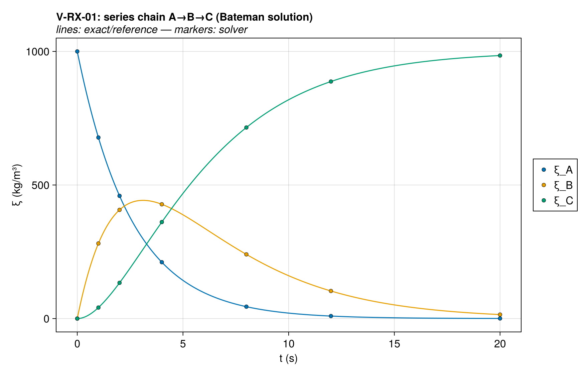
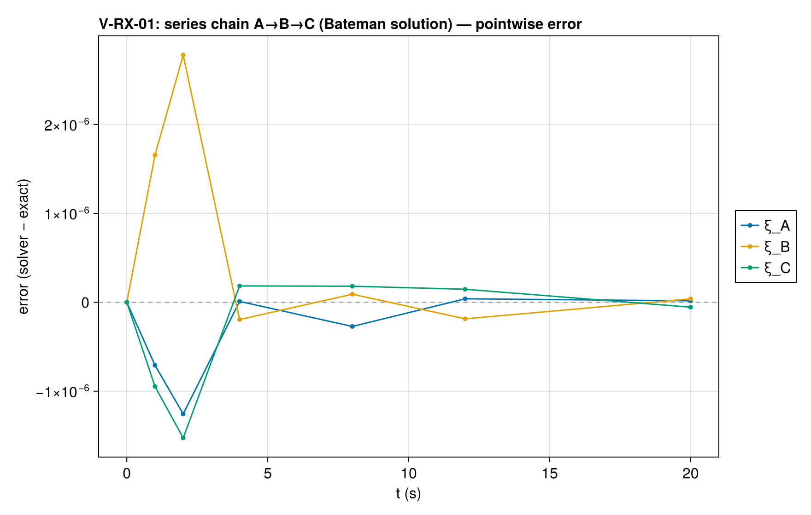
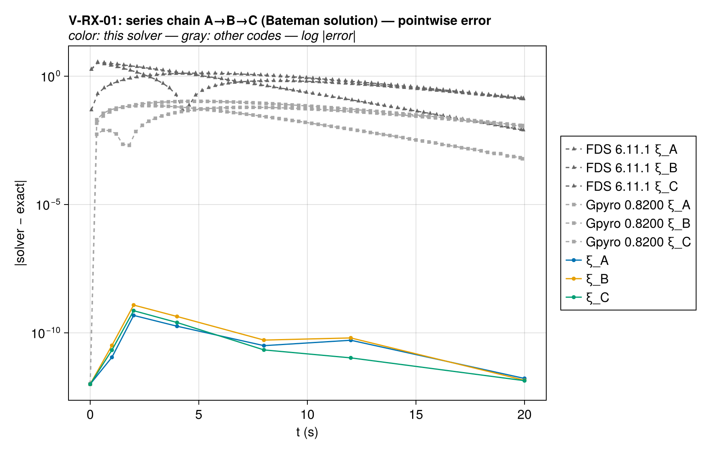
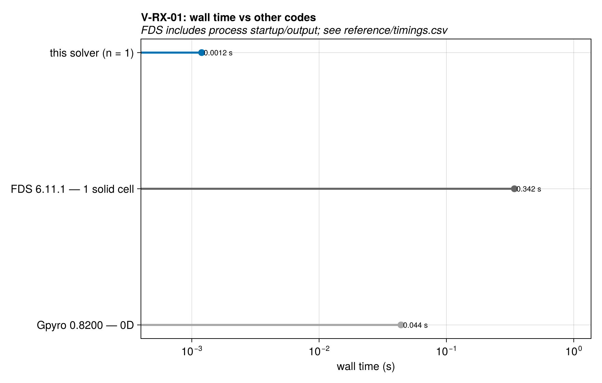

# V-RX-01 — two-step series chain A→B→C, isothermal

**Tags:** `kinetics`, `multi_step`, `isothermal`

**References:**

- FDS Verification Guide `two_step_solid_reaction`
- Lautenberger dissertation (2007) §3.4.4

## Problem statement

Identical problem in FDS (`two_step_solid_reaction`) and Gpyro §3.4.4:
constant rates k₁ = 0.389 s⁻¹, k₂ = 0.262 s⁻¹ (published values, so numbers
are cross-checkable against both codes), isothermal, exact Bateman solution
in exact/kinetics.jl.

Exercises multi-step reaction coupling: intermediate B is produced by
reaction 1 and consumed by reaction 2 SIMULTANEOUSLY (the existing
isothermal test is single-step).

Setup notes (solver conventions that would corrupt the case):
- constant rates realized as E = 0 (rate = A exactly, independent of T, so
  the Dirichlet-pinned temperature field cannot perturb the kinetics);
- depletion limiter DISABLED (tanh roll-off below ~1 kg/m³ would distort
  the late decay: ξ_A < 1 kg/m³ for t > ln(ξ₀)/k₁ ≈ 17.8 s);
- temperature gates left at defaults (fully open);
- h = 0 on both reactions keeps the single cell exactly isothermal.

### Quantities of interest (n = 1)

| QoI | value | exact | error | tolerance | within tol | provenance |
| --- | --- | --- | --- | --- | --- | --- |
| max relative ξ_A error | 4.773e-13 | — | 4.773e-13 | 1e-08 | yes | Bateman solution, k₁=0.389, k₂=0.262 (FDS/Gpyro values) |
| max relative ξ_B error | 1.207e-12 | — | 1.207e-12 | 1e-08 | yes | Bateman solution, k₁=0.389, k₂=0.262 (FDS/Gpyro values) |
| max relative ξ_C error | 7.295e-13 | — | 7.295e-13 | 1e-08 | yes | Bateman solution, k₁=0.389, k₂=0.262 (FDS/Gpyro values) |
| total-mass conservation (closed chain) | 1.251e-15 | — | 1.251e-15 | 1e-13 | yes | Σξ must equal ξ₀; unit yields |
| isothermality drift | 0 | — | 0 | 1e-12 | yes | h = 0 both reactions; Dirichlet-pinned single cell |

### Comparison with other codes

The same case was solved with FDS 6.11.1 at 1 solid cell and Gpyro 0.8200 at 0D; decks, outputs, and
run provenance are committed under `test/verification/reference/`.
Each code's error against the same exact solution is drawn below
on a log scale, muted gray behind this solver's series — the
signed linear-scale panel above shows where the error lives, this
one compares magnitudes across codes.

Wall times at every ladder rung against the reference runs.
Resolutions and simulated spans differ where noted (details in
`reference/timings.csv`), so cross-code timings are indicative
rather than a controlled benchmark. FDS timings include
process startup and output; the reference provenance records
the measurement protocol.

Solution overlays including the other codes' points: [xi_histories_vs_codes](assets/V-RX-01/V-RX-01_xi_histories_vs_codes.png).

### Solver configuration

| setting | value |
| --- | --- |
| integrator | Rodas5P (default) |
| abstol | 1.0e-12 |
| reltol | 1.0e-10 |

