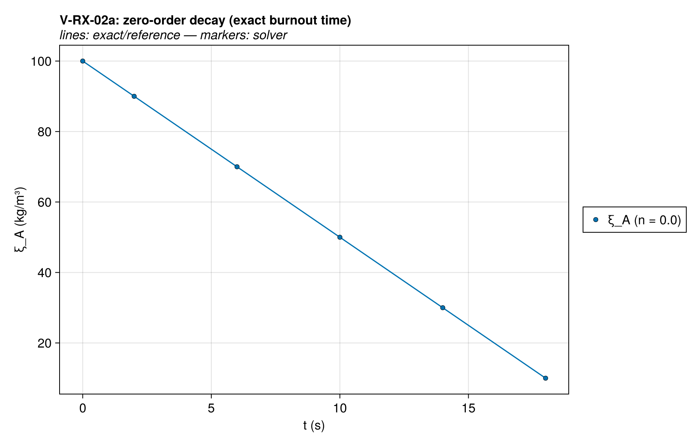
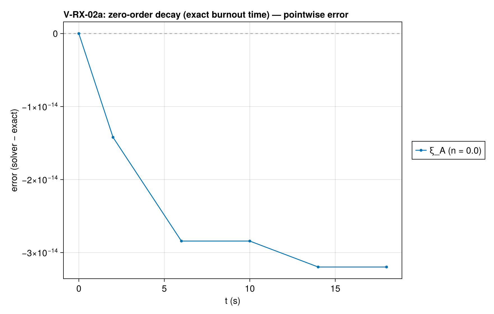
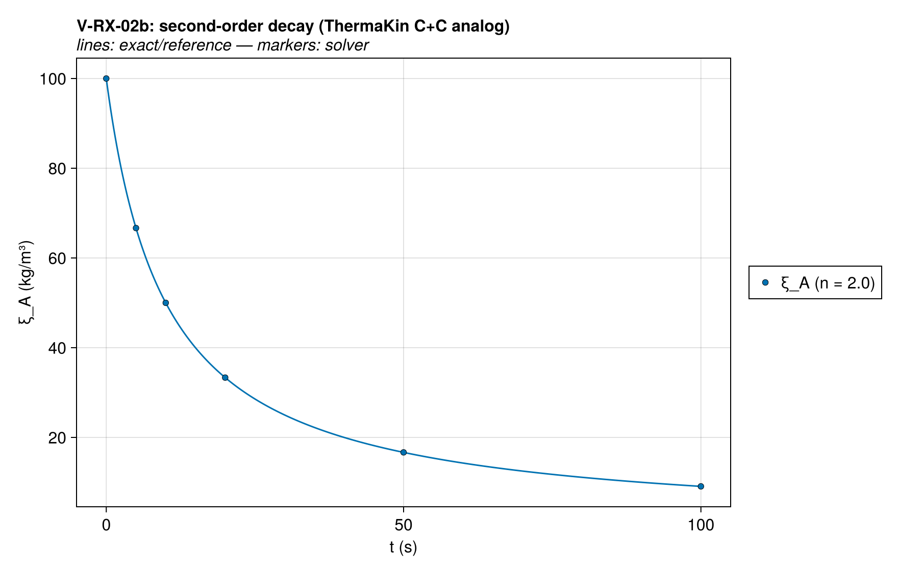
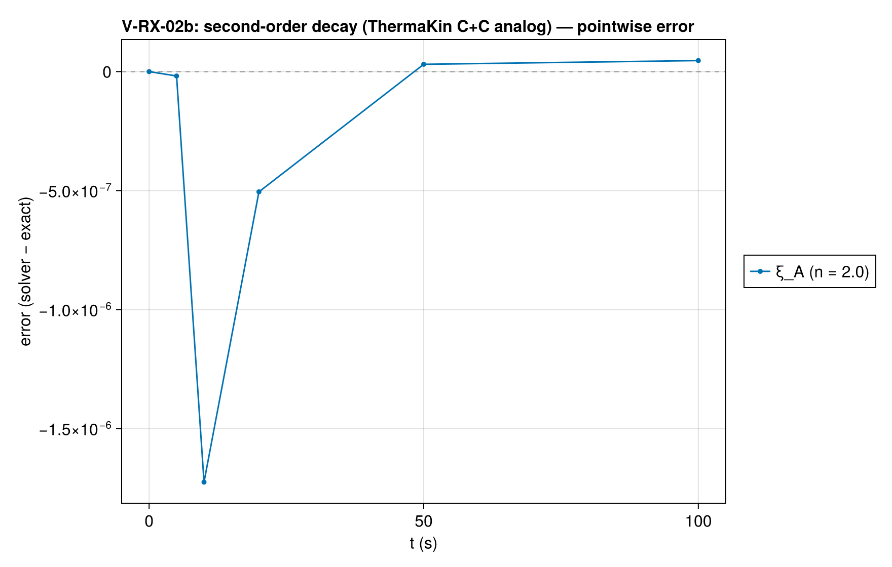
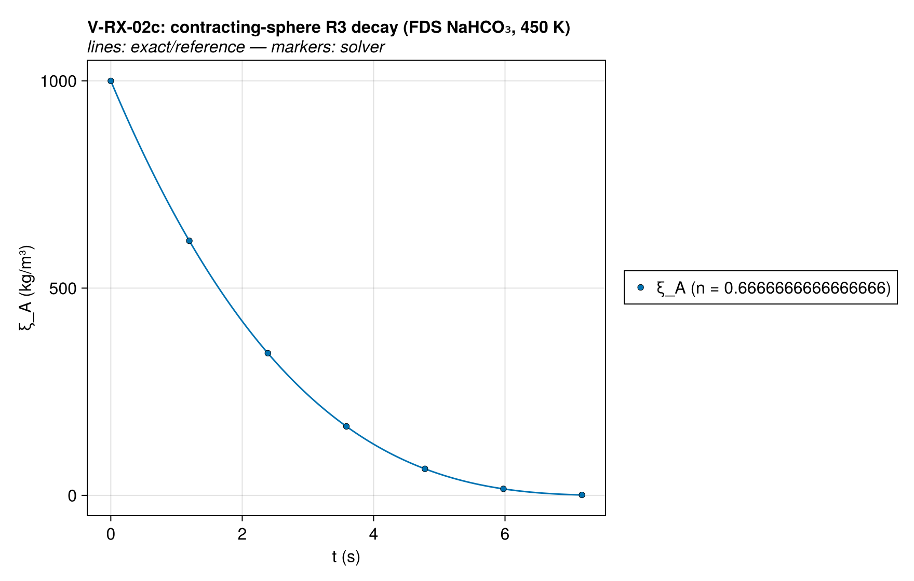
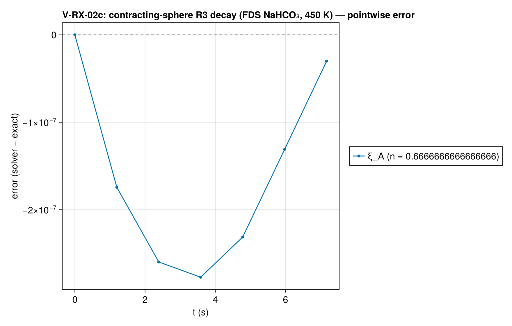
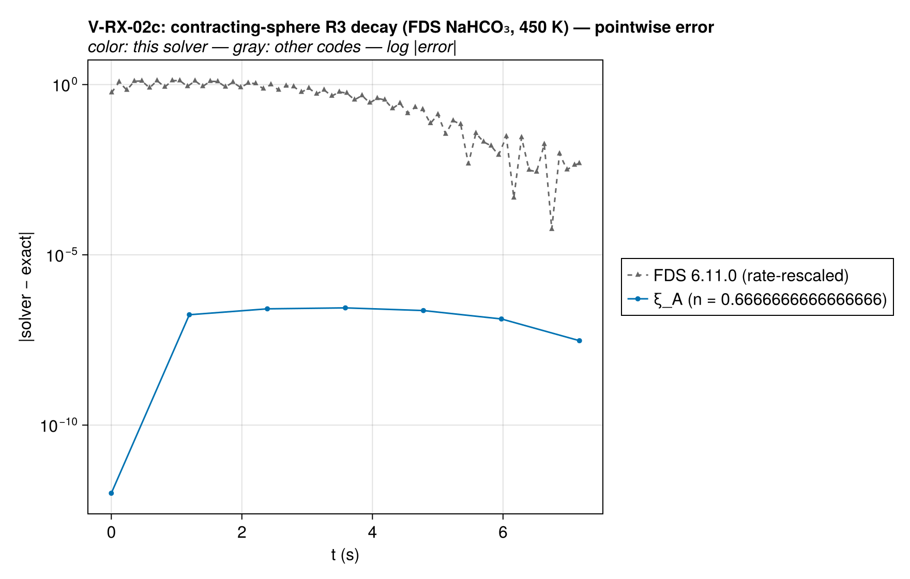
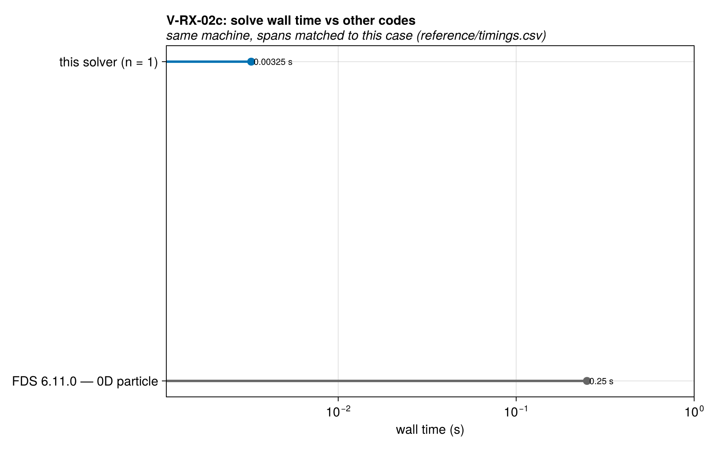
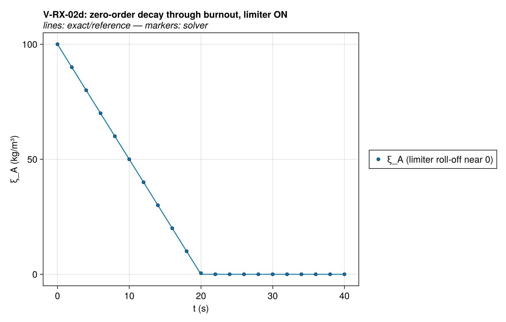
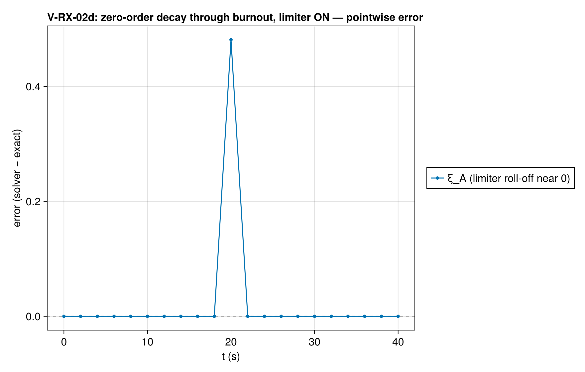

# V-RX-02 — zero-order decay (exact burnout time)

**Tags:** `kinetics`, `reaction_order`, `isothermal`

**References:**

- Khawam & Flanagan (2006), J. Phys. Chem. B 110:17315

## Problem statement

Khawam & Flanagan (2006) exact isothermal integrations (FDS verifies its
`part_baking_soda` case against the same forms). Sub-cases:

  a) n = 0    — linear decay, exact finite burnout time. Compared only up to
                0.9·t_b with the depletion limiter DISABLED: the solver
                clamps ξ ≥ 0 inside ξⁿ, so at ξ = 0 the n = 0 rate stays A
                and would integrate ξ negative (kinetics.jl `_fast_pow`).
  b) n = 2    — ThermaKin's second-order case as single-reactant n = 2:
                ξ = ξ₀/(1 + ξ₀kt).
  c) n = 2/3  — contracting-sphere R3 model with FDS's NaHCO₃ parameters
                A_pub = 3.4e11 1/s, E = 103 kJ/mol at T = 450 K; the marker
                is m^(1/3) linear in t.
  d) n = 0 with the limiter ENABLED (default) — non-negativity guard: run to
                2× burnout and require 0 ≤ ξ ≤ limiter threshold at the end.
                This is the case the limiter exists for.

UNIT CONVERSION (pitfall): solver rate is A·e^(−E/RT)·ξⁿ with ξ in kg/m³;
published constants for normalized m = ξ/ξ₀ convert as A_ours = k_pub·ξ₀^(1−n)
(see exact/kinetics.jl header). Applied below for sub-case c.

## V-RX-02a — zero-order decay (exact burnout time)

### Quantities of interest (n = 1)

| QoI | value | exact | error | tolerance | within tol | provenance |
| --- | --- | --- | --- | --- | --- | --- |
| max relative ξ_A error (n=0.0) | 3.197e-16 | — | 3.197e-16 | 1e-12 | yes | linear decay; compared only to 0.9·t_b, limiter off |
| total-mass conservation | 2.842e-16 | — | 2.842e-16 | 1e-13 | yes | A→B closed system |

### Solver configuration

| setting | value |
| --- | --- |
| integrator | KenCarp4 (default) |
| abstol | 1.0e-12 |
| reltol | 1.0e-10 |

## V-RX-02b — second-order decay (ThermaKin C+C analog)

### Quantities of interest (n = 1)

| QoI | value | exact | error | tolerance | within tol | provenance |
| --- | --- | --- | --- | --- | --- | --- |
| max relative ξ_A error (n=2.0) | 1.725e-08 | — | 1.725e-08 | 5e-08 | yes | ξ = ξ₀/(1+ξ₀kt); k in m³/(kg·s) |
| total-mass conservation | 5.684e-16 | — | 5.684e-16 | 1e-13 | yes | A→B closed system |

### Solver configuration

| setting | value |
| --- | --- |
| integrator | KenCarp4 (default) |
| abstol | 1.0e-12 |
| reltol | 1.0e-10 |

## V-RX-02c — contracting-sphere R3 decay (FDS NaHCO₃, 450 K)

### Quantities of interest (n = 1)

| QoI | value | exact | error | tolerance | within tol | provenance |
| --- | --- | --- | --- | --- | --- | --- |
| max relative ξ_A error (n=0.6666666666666666) | 2.772e-10 | — | 2.772e-10 | 1e-09 | yes | m^(1/3) linear in t; k_pub=0.3765 1/s at 450 K; exercises live Arrhenius (E ≠ 0) at pinned T |
| total-mass conservation | 7.958e-16 | — | 7.958e-16 | 1e-13 | yes | A→B closed system |

### Comparison with other codes

The same case was solved with FDS 6.11.0 at 0D particle; decks, outputs, and
run provenance are committed under `test/verification/reference/`.
Each code's error against the same exact solution is drawn below
on a log scale, muted gray behind this solver's series — the
signed linear-scale panel above shows where the error lives, this
one compares magnitudes across codes.

Wall times at every ladder rung against the reference runs.
Resolutions and simulated spans differ where noted (details in
`reference/timings.csv`), so cross-code timings are indicative
rather than a controlled benchmark; rungs at a matched
resolution are directly comparable.

Solution overlays including the other codes' points: [xi_histories_vs_codes](assets/V-RX-02c/V-RX-02c_xi_histories_vs_codes.png).

### Solver configuration

| setting | value |
| --- | --- |
| integrator | KenCarp4 (default) |
| abstol | 1.0e-12 |
| reltol | 1.0e-10 |

## V-RX-02d — zero-order decay, depletion limiter ON (guard)

_limiter roll-off characterization_

### Quantities of interest (n = 1)

| QoI | value | exact | error | tolerance | within tol | provenance |
| --- | --- | --- | --- | --- | --- | --- |
| non-negativity through 2× burnout | -1.152e-12 | 0 | 1.152e-12 | 1e-09 | yes | the depletion limiter's job for n = 0 kinetics |
| residual mass within limiter threshold | -1.152e-12 | 0 | 1.152e-12 | 1 | yes | tanh(ξ/th) ≈ ξ/th near 0 ⇒ exponential tail; observed ~8e-13 |

### Solver configuration

| setting | value |
| --- | --- |
| integrator | KenCarp4 (default) |
| abstol | 1.0e-12 |
| reltol | 1.0e-10 |

