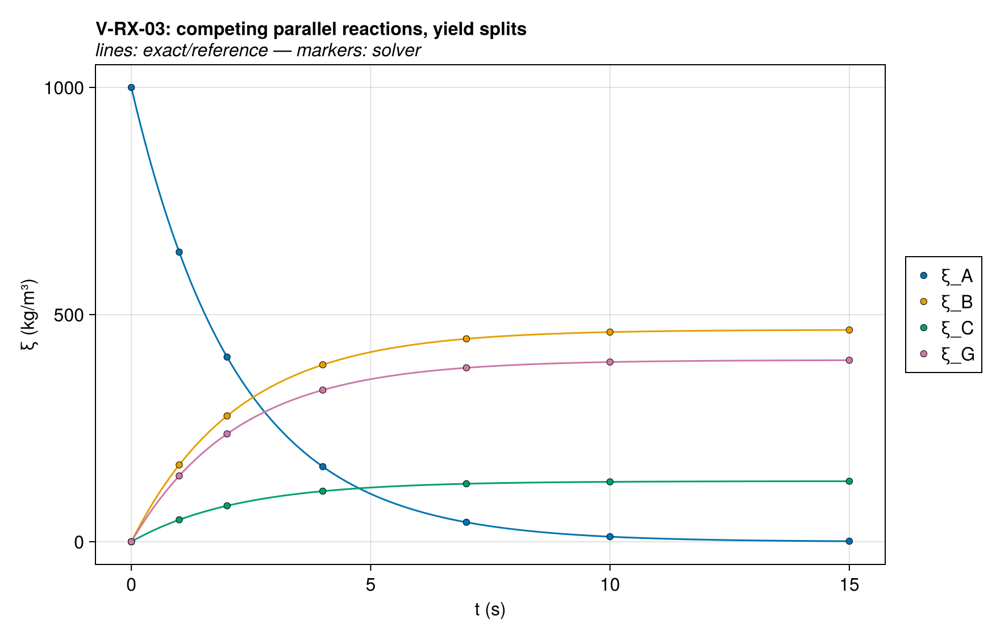
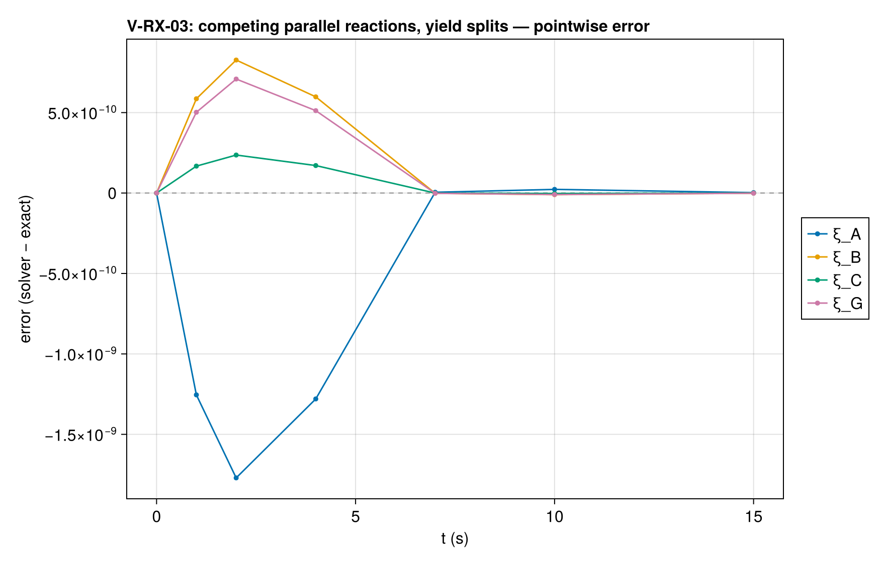
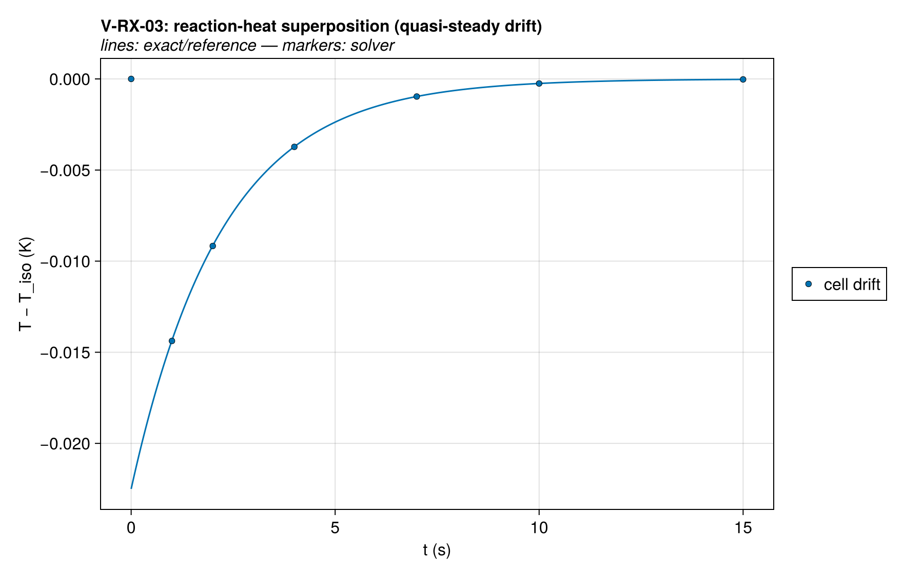
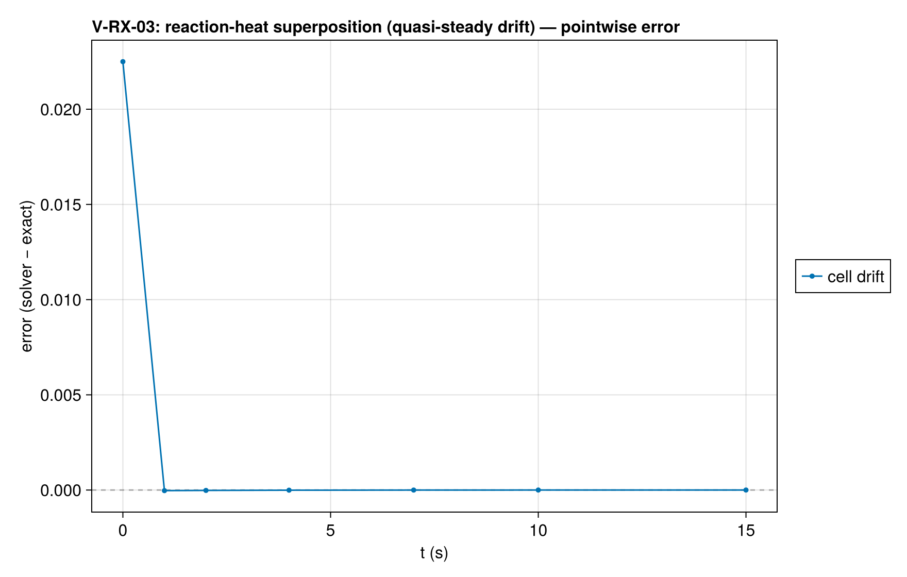

# V-RX-03 — competing parallel reactions with yield splits

**Tags:** `kinetics`, `parallel_reactions`, `stoichiometry`, `energy`

**References:**

- FDS Verification Guide `matl_e_cons` (energy-superposition analog)
- standard parallel first-order kinetics (exact)

## Problem statement

Two reactions consume the same reactant A with different product splits and
different heats of reaction (FDS `matl_e_cons` analog). Exact solution:

  ξ_A = ξ₀·e^(−(k₁+k₂)t);  converted mass splits k₁:k₂, scaled by yields:
  ξ_B = ν_B·(k₁/k)·(ξ₀−ξ_A),  ξ_C = ν_C·(k₂/k)·(ξ₀−ξ_A),
  ξ_G = (γ_B·k₁ + γ_C·k₂)/k·(ξ₀−ξ_A),   k = k₁+k₂, γ = gas yields

Verifies stoichiometric bookkeeping (two-product yields) and heat-release
superposition. E = 0 keeps rates exactly T-independent, so the reaction
heats (h₁ endothermic, h₂ exothermic — h > 0 endothermic in THIS code, as
in Gpyro and FDS, opposite to ThermaKin) perturb only the temperature, not
the species solution.

Heat-release superposition target: a single cell pinned by Dirichlet faces
satisfies the DISCRETE quasi-steady balance exactly:

  2·k_cell·(T_bc − T_c)/(Δz/2) = −Q̇·Δz  ⇒  T_c − T_bc = Q̇·Δz²/(4·k_cell)

with Q̇ = −(h₁k₁ + h₂k₂)·ξ_A(t) the net volumetric source. Quasi-steady is
valid because the cell diffusion time Δz²/α = 0.02 s ≪ 1/(k₁+k₂) = 2.2 s.
The gas is retained (default ImpermeableBC, no Darcy/Fickian transport), so
the system is closed and Σξ = ξ₀ throughout.

### Quantities of interest (n = 1)

| QoI | value | exact | error | tolerance | within tol | provenance |
| --- | --- | --- | --- | --- | --- | --- |
| max relative ξ_A error | 1.771e-12 | — | 1.771e-12 | 1e-08 | yes | competing-parallel exact split k₁:k₂ × yields |
| max relative ξ_B error | 8.267e-13 | — | 8.267e-13 | 1e-08 | yes | competing-parallel exact split k₁:k₂ × yields |
| max relative ξ_C error | 2.361e-13 | — | 2.361e-13 | 1e-08 | yes | competing-parallel exact split k₁:k₂ × yields |
| max relative ξ_G error | 7.086e-13 | — | 7.086e-13 | 1e-08 | yes | competing-parallel exact split k₁:k₂ × yields |
| total-mass conservation (incl. retained gas) | 1.023e-15 | — | 1.023e-15 | 1e-13 | yes | yields sum to 1 per reaction; gas sealed in |
| reaction-heat superposition (quasi-steady cell drift) | 3.235e-05 | — | 3.235e-05 | 0.0001 | yes | T_c − T_bc = Q̇Δz²/(4k) exactly in the discrete steady balance; drift amplitude ~0.02 K at t=0 (h₁k₁+h₂k₂ superposed) |

### Solver configuration

| setting | value |
| --- | --- |
| integrator | Rodas5P (default) |
| abstol | 1.0e-12 |
| reltol | 1.0e-10 |

