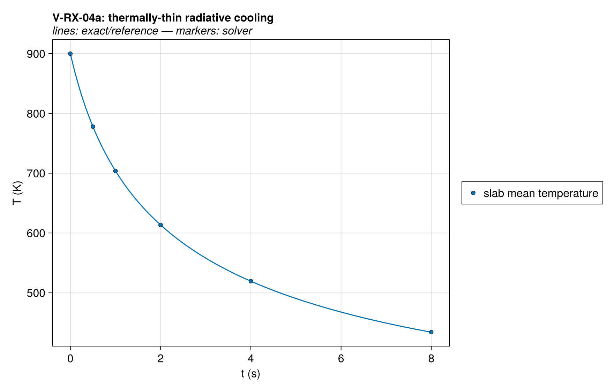
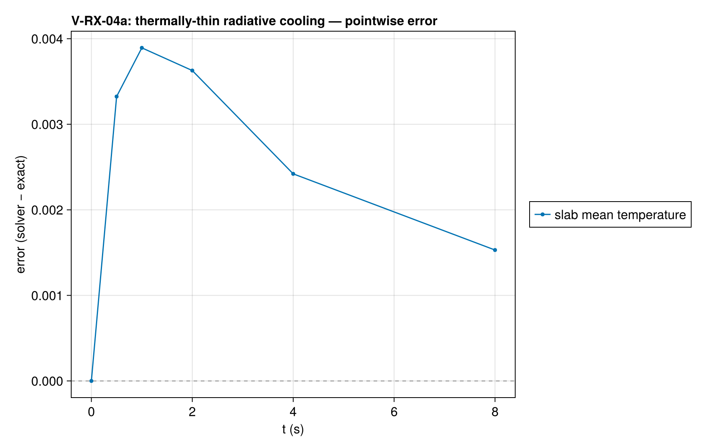
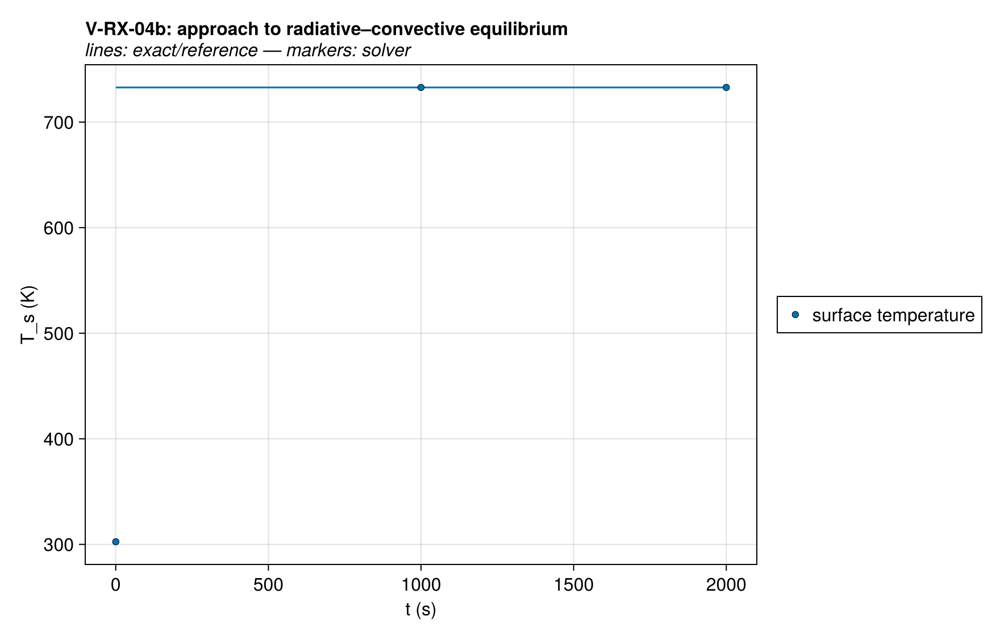
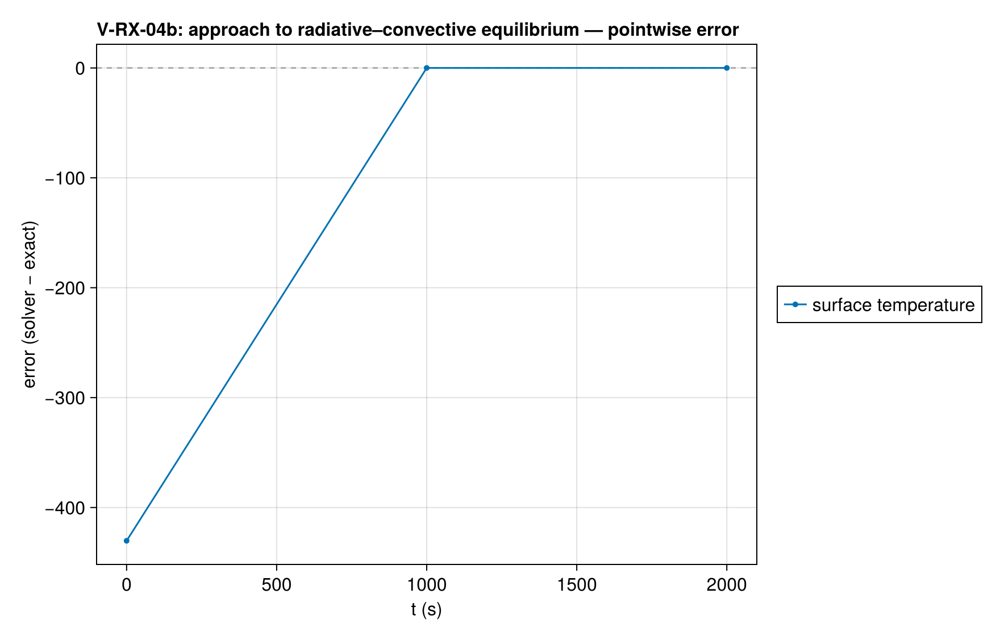

# V-RX-04 — thermally-thin radiative cooling (implicit exact)

**Tags:** `radiation`, `radiative_bc`, `surface_newton`, `thermally_thin`

**References:**

- partial-fraction antiderivative re-derived in exact/radiative_cooling.jl
- suite plan V-RX-04 (transient T⁴ closed form)

## Problem statement

surface equilibrium

The only closed-form transient involving the T⁴ nonlinearity: a thin slab
cooling purely by radiation, dT/dt = −K(T⁴−T∞⁴) with K = εσ/(ρcL), exact
implicit solution t = (G(Tᵢ)−G(T))/K (exact/radiative_cooling.jl, quadrature
self-tested). Verifies `RadiativeBC` + the surface Newton solve against
something other than steady algebra.

  a) transient cooling — thin-limit setup: L = 0.1 mm, k = 100 W/mK makes
     the internal ΔT ≈ q·L/2k ≈ 0.017 K at t = 0 (flux bias ~7e-5 relative),
     far below the comparison tolerance; compared on the cell-mean
     temperature, which is what the lumped ODE governs.
  b) steady companion — HeatFluxBC + RadiativeBC + ConvectiveBC vs the exact
     algebraic root of q_abs = εσ(Ts⁴−T∞⁴) + h(Ts−T∞): a direct check of
     the surface-Newton residual (Ts ≈ 732 K, cone-like). Run to 36 thermal
     time constants; at steady state with an adiabatic back the whole slab
     must be uniform at Ts.

Uses the code's own STEFAN_BOLTZMANN so the reference cannot drift from the
implementation's constant.

## V-RX-04a — thermally-thin radiative cooling (implicit exact)

### Quantities of interest (n = 4)

| QoI | value | exact | error | tolerance | within tol | provenance |
| --- | --- | --- | --- | --- | --- | --- |
| max mean-T error vs implicit exact | 0.003893 | — | 0.003893 | 0.012 | yes | lumped T⁴ cooling; thin-limit bias ~7e-5 relative in flux |
| internal ΔT (thin-limit validity) | 0.006854 | — | 0.006854 | 0.05 | yes | guards the lumped assumption of the reference solution |

### Solver configuration

| setting | value |
| --- | --- |
| integrator | KenCarp4 (default) |
| abstol | 1.0e-10 |
| reltol | 1.0e-8 |

## V-RX-04b — steady radiative–convective surface equilibrium

### Quantities of interest (n = 20)

| QoI | value | exact | error | tolerance | within tol | provenance |
| --- | --- | --- | --- | --- | --- | --- |
| steady surface temperature vs algebraic root | 732.8 | 732.8 | 3.748e-09 | 1e-06 | yes | surface-Newton residual check; Ts_exact ≈ 732.8 K |
| steadiness (last half-interval drift) | 0.0001074 | — | 0.0001074 | 0.001 | yes | t_end ≈ 36 thermal time constants |
| steady uniformity (adiabatic back) | 8.77e-10 | — | 8.77e-10 | 1e-07 | yes | zero steady flux ⇒ uniform slab at Ts |

### Solver configuration

| setting | value |
| --- | --- |
| integrator | KenCarp4 (default) |
| abstol | 1.0e-10 |
| reltol | 1.0e-8 |

