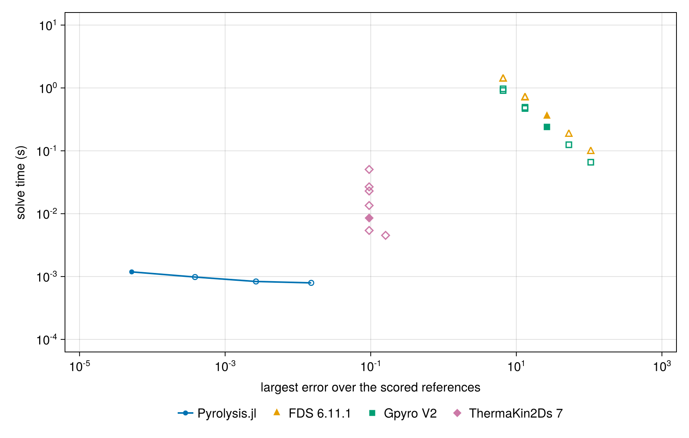
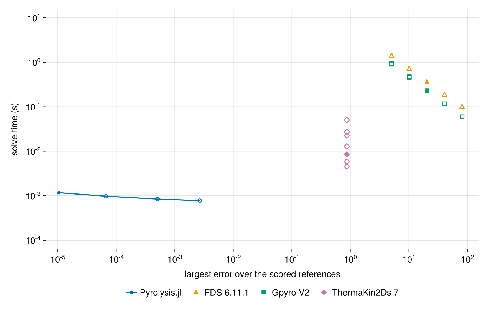
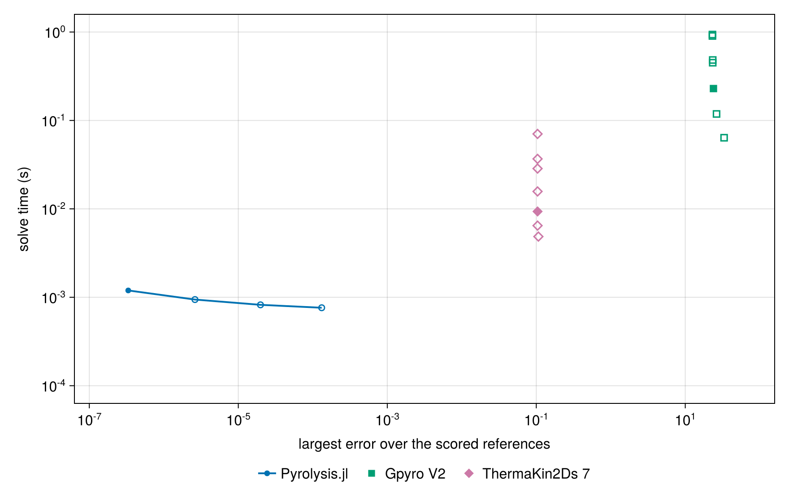

# V-RX-05 — insulated reaction (endothermic)

**Tags:** `kinetics`, `reaction_enthalpy`, `adiabatic`, `analytical`

**References:**

- [Gpyro Verification and Validation Manual v1.0 (2026), §3.6, p. 23, Eq. (3.11)](https://github.com/Gedeben/GPYRO-V2/blob/bff0126c68f2a35c084ef04490ae327185f281a3/documentation/gpyro_verification_manual.pdf#page=25)
- Independent closed-form adaptation: E = 0, insulated and sealed cell, unequal heat capacities; see problem statement.

## Problem statement

Inspired by Gpyro Verification and Validation Manual v1.0 (2026), §3.6,
p. 23, Eq. (3.11): endothermic (+1e6 J/kg), exothermic (-1e5 J/kg),
and zero-reaction-heat cases, the latter producing 60% gas by mass.

Adaptation: a sealed, insulated single cell starts at T₀ = 1000 K. Set
E = 0 and A = 0.2 s⁻¹ so the first-order reactant mass fraction is exactly
a(t) = exp(-0.2t), independently of the evolving temperature. Unlike the
guide's source-term reconstruction from numerical reaction rates, both
the species histories and temperature here have independent references.

c_A = 1200 and c_B = 1900 J/(kg K); retained gas has c_G = 1000 J/(kg K).
For solid yield ν, c_products = ν c_B + (1-ν)c_G. The temperature obeys
[c_A a + c_products(1-a)] dT/dt = -h A a, with the closed-form logarithmic
solution in exact/gpyro_verification.jl. The sensible-enthalpy reference is
`H = m₀[c_A a + c_products(1-a)](T-T_REF)`, evaluated without solver rates.

Cases a/b convert A entirely to B; c produces 0.4 B + 0.6 G with h = 0.
Case c must keep T constant even though its sensible enthalpy changes:
the H equation includes formation terms Σ h_j dm_j/dt. All products stay
inside the cell, the depletion limiter is disabled, and no mesh moves.

## V-RX-05a — insulated reaction (endothermic)

### Quantities of interest (n = 1)

| QoI | value | exact | error | tolerance | within tol | provenance |
| --- | --- | --- | --- | --- | --- | --- |
| independent species histories | 1.663e-12 | — | 1.663e-12 | 1e-10 | yes | exact first-order conversion; observed ≤3e-12 in temperature form, integration margin |
| adiabatic temperature history | 3.162e-08 | — | 3.162e-08 | 1e-07 | yes | logarithmic exact solution; observed ≤3.17e-8 K in temperature form, ~3× margin |
| sensible enthalpy history / initial energy | 6.184e-11 | — | 6.184e-11 | 2e-10 | yes | independent Σ m_j c_j (T-T_REF); observed ≤6.19e-11 relative, ~3× margin |
| closed total mass | 1.332e-15 | — | 1.332e-15 | 1e-12 | yes |  |
| sealed boundary mass flux | 0 | — | 0 | 1e-14 | yes |  |

### Comparison with other codes

Physical-problem agreement does not establish equal discretization or cost. See the [mesh and time comparison basis](comparison_coverage.md#comparison-basis-audit) and [per-pair inventory](assets/comparison_basis.csv). Costs are compared at matched accuracy only.

Matched native-input runs at seven configurations (coarser and finer time steps at fixed mesh, and a finer mesh) are retained under `test/verification/reference/matched/`. See the [coverage and matching notes](comparison_coverage.md). The plotted external series use the base resolution; [analytical errors at every configuration](assets/V-RX-05a/V-RX-05a_comparison_accuracy.csv) are retained separately, and the same runs are timed for the cost comparison.

Gpyro V2 (`bff0126c68f2`) uses two boundary nodes on a uniform insulated slab, Δt = 0.001 s, E = 0, and the same reaction heat, yields and heat capacities. A 1e-6 Pa initial gas pressure avoids a singular vacuum diffusivity; its initial mass is negligible (about 1e-15 kg/m²). Sensible enthalpy is reconstructed from native concentrations and temperature at the common 298.15 K datum. ThermaKin2Ds 7 uses one insulated element at dt = 0.001 s; its positive reaction heat is exothermic, so the sign is reversed.

Error panels show absolute error at each code's output points. Zeros are displayed at 1e-12 on the logarithmic axis; the reference CSV precision limits the discernible error.

#### Cost at matched accuracy

Each external code appears at its matched mesh h and time step Δt, at
coarser steps (2Δt, 4Δt) and at refinements (Δt/2, Δt/4, h/2 at Δt/4,
h/2 at Δt/2); this code at its report ladder, the external meshes and any
finer cost-only meshes, each at its report tolerances and at 10, 100 and
1000 times looser ones, the counterpart of the coarser steps. A coarse
configuration a code cannot express or complete is left out; for the
external codes the reason is in the matched provenance. The error is the
largest analytical error over
the curves and references the external run is scored on. Times are FDS's
internal elapsed time, which excludes its MPI start-up; Gpyro's and
ThermaKin's process time; and this code's warm problem construction and
solve. Each is the median of repeated runs on one pinned core
(`scripts/timing/README.md`; data and provenance in
`test/verification/reference/matched/timing/`). On the smallest problems
the external times are mostly input, setup and output. In the figure,
filled markers are each external code's matched mesh and step and this
code's report tolerances, open markers are the other runs, and this
code's line joins its cheapest configuration at each accuracy; lower left
is better. Errors at or below 1e-12 count as exact
when matching accuracy, errors at or below 1e-14 are drawn at 1e-14, and
runs every code solves exactly are not drawn.

For each external mesh and step: the external code's cheapest run at least as accurate (often itself; a coarser or finer run of the same code when that costs less), this code's cheapest configuration at least as accurate on every scored reference (its cells, and its tolerance multiplier when looser than the report's), and the ratio of the two. A ratio marked ≥ uses this code's coarsest configuration, fewest cells at the loosest tolerance, whose accuracy already exceeds the external run's.

| External run | Mesh, step | External error | External time (s) | Cheapest external at this accuracy (s) | Our cells, tolerance | Our time (s) | Cheapest external/our time |
| --- | --- | --- | --- | --- | --- | --- | --- |
| FDS 6.11.1 | h, Δt | 26.33 | 0.355 | 0.355 | 1, 1000× tol | 0.0007927 | ≥ 448.0 |
| FDS 6.11.1 | h, 2Δt | 52.66 | 0.184 | 0.184 | 1, 1000× tol | 0.0007927 | ≥ 232.0 |
| FDS 6.11.1 | h, 4Δt | 105.4 | 0.098 | 0.098 | 1, 1000× tol | 0.0007927 | ≥ 124.0 |
| FDS 6.11.1 | h, Δt/2 | 13.16 | 0.697 | 0.697 | 1, 1000× tol | 0.0007927 | ≥ 879.0 |
| FDS 6.11.1 | h, Δt/4 | 6.581 | 1.39 | 1.39 | 1, 1000× tol | 0.0007927 | ≥ 1750.0 |
| FDS 6.11.1 | h/2, Δt/4 | 6.581 | 1.394 | 1.39 | 1, 1000× tol | 0.0007927 | ≥ 1750.0 |
| FDS 6.11.1 | h/2, Δt/2 | 13.16 | 0.707 | 0.697 | 1, 1000× tol | 0.0007927 | ≥ 879.0 |
| Gpyro V2 | h, Δt | 26.33 | 0.2398 | 0.2398 | 1, 1000× tol | 0.0007927 | ≥ 303.0 |
| Gpyro V2 | h, 2Δt | 52.66 | 0.1249 | 0.1249 | 1, 1000× tol | 0.0007927 | ≥ 158.0 |
| Gpyro V2 | h, 4Δt | 105.4 | 0.06583 | 0.06583 | 1, 1000× tol | 0.0007927 | ≥ 83.1 |
| Gpyro V2 | h, Δt/2 | 13.16 | 0.4714 | 0.4714 | 1, 1000× tol | 0.0007927 | ≥ 595.0 |
| Gpyro V2 | h, Δt/4 | 6.582 | 0.909 | 0.909 | 1, 1000× tol | 0.0007927 | ≥ 1150.0 |
| Gpyro V2 | h/2, Δt/4 | 6.582 | 0.9685 | 0.909 | 1, 1000× tol | 0.0007927 | ≥ 1150.0 |
| Gpyro V2 | h/2, Δt/2 | 13.16 | 0.4929 | 0.4714 | 1, 1000× tol | 0.0007927 | ≥ 595.0 |
| ThermaKin2Ds 7 | h, Δt | 0.09511 | 0.008531 | 0.005405 | 1, 1000× tol | 0.0007927 | ≥ 6.82 |
| ThermaKin2Ds 7 | h, 2Δt | 0.09511 | 0.005405 | 0.005405 | 1, 1000× tol | 0.0007927 | ≥ 6.82 |
| ThermaKin2Ds 7 | h, 4Δt | 0.1599 | 0.004517 | 0.004517 | 1, 1000× tol | 0.0007927 | ≥ 5.7 |
| ThermaKin2Ds 7 | h, Δt/2 | 0.09511 | 0.01349 | 0.005405 | 1, 1000× tol | 0.0007927 | ≥ 6.82 |
| ThermaKin2Ds 7 | h, Δt/4 | 0.09511 | 0.02294 | 0.005405 | 1, 1000× tol | 0.0007927 | ≥ 6.82 |
| ThermaKin2Ds 7 | h/2, Δt/4 | 0.09511 | 0.05052 | 0.005405 | 1, 1000× tol | 0.0007927 | ≥ 6.82 |
| ThermaKin2Ds 7 | h/2, Δt/2 | 0.09511 | 0.02672 | 0.005405 | 1, 1000× tol | 0.0007927 | ≥ 6.82 |

Solution overlays including the other codes' points: [temperature_vs_codes](assets/V-RX-05a/V-RX-05a_temperature_vs_codes.png), [species_vs_codes](assets/V-RX-05a/V-RX-05a_species_vs_codes.png), [enthalpy_vs_codes](assets/V-RX-05a/V-RX-05a_enthalpy_vs_codes.png).

### Solver configuration

| setting | value |
| --- | --- |
| integrator | Rodas5P (default) |
| reltol | 1.0e-10 |
| abstol | 1.0e-12 |

## V-RX-05b — insulated reaction (exothermic)

### Quantities of interest (n = 1)

| QoI | value | exact | error | tolerance | within tol | provenance |
| --- | --- | --- | --- | --- | --- | --- |
| independent species histories | 2.946e-12 | — | 2.946e-12 | 1e-10 | yes | exact first-order conversion; observed ≤3e-12 in temperature form, integration margin |
| adiabatic temperature history | 5.437e-09 | — | 5.437e-09 | 1e-07 | yes | logarithmic exact solution; observed ≤3.17e-8 K in temperature form, ~3× margin |
| sensible enthalpy history / initial energy | 1.243e-11 | — | 1.243e-11 | 2e-10 | yes | independent Σ m_j c_j (T-T_REF); observed ≤6.19e-11 relative, ~3× margin |
| closed total mass | 1.11e-15 | — | 1.11e-15 | 1e-12 | yes |  |
| sealed boundary mass flux | 0 | — | 0 | 1e-14 | yes |  |

### Comparison with other codes

Physical-problem agreement does not establish equal discretization or cost. See the [mesh and time comparison basis](comparison_coverage.md#comparison-basis-audit) and [per-pair inventory](assets/comparison_basis.csv). Costs are compared at matched accuracy only.

Matched native-input runs at seven configurations (coarser and finer time steps at fixed mesh, and a finer mesh) are retained under `test/verification/reference/matched/`. See the [coverage and matching notes](comparison_coverage.md). The plotted external series use the base resolution; [analytical errors at every configuration](assets/V-RX-05b/V-RX-05b_comparison_accuracy.csv) are retained separately, and the same runs are timed for the cost comparison.

Gpyro V2 (`bff0126c68f2`) uses two boundary nodes on a uniform insulated slab, Δt = 0.001 s, E = 0, and the same reaction heat, yields and heat capacities. A 1e-6 Pa initial gas pressure avoids a singular vacuum diffusivity; its initial mass is negligible (about 1e-15 kg/m²). Sensible enthalpy is reconstructed from native concentrations and temperature at the common 298.15 K datum. ThermaKin2Ds 7 uses one insulated element at dt = 0.001 s; its positive reaction heat is exothermic, so the sign is reversed.

Error panels show absolute error at each code's output points. Zeros are displayed at 1e-12 on the logarithmic axis; the reference CSV precision limits the discernible error.

#### Cost at matched accuracy

Each external code appears at its matched mesh h and time step Δt, at
coarser steps (2Δt, 4Δt) and at refinements (Δt/2, Δt/4, h/2 at Δt/4,
h/2 at Δt/2); this code at its report ladder, the external meshes and any
finer cost-only meshes, each at its report tolerances and at 10, 100 and
1000 times looser ones, the counterpart of the coarser steps. A coarse
configuration a code cannot express or complete is left out; for the
external codes the reason is in the matched provenance. The error is the
largest analytical error over
the curves and references the external run is scored on. Times are FDS's
internal elapsed time, which excludes its MPI start-up; Gpyro's and
ThermaKin's process time; and this code's warm problem construction and
solve. Each is the median of repeated runs on one pinned core
(`scripts/timing/README.md`; data and provenance in
`test/verification/reference/matched/timing/`). On the smallest problems
the external times are mostly input, setup and output. In the figure,
filled markers are each external code's matched mesh and step and this
code's report tolerances, open markers are the other runs, and this
code's line joins its cheapest configuration at each accuracy; lower left
is better. Errors at or below 1e-12 count as exact
when matching accuracy, errors at or below 1e-14 are drawn at 1e-14, and
runs every code solves exactly are not drawn.

For each external mesh and step: the external code's cheapest run at least as accurate (often itself; a coarser or finer run of the same code when that costs less), this code's cheapest configuration at least as accurate on every scored reference (its cells, and its tolerance multiplier when looser than the report's), and the ratio of the two. A ratio marked ≥ uses this code's coarsest configuration, fewest cells at the loosest tolerance, whose accuracy already exceeds the external run's.

| External run | Mesh, step | External error | External time (s) | Cheapest external at this accuracy (s) | Our cells, tolerance | Our time (s) | Cheapest external/our time |
| --- | --- | --- | --- | --- | --- | --- | --- |
| FDS 6.11.1 | h, Δt | 20.26 | 0.353 | 0.353 | 1, 1000× tol | 0.000775 | ≥ 455.0 |
| FDS 6.11.1 | h, 2Δt | 40.54 | 0.185 | 0.185 | 1, 1000× tol | 0.000775 | ≥ 239.0 |
| FDS 6.11.1 | h, 4Δt | 81.08 | 0.098 | 0.098 | 1, 1000× tol | 0.000775 | ≥ 126.0 |
| FDS 6.11.1 | h, Δt/2 | 10.14 | 0.7 | 0.7 | 1, 1000× tol | 0.000775 | ≥ 903.0 |
| FDS 6.11.1 | h, Δt/4 | 5.069 | 1.387 | 1.387 | 1, 1000× tol | 0.000775 | ≥ 1790.0 |
| FDS 6.11.1 | h/2, Δt/4 | 5.069 | 1.391 | 1.387 | 1, 1000× tol | 0.000775 | ≥ 1790.0 |
| FDS 6.11.1 | h/2, Δt/2 | 10.14 | 0.703 | 0.7 | 1, 1000× tol | 0.000775 | ≥ 903.0 |
| Gpyro V2 | h, Δt | 20.27 | 0.2302 | 0.2302 | 1, 1000× tol | 0.000775 | ≥ 297.0 |
| Gpyro V2 | h, 2Δt | 40.53 | 0.116 | 0.116 | 1, 1000× tol | 0.000775 | ≥ 150.0 |
| Gpyro V2 | h, 4Δt | 81.08 | 0.05936 | 0.05936 | 1, 1000× tol | 0.000775 | ≥ 76.6 |
| Gpyro V2 | h, Δt/2 | 10.13 | 0.456 | 0.456 | 1, 1000× tol | 0.000775 | ≥ 588.0 |
| Gpyro V2 | h, Δt/4 | 5.066 | 0.9078 | 0.9078 | 1, 1000× tol | 0.000775 | ≥ 1170.0 |
| Gpyro V2 | h/2, Δt/4 | 5.066 | 0.9464 | 0.9078 | 1, 1000× tol | 0.000775 | ≥ 1170.0 |
| Gpyro V2 | h/2, Δt/2 | 10.13 | 0.4783 | 0.456 | 1, 1000× tol | 0.000775 | ≥ 588.0 |
| ThermaKin2Ds 7 | h, Δt | 0.8697 | 0.008503 | 0.00453 | 1, 1000× tol | 0.000775 | ≥ 5.85 |
| ThermaKin2Ds 7 | h, 2Δt | 0.8697 | 0.005847 | 0.00453 | 1, 1000× tol | 0.000775 | ≥ 5.85 |
| ThermaKin2Ds 7 | h, 4Δt | 0.8697 | 0.00453 | 0.00453 | 1, 1000× tol | 0.000775 | ≥ 5.85 |
| ThermaKin2Ds 7 | h, Δt/2 | 0.8697 | 0.01285 | 0.00453 | 1, 1000× tol | 0.000775 | ≥ 5.85 |
| ThermaKin2Ds 7 | h, Δt/4 | 0.8697 | 0.0226 | 0.00453 | 1, 1000× tol | 0.000775 | ≥ 5.85 |
| ThermaKin2Ds 7 | h/2, Δt/4 | 0.8697 | 0.05042 | 0.00453 | 1, 1000× tol | 0.000775 | ≥ 5.85 |
| ThermaKin2Ds 7 | h/2, Δt/2 | 0.8697 | 0.02726 | 0.00453 | 1, 1000× tol | 0.000775 | ≥ 5.85 |

Solution overlays including the other codes' points: [temperature_vs_codes](assets/V-RX-05b/V-RX-05b_temperature_vs_codes.png), [species_vs_codes](assets/V-RX-05b/V-RX-05b_species_vs_codes.png), [enthalpy_vs_codes](assets/V-RX-05b/V-RX-05b_enthalpy_vs_codes.png).

### Solver configuration

| setting | value |
| --- | --- |
| integrator | Rodas5P (default) |
| reltol | 1.0e-10 |
| abstol | 1.0e-12 |

## V-RX-05c — insulated reaction (zero heat, retained gas)

### Quantities of interest (n = 1)

| QoI | value | exact | error | tolerance | within tol | provenance |
| --- | --- | --- | --- | --- | --- | --- |
| independent species histories | 2.966e-12 | — | 2.966e-12 | 1e-10 | yes | exact first-order conversion; observed ≤3e-12 in temperature form, integration margin |
| adiabatic temperature history | 1.137e-13 | — | 1.137e-13 | 1e-07 | yes | logarithmic exact solution; observed ≤3.17e-8 K in temperature form, ~3× margin |
| sensible enthalpy history / initial energy | 3.955e-13 | — | 3.955e-13 | 2e-10 | yes | independent Σ m_j c_j (T-T_REF); observed ≤6.19e-11 relative, ~3× margin |
| closed total mass | 1.11e-15 | — | 1.11e-15 | 1e-12 | yes |  |
| sealed boundary mass flux | 0 | — | 0 | 1e-14 | yes |  |

### Comparison with other codes

Physical-problem agreement does not establish equal discretization or cost. See the [mesh and time comparison basis](comparison_coverage.md#comparison-basis-audit) and [per-pair inventory](assets/comparison_basis.csv). Costs are compared at matched accuracy only.

Matched native-input runs at seven configurations (coarser and finer time steps at fixed mesh, and a finer mesh) are retained under `test/verification/reference/matched/`. See the [coverage and matching notes](comparison_coverage.md). The plotted external series use the base resolution; [analytical errors at every configuration](assets/V-RX-05c/V-RX-05c_comparison_accuracy.csv) are retained separately, and the same runs are timed for the cost comparison.

Gpyro V2 (`bff0126c68f2`) uses two boundary nodes on a uniform insulated slab, Δt = 0.001 s, E = 0, and the same reaction heat, yields and heat capacities. A 1e-6 Pa initial gas pressure avoids a singular vacuum diffusivity; its initial mass is negligible (about 1e-15 kg/m²). Sensible enthalpy is reconstructed from native concentrations and temperature at the common 298.15 K datum. The retained-gas case has a Gpyro mass discrepancy of about 3.27e-5 of initial mass that persists when Δt is halved; its density and pressure routines use different gas constants. ThermaKin2Ds 7 uses one insulated element at dt = 0.001 s; its positive reaction heat is exothermic, so the sign is reversed, and its gas product stays in the element without occupying volume.

Error panels show absolute error at each code's output points. Zeros are displayed at 1e-12 on the logarithmic axis; the reference CSV precision limits the discernible error.

#### Cost at matched accuracy

Each external code appears at its matched mesh h and time step Δt, at
coarser steps (2Δt, 4Δt) and at refinements (Δt/2, Δt/4, h/2 at Δt/4,
h/2 at Δt/2); this code at its report ladder, the external meshes and any
finer cost-only meshes, each at its report tolerances and at 10, 100 and
1000 times looser ones, the counterpart of the coarser steps. A coarse
configuration a code cannot express or complete is left out; for the
external codes the reason is in the matched provenance. The error is the
largest analytical error over
the curves and references the external run is scored on. Times are FDS's
internal elapsed time, which excludes its MPI start-up; Gpyro's and
ThermaKin's process time; and this code's warm problem construction and
solve. Each is the median of repeated runs on one pinned core
(`scripts/timing/README.md`; data and provenance in
`test/verification/reference/matched/timing/`). On the smallest problems
the external times are mostly input, setup and output. In the figure,
filled markers are each external code's matched mesh and step and this
code's report tolerances, open markers are the other runs, and this
code's line joins its cheapest configuration at each accuracy; lower left
is better. Errors at or below 1e-12 count as exact
when matching accuracy, errors at or below 1e-14 are drawn at 1e-14, and
runs every code solves exactly are not drawn.

For each external mesh and step: the external code's cheapest run at least as accurate (often itself; a coarser or finer run of the same code when that costs less), this code's cheapest configuration at least as accurate on every scored reference (its cells, and its tolerance multiplier when looser than the report's), and the ratio of the two. A ratio marked ≥ uses this code's coarsest configuration, fewest cells at the loosest tolerance, whose accuracy already exceeds the external run's.

| External run | Mesh, step | External error | External time (s) | Cheapest external at this accuracy (s) | Our cells, tolerance | Our time (s) | Cheapest external/our time |
| --- | --- | --- | --- | --- | --- | --- | --- |
| Gpyro V2 | h, Δt | 23.9 | 0.2294 | 0.2294 | 1, 1000× tol | 0.0007615 | ≥ 301.0 |
| Gpyro V2 | h, 2Δt | 26.3 | 0.1184 | 0.1184 | 1, 1000× tol | 0.0007615 | ≥ 156.0 |
| Gpyro V2 | h, 4Δt | 33.21 | 0.06376 | 0.06376 | 1, 1000× tol | 0.0007615 | ≥ 83.7 |
| Gpyro V2 | h, Δt/2 | 23.37 | 0.4499 | 0.4499 | 1, 1000× tol | 0.0007615 | ≥ 591.0 |
| Gpyro V2 | h, Δt/4 | 23.16 | 0.9023 | 0.9023 | 1, 1000× tol | 0.0007615 | ≥ 1180.0 |
| Gpyro V2 | h/2, Δt/4 | 23.16 | 0.9361 | 0.9023 | 1, 1000× tol | 0.0007615 | ≥ 1180.0 |
| Gpyro V2 | h/2, Δt/2 | 23.37 | 0.4826 | 0.4499 | 1, 1000× tol | 0.0007615 | ≥ 591.0 |
| ThermaKin2Ds 7 | h, Δt | 0.104 | 0.009347 | 0.006465 | 1, 1000× tol | 0.0007615 | ≥ 8.49 |
| ThermaKin2Ds 7 | h, 2Δt | 0.104 | 0.006465 | 0.006465 | 1, 1000× tol | 0.0007615 | ≥ 8.49 |
| ThermaKin2Ds 7 | h, 4Δt | 0.1068 | 0.00486 | 0.00486 | 1, 1000× tol | 0.0007615 | ≥ 6.38 |
| ThermaKin2Ds 7 | h, Δt/2 | 0.104 | 0.01574 | 0.006465 | 1, 1000× tol | 0.0007615 | ≥ 8.49 |
| ThermaKin2Ds 7 | h, Δt/4 | 0.104 | 0.02856 | 0.006465 | 1, 1000× tol | 0.0007615 | ≥ 8.49 |
| ThermaKin2Ds 7 | h/2, Δt/4 | 0.104 | 0.07037 | 0.006465 | 1, 1000× tol | 0.0007615 | ≥ 8.49 |
| ThermaKin2Ds 7 | h/2, Δt/2 | 0.104 | 0.03675 | 0.006465 | 1, 1000× tol | 0.0007615 | ≥ 8.49 |

Solution overlays including the other codes' points: [temperature_vs_codes](assets/V-RX-05c/V-RX-05c_temperature_vs_codes.png), [species_vs_codes](assets/V-RX-05c/V-RX-05c_species_vs_codes.png), [enthalpy_vs_codes](assets/V-RX-05c/V-RX-05c_enthalpy_vs_codes.png).

### Solver configuration

| setting | value |
| --- | --- |
| integrator | Rodas5P (default) |
| reltol | 1.0e-10 |
| abstol | 1.0e-12 |
