# V-RX-05 — insulated reaction (endothermic)

**Tags:** `kinetics`, `reaction_enthalpy`, `adiabatic`, `analytical`

**References:**

- [Gpyro Verification and Validation Manual v1.0 (2026), §3.6, p. 23, Eq. (3.11)](https://github.com/Gedeben/GPYRO-V2/blob/bff0126c68f2a35c084ef04490ae327185f281a3/documentation/gpyro_verification_manual.pdf#page=25)
- Independent closed-form adaptation: E = 0, insulated and sealed cell, unequal heat capacities; see problem statement.

## Problem statement

Inspired by Gpyro Verification and Validation Manual v1.0 (2026), §3.6,
p. 23, Eq. (3.11): endothermic (+1e6 J/kg), exothermic (-1e5 J/kg),
and zero-reaction-heat cases, the latter producing 60% gas by mass.

Adaptation: a sealed, insulated single cell starts at T₀ = 1000 K. Set
E = 0 and A = 0.2 s⁻¹ so the first-order reactant mass fraction is exactly
a(t) = exp(-0.2t), independently of the evolving temperature. Unlike the
guide's source-term reconstruction from numerical reaction rates, both
the species histories and temperature here have independent references.

c_A = 1200 and c_B = 1900 J/(kg K); retained gas has c_G = 1000 J/(kg K).
For solid yield ν, c_products = ν c_B + (1-ν)c_G. The temperature obeys
[c_A a + c_products(1-a)] dT/dt = -h A a, with the closed-form logarithmic
solution in exact/gpyro_verification.jl. The sensible-enthalpy reference is
`H = m₀[c_A a + c_products(1-a)](T-T_REF)`, evaluated without solver rates.

Cases a/b convert A entirely to B; c produces 0.4 B + 0.6 G with h = 0.
Case c must keep T constant even though its sensible enthalpy changes:
the H equation includes formation terms Σ h_j dm_j/dt. All products stay
inside the cell, the depletion limiter is disabled, and no mesh moves.

## V-RX-05a — insulated reaction (endothermic)

### Quantities of interest (n = 1)

| QoI | value | exact | error | tolerance | within tol | provenance |
| --- | --- | --- | --- | --- | --- | --- |
| independent species histories | 1.663e-12 | — | 1.663e-12 | 1e-10 | yes | exact first-order conversion; observed ≤3e-12 in temperature form, integration margin |
| adiabatic temperature history | 3.162e-08 | — | 3.162e-08 | 1e-07 | yes | logarithmic exact solution; observed ≤3.17e-8 K in temperature form, ~3× margin |
| sensible enthalpy history / initial energy | 6.184e-11 | — | 6.184e-11 | 2e-10 | yes | independent Σ m_j c_j (T-T_REF); observed ≤6.19e-11 relative, ~3× margin |
| closed total mass | 1.332e-15 | — | 1.332e-15 | 1e-12 | yes |  |
| sealed boundary mass flux | 0 | — | 0 | 1e-14 | yes |  |

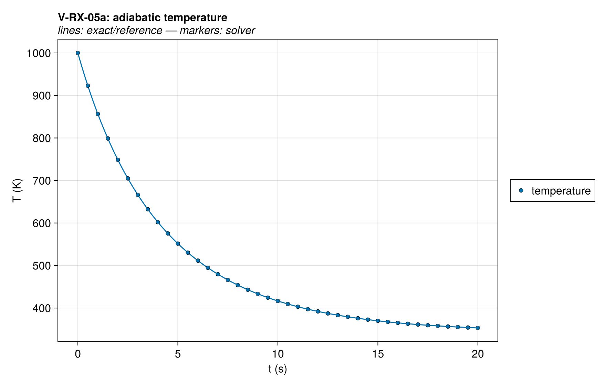

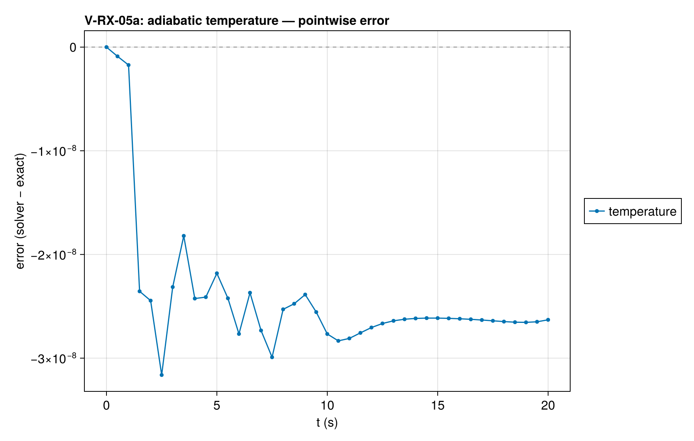

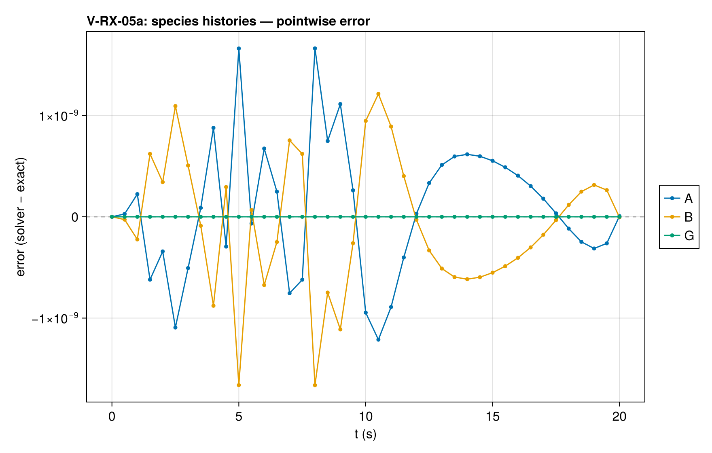

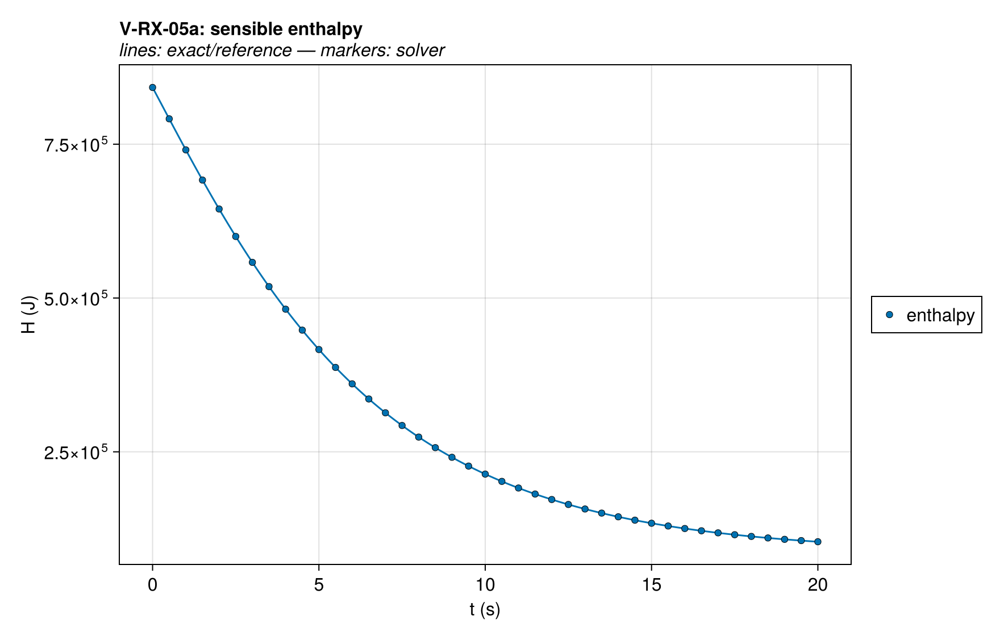

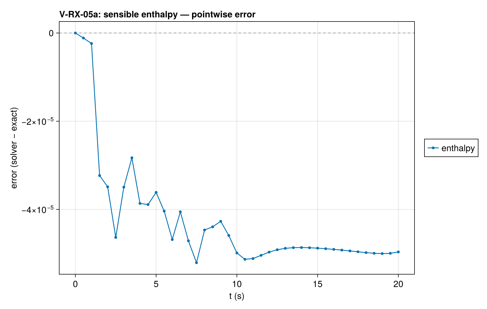

### Comparison with other codes

See the [mesh and time comparison basis](comparison_coverage.md#comparison-basis-audit) and [per-pair inventory](assets/comparison_basis.csv). These overlays establish physical-problem comparisons; equal spacing and equal achieved accuracy require the qualifications listed there.

Matched native-input runs, independent time refinement at fixed mesh (dt, dt/2, dt/4), and spatial refinement at fixed dt/4 are retained under `test/verification/reference/matched/`. See the [coverage and matching notes](comparison_coverage.md). The plotted external series use the base resolution; [base and refined analytical errors](assets/V-RX-05a/V-RX-05a_comparison_accuracy.csv) are retained separately. These runs provide accuracy measurements.

Gpyro V2 (`bff0126c68f2`) uses two boundary nodes on a uniform insulated slab, Δt = 0.001 s, E = 0, and the same reaction heat, yields and heat capacities. A 1e-6 Pa initial gas pressure avoids a singular vacuum diffusivity; its initial mass is negligible (about 1e-15 kg/m²). Sensible enthalpy is reconstructed from native concentrations and temperature at the common 298.15 K datum. Inputs, raw outputs, refinement checks and extraction are in `test/verification/reference/gpyro/v2_accuracy/`.

Accuracy comparison only; timing measurements are omitted.

Error panels show absolute error at each code's output points. Zeros are displayed at 1e-12 on the logarithmic axis; the reference CSV precision limits the discernible error.

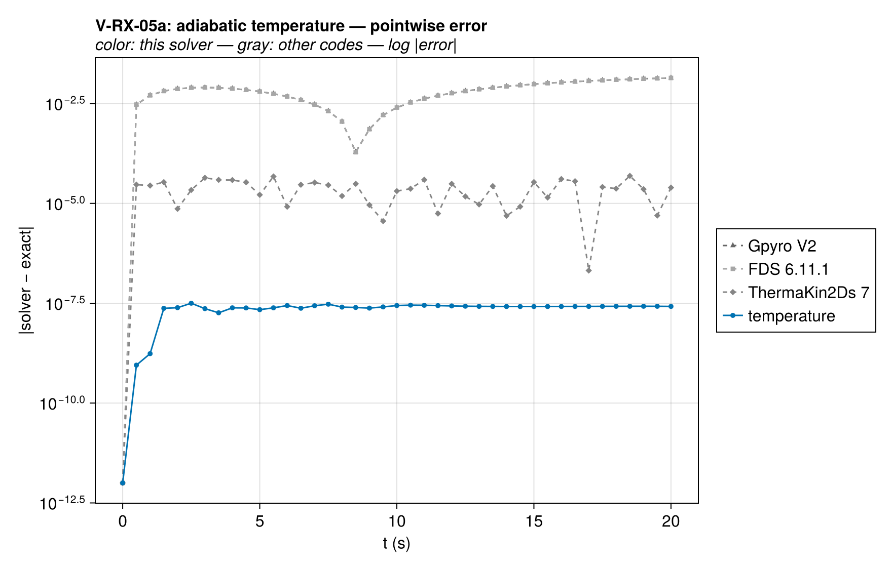

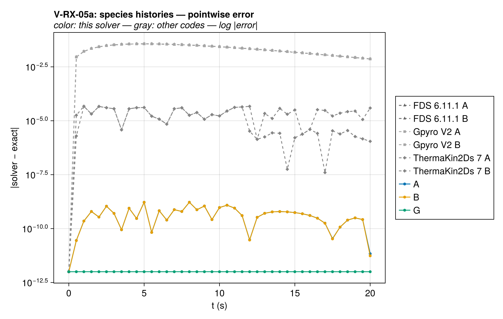

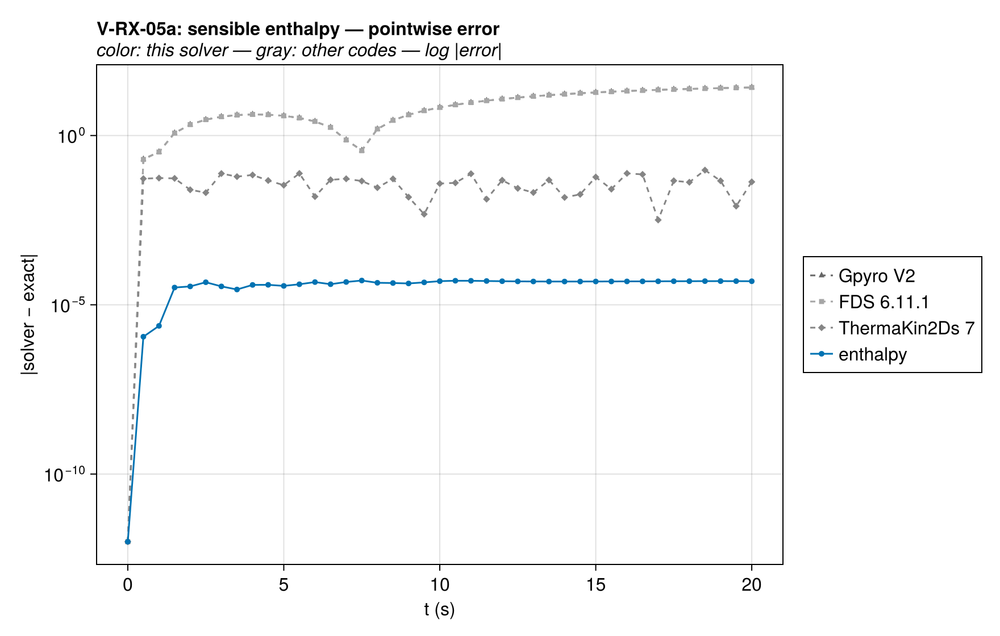

Solution overlays including the other codes' points: [temperature_vs_codes](assets/V-RX-05a/V-RX-05a_temperature_vs_codes.png), [species_vs_codes](assets/V-RX-05a/V-RX-05a_species_vs_codes.png), [enthalpy_vs_codes](assets/V-RX-05a/V-RX-05a_enthalpy_vs_codes.png).

### Solver configuration

| setting | value |
| --- | --- |
| integrator | Rodas5P (default) |
| reltol | 1.0e-10 |
| abstol | 1.0e-12 |

## V-RX-05b — insulated reaction (exothermic)

### Quantities of interest (n = 1)

| QoI | value | exact | error | tolerance | within tol | provenance |
| --- | --- | --- | --- | --- | --- | --- |
| independent species histories | 2.946e-12 | — | 2.946e-12 | 1e-10 | yes | exact first-order conversion; observed ≤3e-12 in temperature form, integration margin |
| adiabatic temperature history | 5.437e-09 | — | 5.437e-09 | 1e-07 | yes | logarithmic exact solution; observed ≤3.17e-8 K in temperature form, ~3× margin |
| sensible enthalpy history / initial energy | 1.243e-11 | — | 1.243e-11 | 2e-10 | yes | independent Σ m_j c_j (T-T_REF); observed ≤6.19e-11 relative, ~3× margin |
| closed total mass | 1.11e-15 | — | 1.11e-15 | 1e-12 | yes |  |
| sealed boundary mass flux | 0 | — | 0 | 1e-14 | yes |  |

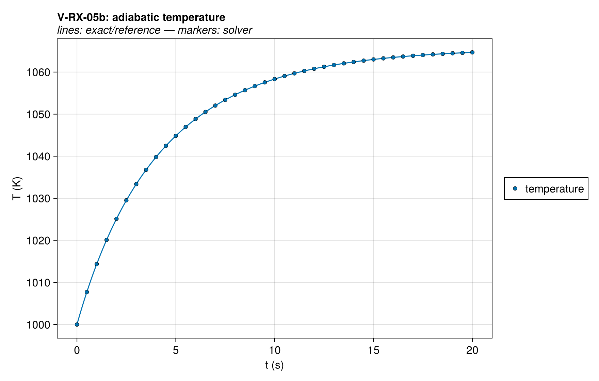

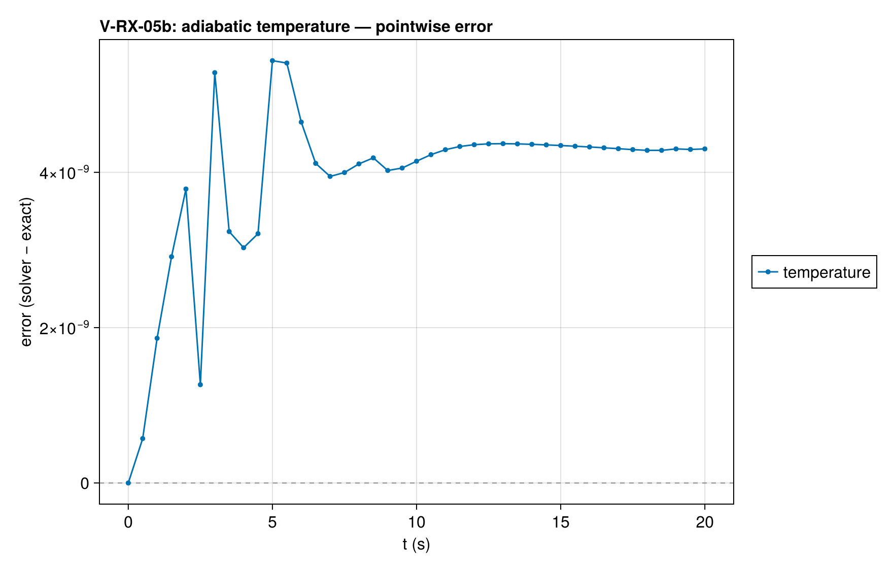

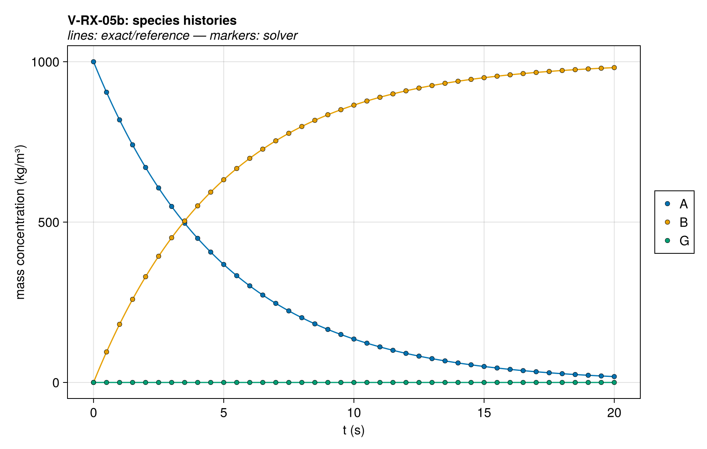

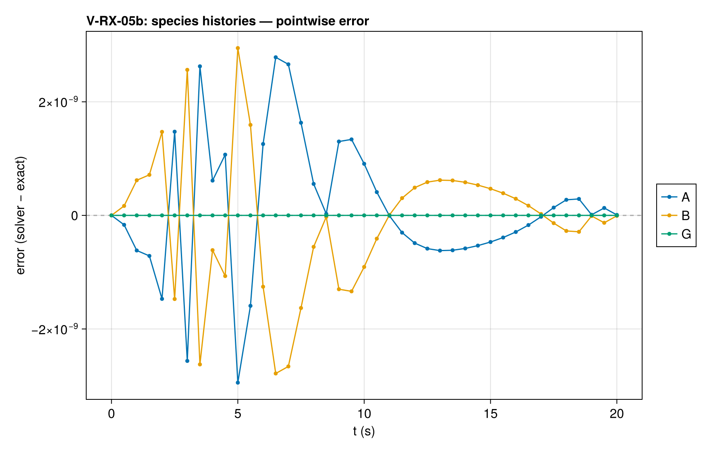

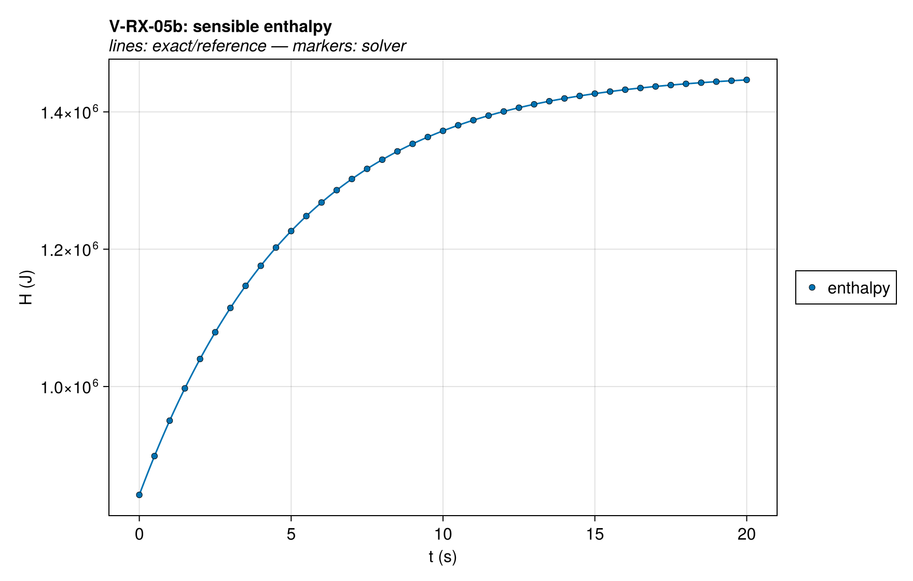

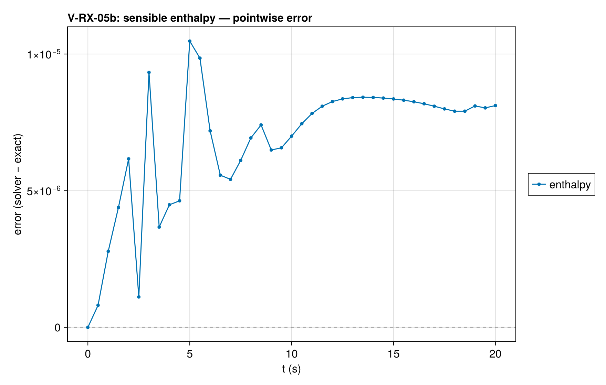

### Comparison with other codes

See the [mesh and time comparison basis](comparison_coverage.md#comparison-basis-audit) and [per-pair inventory](assets/comparison_basis.csv). These overlays establish physical-problem comparisons; equal spacing and equal achieved accuracy require the qualifications listed there.

Matched native-input runs, independent time refinement at fixed mesh (dt, dt/2, dt/4), and spatial refinement at fixed dt/4 are retained under `test/verification/reference/matched/`. See the [coverage and matching notes](comparison_coverage.md). The plotted external series use the base resolution; [base and refined analytical errors](assets/V-RX-05b/V-RX-05b_comparison_accuracy.csv) are retained separately. These runs provide accuracy measurements.

Gpyro V2 (`bff0126c68f2`) uses two boundary nodes on a uniform insulated slab, Δt = 0.001 s, E = 0, and the same reaction heat, yields and heat capacities. A 1e-6 Pa initial gas pressure avoids a singular vacuum diffusivity; its initial mass is negligible (about 1e-15 kg/m²). Sensible enthalpy is reconstructed from native concentrations and temperature at the common 298.15 K datum. Inputs, raw outputs, refinement checks and extraction are in `test/verification/reference/gpyro/v2_accuracy/`.

Accuracy comparison only; timing measurements are omitted.

Error panels show absolute error at each code's output points. Zeros are displayed at 1e-12 on the logarithmic axis; the reference CSV precision limits the discernible error.

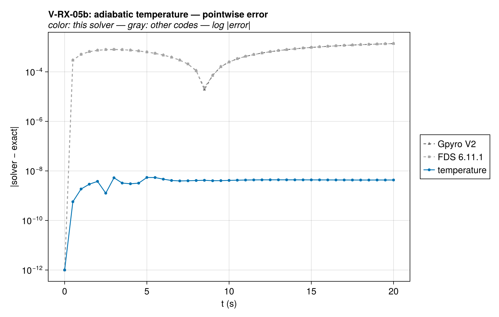

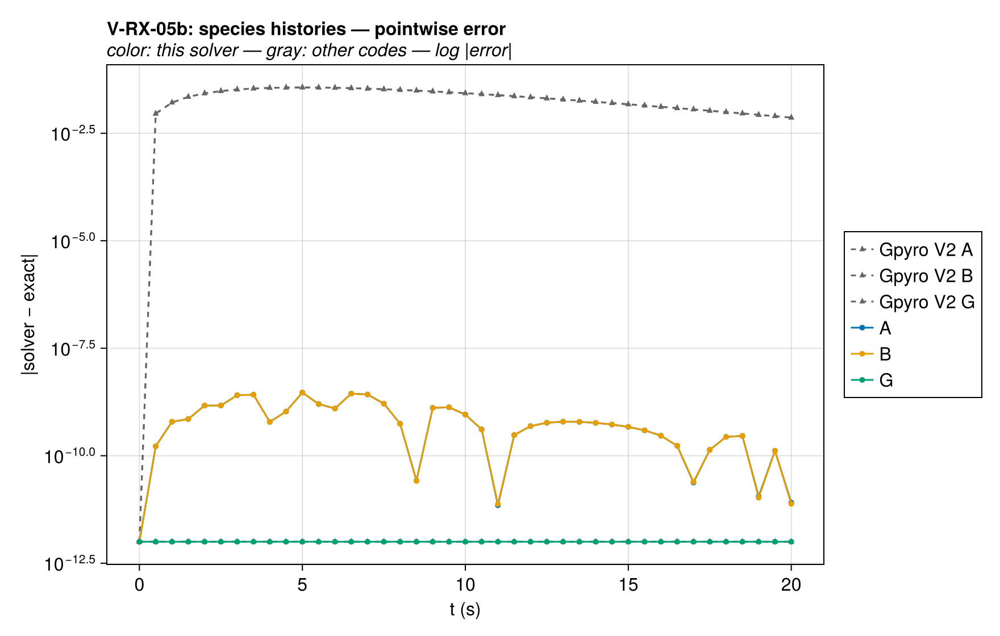

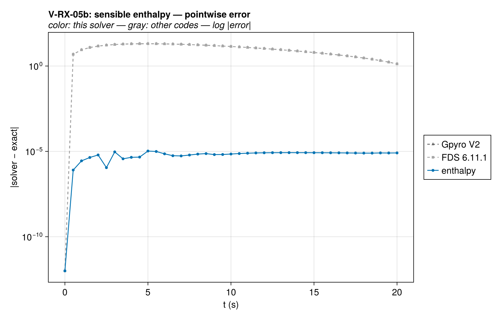

Solution overlays including the other codes' points: [temperature_vs_codes](assets/V-RX-05b/V-RX-05b_temperature_vs_codes.png), [species_vs_codes](assets/V-RX-05b/V-RX-05b_species_vs_codes.png), [enthalpy_vs_codes](assets/V-RX-05b/V-RX-05b_enthalpy_vs_codes.png).

### Solver configuration

| setting | value |
| --- | --- |
| integrator | Rodas5P (default) |
| reltol | 1.0e-10 |
| abstol | 1.0e-12 |

## V-RX-05c — insulated reaction (zero heat, retained gas)

### Quantities of interest (n = 1)

| QoI | value | exact | error | tolerance | within tol | provenance |
| --- | --- | --- | --- | --- | --- | --- |
| independent species histories | 2.966e-12 | — | 2.966e-12 | 1e-10 | yes | exact first-order conversion; observed ≤3e-12 in temperature form, integration margin |
| adiabatic temperature history | 1.137e-13 | — | 1.137e-13 | 1e-07 | yes | logarithmic exact solution; observed ≤3.17e-8 K in temperature form, ~3× margin |
| sensible enthalpy history / initial energy | 3.955e-13 | — | 3.955e-13 | 2e-10 | yes | independent Σ m_j c_j (T-T_REF); observed ≤6.19e-11 relative, ~3× margin |
| closed total mass | 1.11e-15 | — | 1.11e-15 | 1e-12 | yes |  |
| sealed boundary mass flux | 0 | — | 0 | 1e-14 | yes |  |

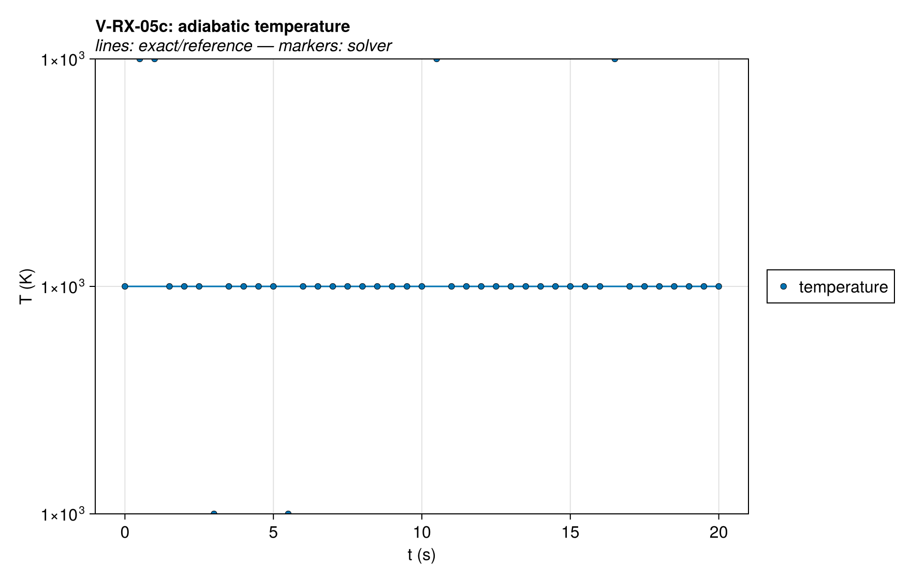

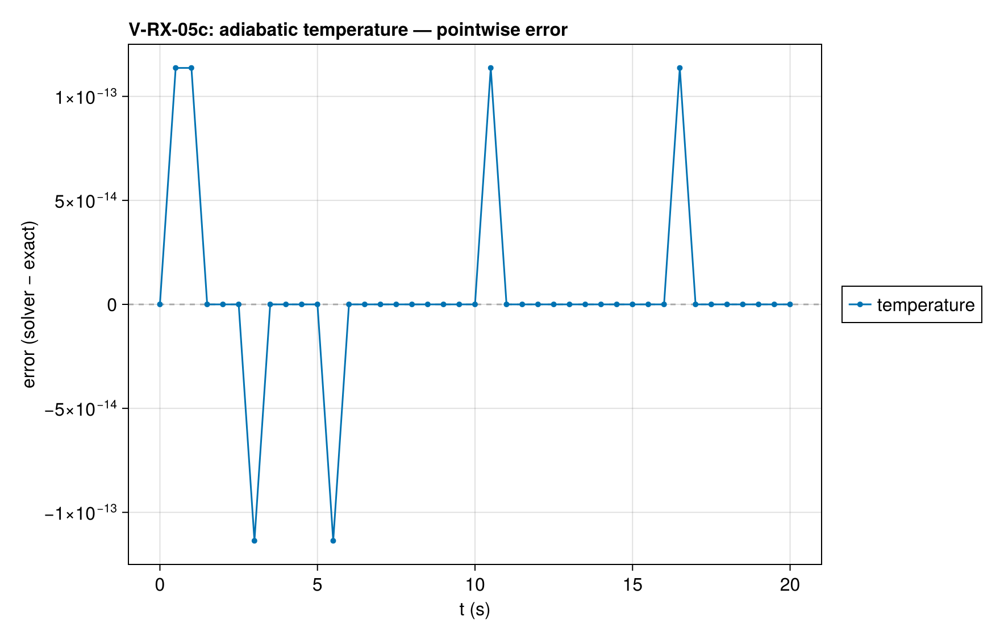

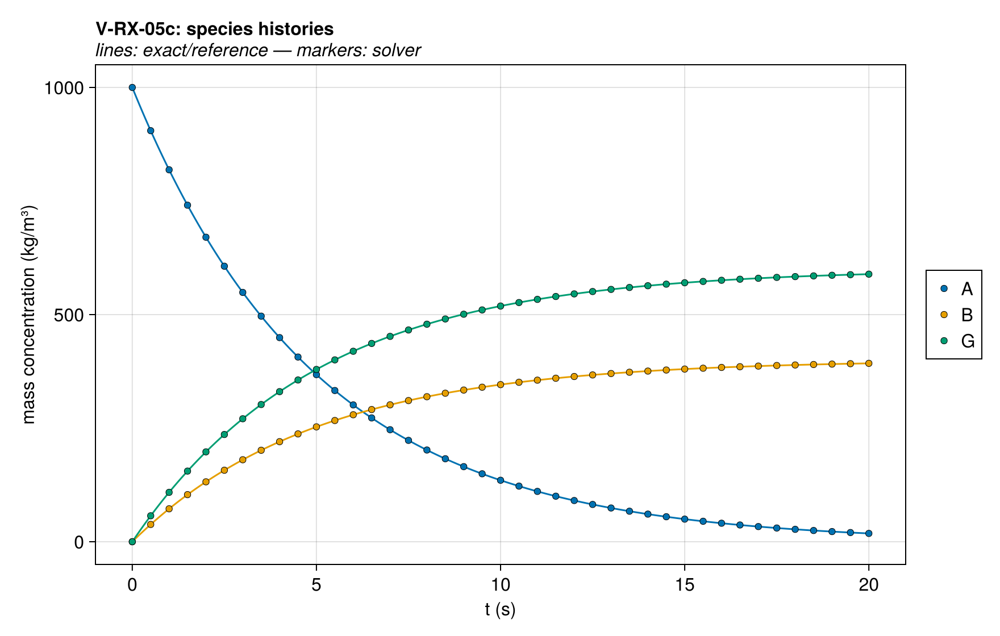

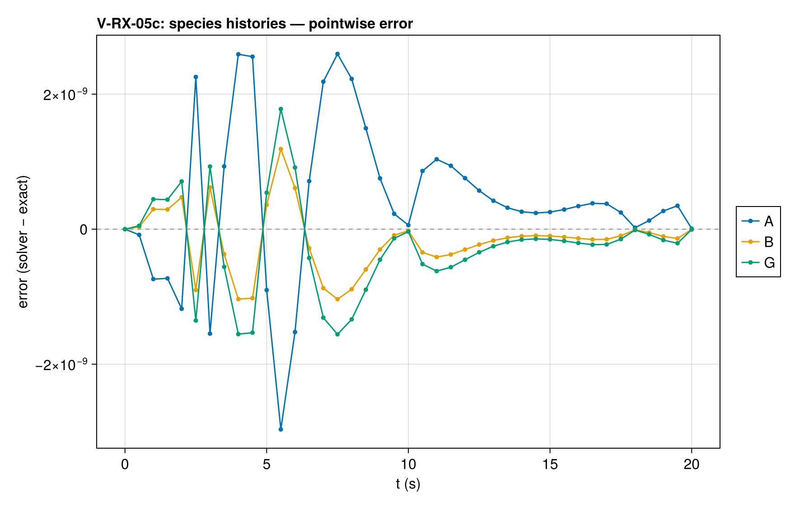

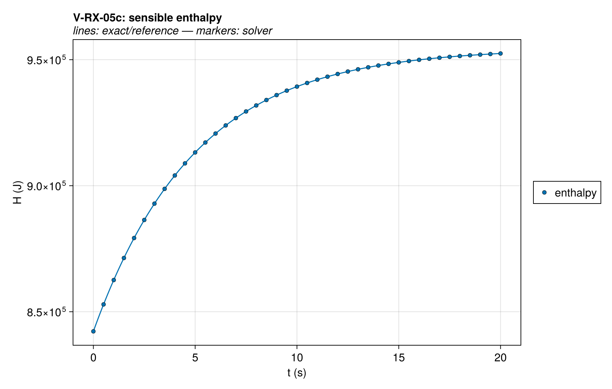

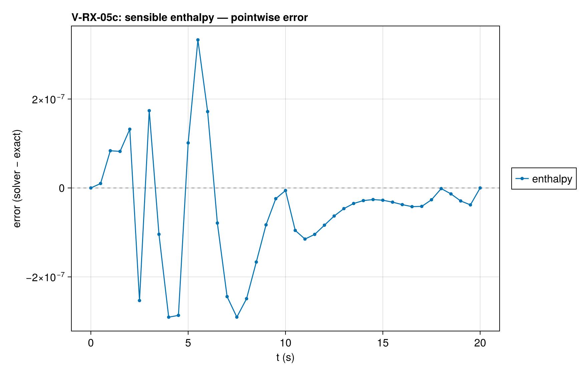

### Comparison with other codes

See the [mesh and time comparison basis](comparison_coverage.md#comparison-basis-audit) and [per-pair inventory](assets/comparison_basis.csv). These overlays establish physical-problem comparisons; equal spacing and equal achieved accuracy require the qualifications listed there.

Gpyro V2 (`bff0126c68f2`) uses two boundary nodes on a uniform insulated slab, Δt = 0.001 s, E = 0, and the same reaction heat, yields and heat capacities. A 1e-6 Pa initial gas pressure avoids a singular vacuum diffusivity; its initial mass is negligible (about 1e-15 kg/m²). Sensible enthalpy is reconstructed from native concentrations and temperature at the common 298.15 K datum. The retained-gas case has a Gpyro mass discrepancy of about 3.27e-5 of initial mass that persists when Δt is halved; its density and pressure routines use different gas constants. Inputs, raw outputs, refinement checks and extraction are in `test/verification/reference/gpyro/v2_accuracy/`.

Accuracy comparison only; timing measurements are omitted.

Error panels show absolute error at each code's output points. Zeros are displayed at 1e-12 on the logarithmic axis; the reference CSV precision limits the discernible error.

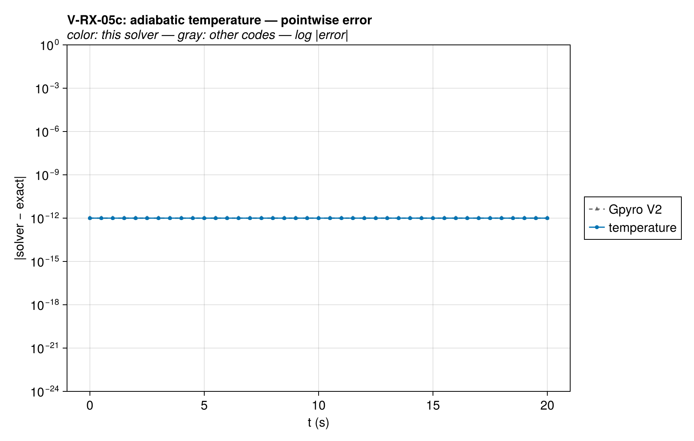

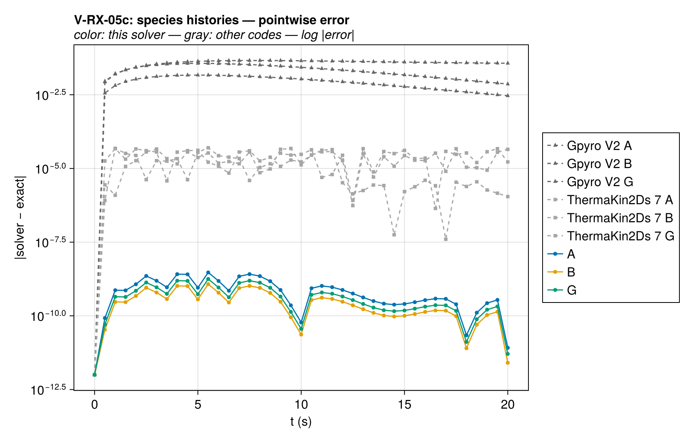

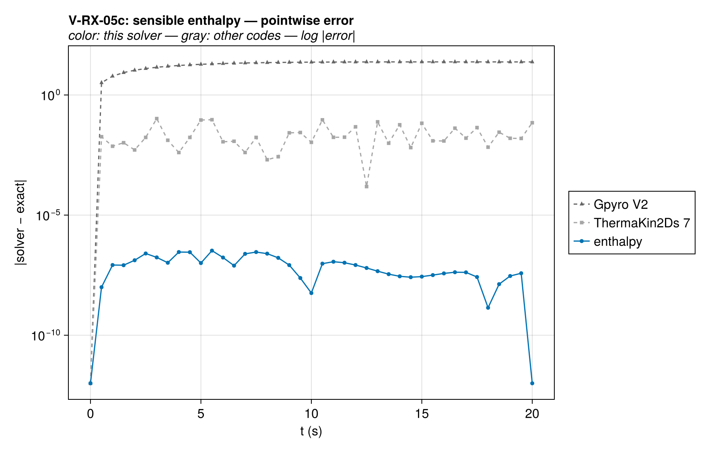

Solution overlays including the other codes' points: [temperature_vs_codes](assets/V-RX-05c/V-RX-05c_temperature_vs_codes.png), [species_vs_codes](assets/V-RX-05c/V-RX-05c_species_vs_codes.png), [enthalpy_vs_codes](assets/V-RX-05c/V-RX-05c_enthalpy_vs_codes.png).

### Solver configuration

| setting | value |
| --- | --- |
| integrator | Rodas5P (default) |
| reltol | 1.0e-10 |
| abstol | 1.0e-12 |
