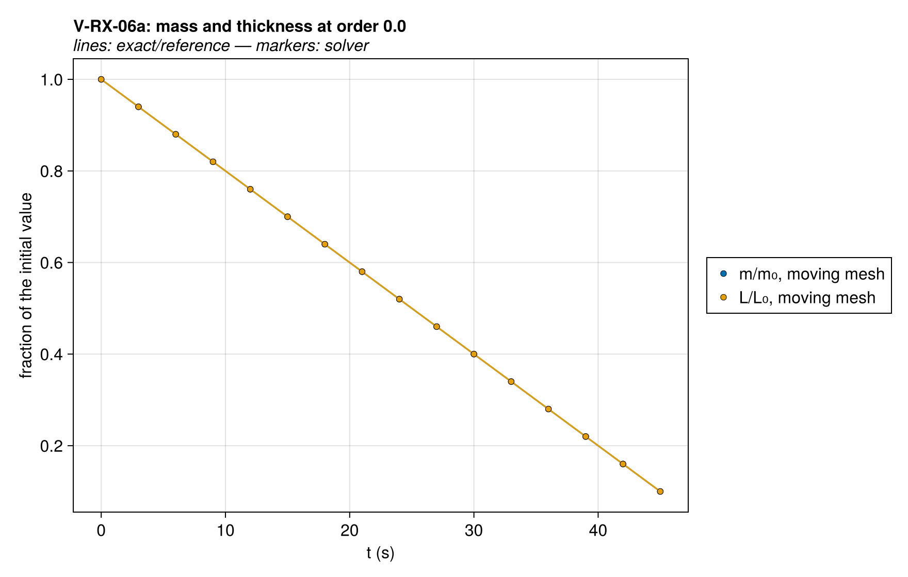
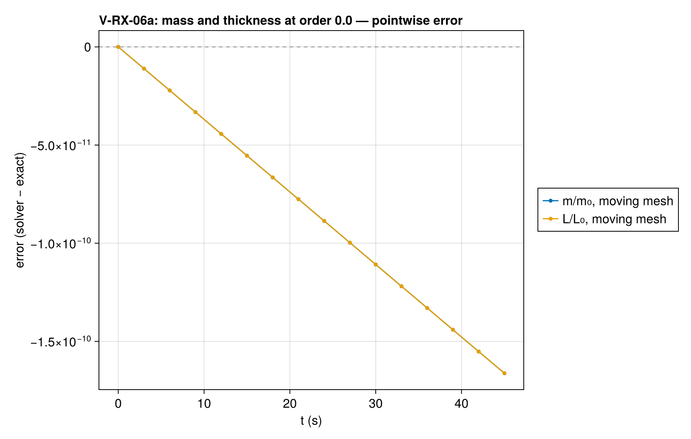
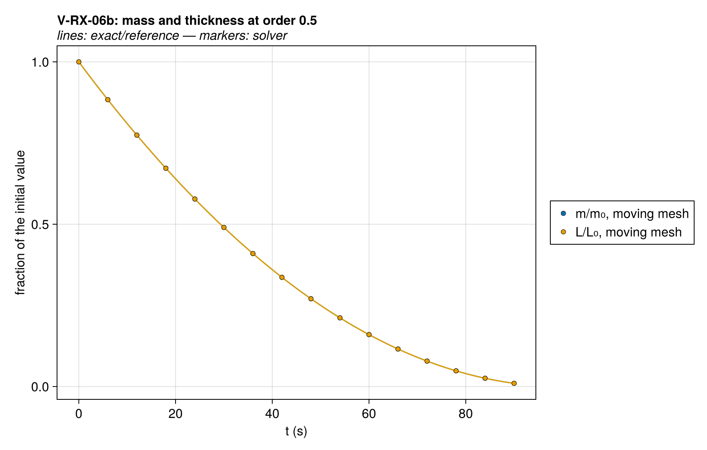
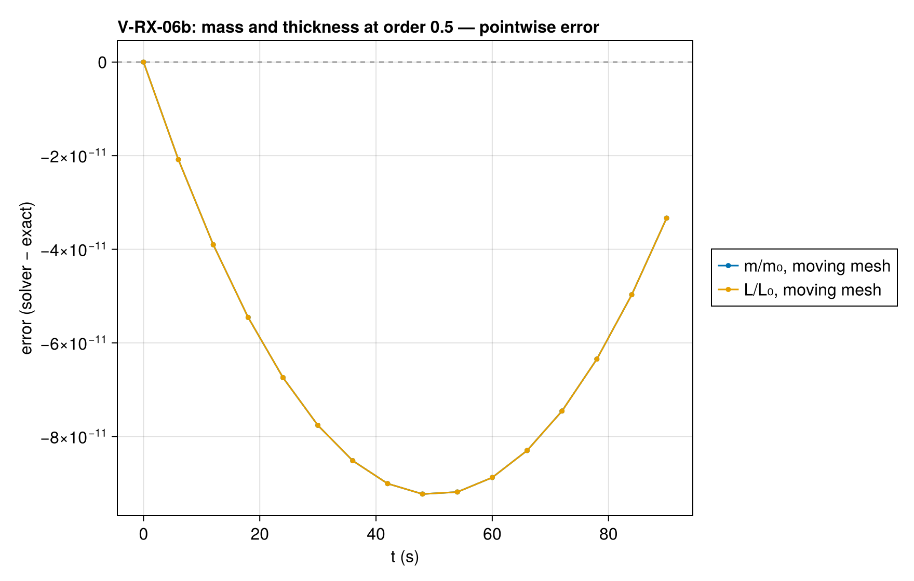
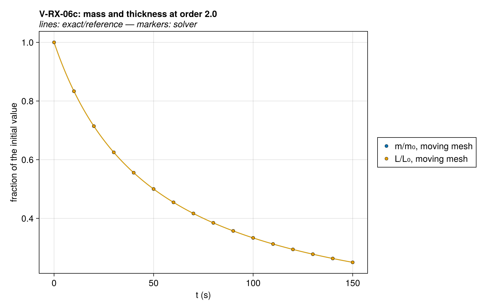
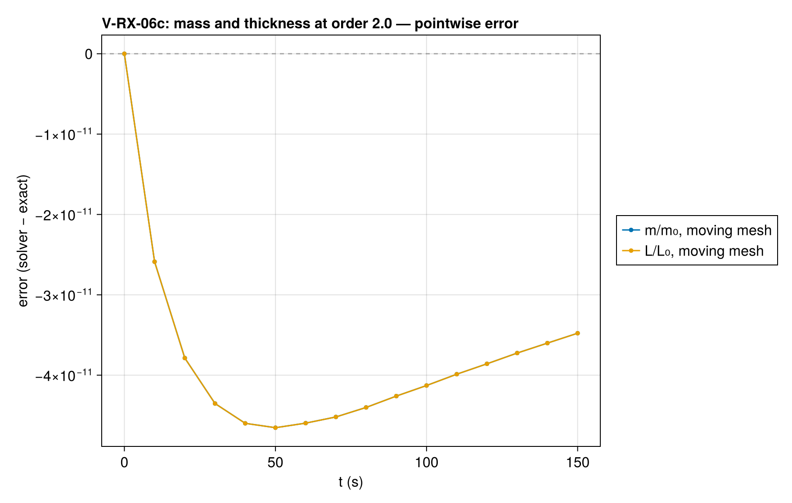

# V-RX-06 — conversion-basis burnout on the moving mesh (n = 0.0)

**Tags:** `ale`, `kinetics`, `reaction_order`, `exact`

**References:**

- closed form m/m₀ = L/L₀ = [1 − (1−n) k t]^(1/(1−n))

## Problem statement

An adiabatic uniform slab at T₀ with one reaction solid → gas of order n and
no heat of reaction, so T stays at T₀, k = A·exp(−E/RT₀) is a constant and the
conversion x = m/m₀ obeys dx/dt = −k xⁿ. The order acts on the conversion
whatever the mesh does: on the moving mesh, where the concentration stays at
its bulk density and a concentration-based order would behave as first order,
the mass and the thickness follow

  m/m₀ = L/L₀ = [1 − (1−n) k t]^(1/(1−n)).

Sub-cases at n = 0, 0.5 and 2, on the moving mesh and on a fixed one, the
orders below one compared up to 0.9·t_b. The limiter's onset sits at 1e-6, so
over the window it is exactly one and the finite base rounds away.

## V-RX-06a — conversion-basis burnout on the moving mesh (n = 0.0)

### Quantities of interest (n = 20)

| QoI | value | exact | error | tolerance | within tol | provenance |
| --- | --- | --- | --- | --- | --- | --- |
| m/m₀ on the moving mesh | 0.1 | 0.1 | 1.663e-09 | 5e-09 | yes | max relative error over the saved times |
| m/m₀ on the fixed mesh | 0.1 | 0.1 | 1.663e-09 | 5e-09 | yes | max relative error over the saved times |
| L/L₀ on the moving mesh | 0.1 | 0.1 | 1.663e-09 | 5e-09 | yes | max relative error over the saved times |
| the two meshes agree | 5.343e-15 | 0 | 5.343e-15 | 2e-14 | yes | largest difference of m/m₀, moving against fixed |
| isothermal: T stays at T₀ | 600 | 600 | 6.821e-13 | 1.4e-11 | yes | K; no heat of reaction, no gradient |

### Solver configuration

| setting | value |
| --- | --- |
| integrator | Rodas5P (default) |
| use_ale | true |
| abstol | 1.0e-10 |
| reltol | 1.0e-8 |

## V-RX-06b — conversion-basis burnout on the moving mesh (n = 0.5)

### Quantities of interest (n = 20)

| QoI | value | exact | error | tolerance | within tol | provenance |
| --- | --- | --- | --- | --- | --- | --- |
| m/m₀ on the moving mesh | 0.01 | 0.01 | 3.334e-09 | 1e-08 | yes | max relative error over the saved times |
| m/m₀ on the fixed mesh | 0.01 | 0.01 | 6.832e-08 | 2.3e-07 | yes | max relative error over the saved times |
| L/L₀ on the moving mesh | 0.01 | 0.01 | 3.334e-09 | 1e-08 | yes | max relative error over the saved times |
| the two meshes agree | 6.652e-10 | 0 | 6.652e-10 | 2.2e-09 | yes | largest difference of m/m₀, moving against fixed |
| isothermal: T stays at T₀ | 600 | 600 | 7.958e-13 | 1.4e-11 | yes | K; no heat of reaction, no gradient |

### Solver configuration

| setting | value |
| --- | --- |
| integrator | Rodas5P (default) |
| use_ale | true |
| abstol | 1.0e-10 |
| reltol | 1.0e-8 |

## V-RX-06c — conversion-basis burnout on the moving mesh (n = 2.0)

### Quantities of interest (n = 20)

| QoI | value | exact | error | tolerance | within tol | provenance |
| --- | --- | --- | --- | --- | --- | --- |
| m/m₀ on the moving mesh | 0.25 | 0.25 | 1.391e-10 | 4.2e-10 | yes | max relative error over the saved times |
| m/m₀ on the fixed mesh | 0.25 | 0.25 | 6.043e-10 | 2.3e-09 | yes | max relative error over the saved times |
| L/L₀ on the moving mesh | 0.25 | 0.25 | 1.391e-10 | 4.2e-10 | yes | max relative error over the saved times |
| the two meshes agree | 1.397e-10 | 0 | 1.397e-10 | 5e-10 | yes | largest difference of m/m₀, moving against fixed |
| isothermal: T stays at T₀ | 600 | 600 | 5.684e-13 | 1.4e-11 | yes | K; no heat of reaction, no gradient |

### Solver configuration

| setting | value |
| --- | --- |
| integrator | Rodas5P (default) |
| use_ale | true |
| abstol | 1.0e-10 |
| reltol | 1.0e-8 |
