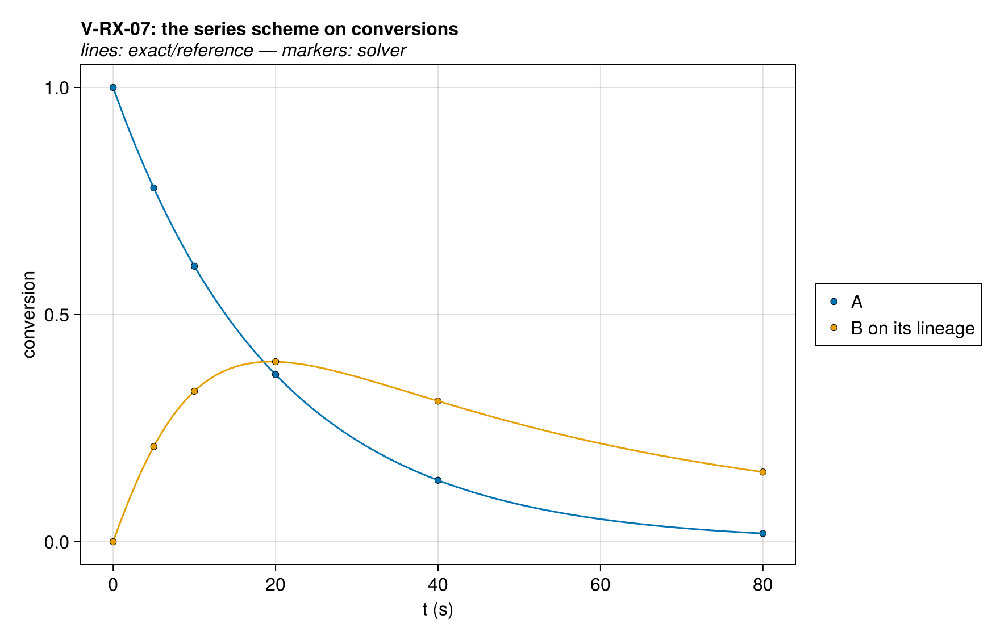
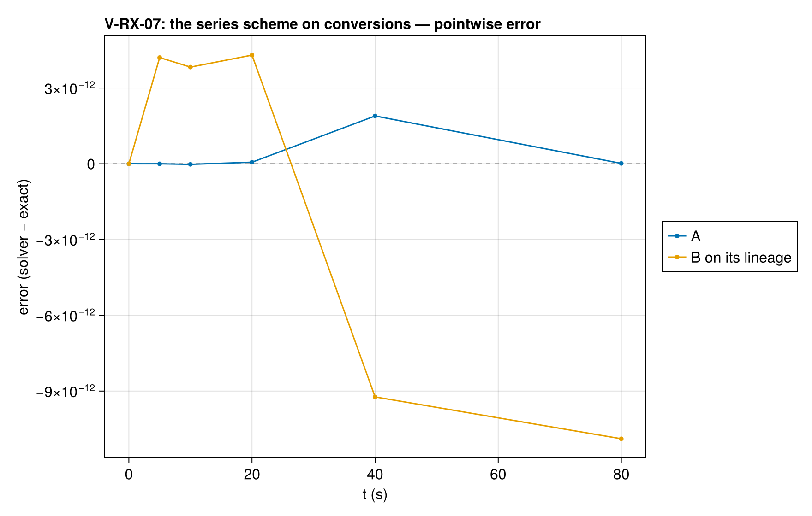

# V-RX-07 — series scheme with an order other than one on the intermediate

**Tags:** `kinetics`, `reaction_order`, `isothermal`

**References:**

- NETZSCH Kinetics Neo FAQ, What Equations Are Used in My Kinetic Model?

## Problem statement

One cell held at 400 K by Dirichlet faces, A → 0.9 B + 0.1 gas at first order,
k₁ = 0.05 s⁻¹, and B → gas at order 1.8, k₂ = 0.1 s⁻¹, with E = 0 and no limiter.
The intermediate's reference is its lineage inventory, 0.9 of the mass the
cell started with, so its conversion e_B = m_B/(0.9 m_A,0) obeys the Kinetics
Neo balance on conversions,

  de_A/dt = −k₁ e_A,    de_B/dt = k₁ e_A − k₂ e_B^1.8,

integrated by `series_chain_conversion`. With the limiter off only the finite
base of the conversion remains, a sink of about 2e-15 k₂ y m_A,0 at e_B = 0.

### Quantities of interest (n = 1)

| QoI | value | exact | error | tolerance | within tol | provenance |
| --- | --- | --- | --- | --- | --- | --- |
| conversion of A | 0.01832 | 0.01832 | 1.894e-12 | 2.4e-12 | yes | max absolute error over 5, 10, 20, 40, 80 s |
| conversion of B on its lineage | 0.1534 | 0.1534 | 1.089e-11 | 3.7e-11 | yes | max absolute error over 5, 10, 20, 40, 80 s |
| condensed mass | 0.1564 | 0.1564 | 9.787e-12 | 3.3e-11 | yes | max absolute error over 5, 10, 20, 40, 80 s |

### Solver configuration

| setting | value |
| --- | --- |
| integrator | Rodas5P (default) |
| abstol | 1.0e-11 |
| reltol | 1.0e-9 |
