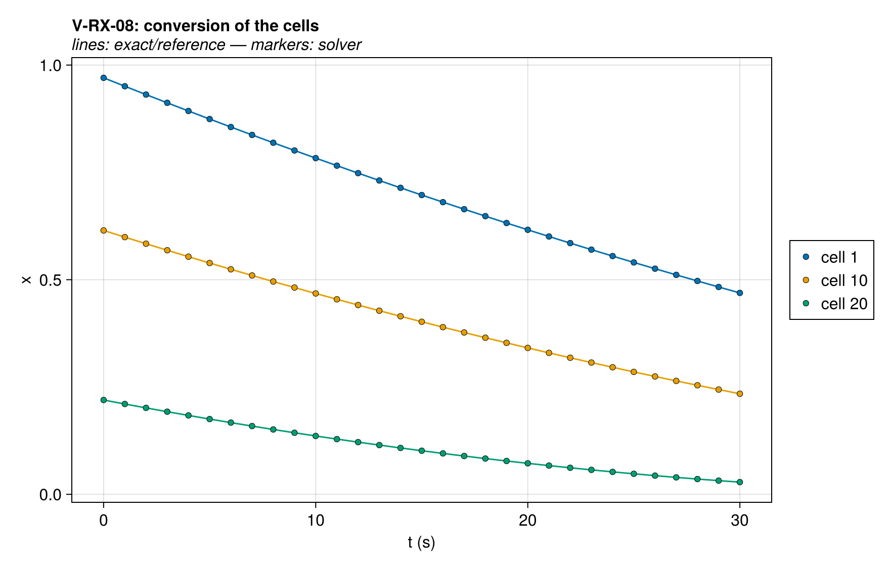
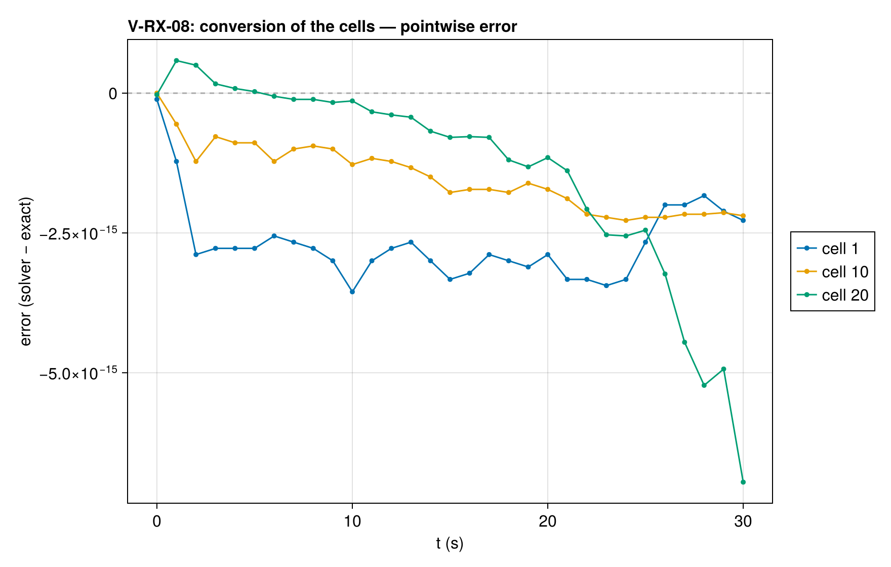

# V-RX-08 — a graded conversion on the material

**Tags:** `ale`, `kinetics`, `reaction_order`, `exact`

**References:**

- closed form x(t) at each material point

## Problem statement

A 10 mm slab at a uniform 600 K, adiabatic, of a reactant A at the fraction
f(z₀) of the column's mass, falling to the top, and a filler of the same density
stripped at 2 s⁻¹. With `basis = 1` the reference is the cell's whole initial
mass, so A starts at the conversion x₀ = f(z₀), and every cell, keeping its
material, follows

  D_t x = −k xⁿ,   x(t) = [x₀^(1−n) − (1−n) k t]^(1/(1−n)).

V-RX-06 holds one conversion over the column; here the column holds a range of
them, the state a heated deck reaches. The window keeps x at 20 x_th or more,
where the onset is exactly one, and the rate is the kernel's own.

### Quantities of interest (n = 20)

| QoI | value | exact | error | tolerance | within tol | provenance |
| --- | --- | --- | --- | --- | --- | --- |
| x(t) of every cell | 2.442e-13 | 0 | 2.442e-13 | 7e-13 | yes | max relative error against the closed form |
| the kernel's rate | 1.099e-14 | 0 | 1.099e-14 | 3.2e-14 | yes | max relative error of the rate of A against the sum |
| isothermal: T stays at 600 K | 1.023e-12 | 0 | 1.023e-12 | 1.9e-11 | yes | K |

### Solver configuration

| setting | value |
| --- | --- |
| integrator | Rodas5P (default) |
| use_ale | true |
| reltol | 1.0e-8 |
| abstol | 1.0e-10 |
